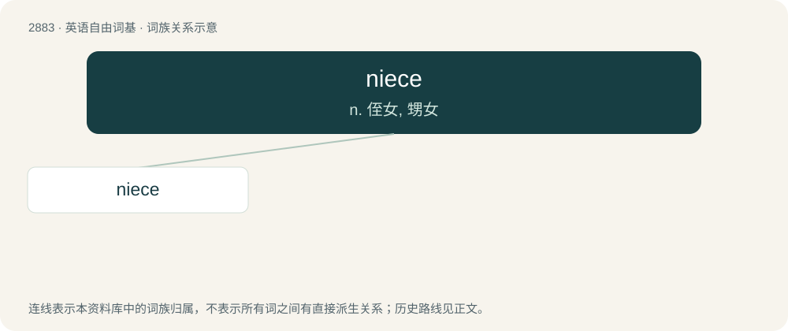

# 2992 · niece — n. 侄女, 甥女

[总目录](../00_总目录_按常用程度.md)

**类型**：英语自由词基　｜　**来源语言**：见词源记录

## 核心含义与来源

- 核心含义：n. 侄女, 甥女
- 英文含义：A daughter of one’s sibling, brother-in-law, or sister-in-law; either the daughter of one's brother ("fraternal niece"), or of one's sister ("sororal niece").
- 词形：niece

**来源记录 1**（名词；A daughter of one’s sibling, brother-in-law, or sister-in-law; either the daughter of one's brother ("fraternal niece"), or of one's sister ("sororal niece").）

From Middle English nece (“niece, granddaughter”), from Old French nece (“niece, granddaughter”) (Modern French nièce (“niece”)) from Late Latin neptia, representing Latin neptis (“granddaughter”), from Proto-Indo-European \*néptih₂ (“granddaughter, niece”). Doublet of nift.

## 词族图

## 单词速览（常用到不常用）

| 单词 | 音标 | 释义 |
|---|---|---|
| [niece](#w-1) | 英 /niːs/；美 /nis/ | n. 侄女, 甥女 |

## 逐词详解

### 1. niece

**词性**：名词　｜　**音标**：英 /niːs/；美 /nis/

**中文释义**：n. 侄女, 甥女

**英文义项**：A daughter of one’s sibling, brother-in-law, or sister-in-law; either the daughter of one's brother ("fraternal niece"), or of one's sister ("sororal niece"). / A daughter of one’s cousin or cousin-in-law

**词源与演化**：

From Middle English nece (“niece, granddaughter”), from Old French nece (“niece, granddaughter”) (Modern French nièce (“niece”)) from Late Latin neptia, representing Latin neptis (“granddaughter”), from Proto-Indo-European \*néptih₂ (“granddaughter, niece”). Doublet of nift.

**例句**：

> My niece just celebrated her 15th birthday.

该用例对应义项：A daughter of one’s sibling, brother-in-law, or sister-in-law; either the daughter of one's brother ("fraternal niece"), or of one's sister ("sororal niece").
