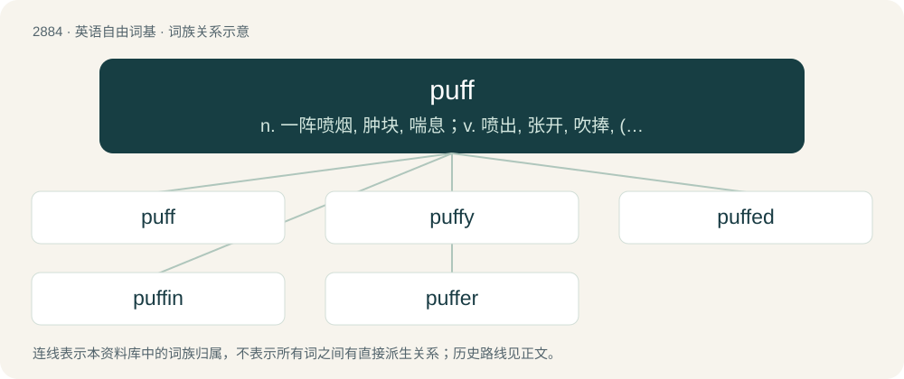

# 2993 · puff — n. 一阵喷烟, 肿块, 喘息；v. 喷出, 张开, 吹捧, (使)充气, 喘气, (使)骄傲, (使)膨胀

[总目录](../00_总目录_按常用程度.md)

**类型**：英语自由词基　｜　**来源语言**：见词源记录

## 核心含义与来源

- 核心含义：n. 一阵喷烟, 肿块, 喘息；v. 喷出, 张开, 吹捧, (使)充气, 喘气, (使)骄傲, (使)膨胀
- 英文含义：A sharp exhalation of a small amount of breath through the mouth.
- 词形：puff

**多个词源／构词路径**：同一拼写可能有不同来源；以下按词性和含义分别列出。

**来源记录 1**（名词；A sharp exhalation of a small amount of breath through the mouth.）

From Middle English puff, puf, from Old English pyf (“a blast of wind, puff”), from Proto-West Germanic \*puf(f)- (“to blow, puff”), of imitative origin. Cognate with Dutch puf (“puff, wind, fart”), Middle Low German puf, pof (“puff”).

**来源记录 2**（动词；To emit smoke, gas, etc., in puffs.）

From Middle English puffen, from Old English pyffan (“to breathe out, blow with the mouth”). Compare Dutch puffen, German Low German puffen, German puffen, Danish puffe, Swedish puffa.

## 词族图

## 单词速览（常用到不常用）

| 单词 | 音标 | 释义 |
|---|---|---|
| [puff](#w-1) | 英 /pʌf/ | n. 一阵喷烟, 肿块, 喘息；v. 喷出, 张开, 吹捧, (使)充气, 喘气, (使)骄傲, (使)膨胀 |
| [puffy](#w-2) | /ˈpʌfi/ | a. 胀大的, 肥胖的, 喘气的, 一阵阵吹的；\[医\] 虚肿的, 浮肿的 |
| [puffed](#w-3) | /pʌft/ | a. 疏松的 |
| [puffin](#w-4) | /ˈpʌfɪn/ | n. 角嘴海雀 |
| [puffer](#w-5) | 英 /ˈpʌfə/；美 /ˈpʌfɚ/ | n. 喷烟的人, 吹嘘的人, 小绞车工；\[法\] 吹捧者, 抬价人, 加价人 |

## 逐词详解

### 1. puff

**词性**：名词　｜　**音标**：英 /pʌf/

**中文释义**：n. 一阵喷烟, 肿块, 喘息；v. 喷出, 张开, 吹捧, (使)充气, 喘气, (使)骄傲, (使)膨胀

**英文义项**：A sharp exhalation of a small amount of breath through the mouth. / The ability to breathe easily while exerting oneself.

**词源与演化**：

From Middle English puff, puf, from Old English pyf (“a blast of wind, puff”), from Proto-West Germanic \*puf(f)- (“to blow, puff”), of imitative origin. Cognate with Dutch puf (“puff, wind, fart”), Middle Low German puf, pof (“puff”).

**用法示例／搭配（非完整句）**：

> a sleeve with a puff at the shoulder

该用例对应义项：A portion of fabric gathered up so as to be left full in the middle.

### 2. puffy

**词性**：形容词　｜　**音标**：/ˈpʌfi/

**中文释义**：a. 胀大的, 肥胖的, 喘气的, 一阵阵吹的；\[医\] 虚肿的, 浮肿的

**英文义项**：Swollen or inflated in shape, as if filled with air; pillow-like. / Coming or exhaling in puffs.

**构词拆分**：From puff + -y.

**词源与演化**：

From puff + -y.

**例句**：

> A puffy fat man in a tracksuit came jogging around the corner.

该用例对应义项：Coming or exhaling in puffs.

### 3. puffed

**词性**：形容词　｜　**音标**：/pʌft/

**中文释义**：a. 疏松的

**英文义项**：Inflated or swollen. / Gathered up into rounded ridges.

**构词拆分**：From puff + -ed.

**词源与演化**：

From puff + -ed.

**例句**：

> The dress had puffed sleeves.

该用例对应义项：Gathered up into rounded ridges.

### 4. puffin

**词性**：名词　｜　**音标**：/ˈpʌfɪn/

**中文释义**：n. 角嘴海雀

**英文义项**：The Atlantic puffin (Fratercula arctica) or (by extension) any of the other various small seabirds of the genera Fratercula and Lunda that are black and white with a brightly-coloured beak. / Any of various African and Asian pierid butterflies of the genus Appias. Some species of this genus are also known as albatrosses.

**构词拆分**：puff + -ing

**词源与演化**：

From Middle English poffin, poffoun, puffon, equivalent to puff + -ing, or perhaps ultimately from Middle Cornish (compare Breton poc'han (“puffin”)).

**例句**：

> What's the difference between a puffin and a penguin?

### 5. puffer

**词性**：名词　｜　**音标**：英 /ˈpʌfə/；美 /ˈpʌfɚ/

**中文释义**：n. 喷烟的人, 吹嘘的人, 小绞车工；\[法\] 吹捧者, 抬价人, 加价人

**英文义项**：Someone or something that puffs. / Any of several poisonous fish, of the family Tetraodontidae, which have the ability to inflate their bodies when in danger.

**构词拆分**：puff + -er

**词源与演化**：

From puff + -er. The cellular automata definition is a clipping of puffer train.
