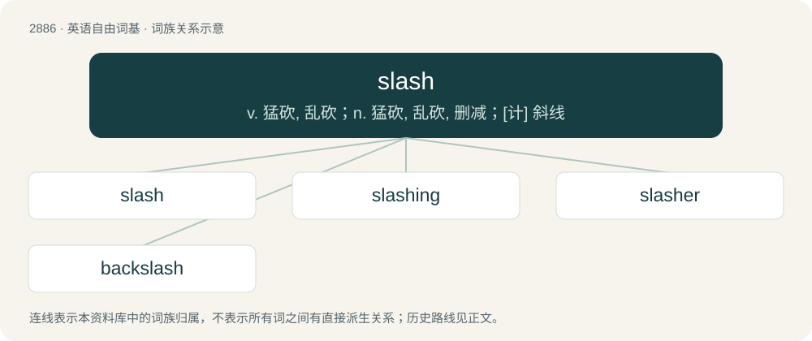

# 2994 · slash — v. 猛砍, 乱砍；n. 猛砍, 乱砍, 删减；\[计\] 斜线

[总目录](../00_总目录_按常用程度.md)

**类型**：英语自由词基　｜　**来源语言**：见词源记录

## 核心含义与来源

- 核心含义：v. 猛砍, 乱砍；n. 猛砍, 乱砍, 删减；\[计\] 斜线
- 英文含义：A swift, broad cutting stroke, especially one made with an edged weapon or whip.
- 词形：slash

**多个词源／构词路径**：同一拼写可能有不同来源；以下按词性和含义分别列出。

**来源记录 1**（名词；A swift, broad cutting stroke, especially one made with an edged weapon or whip.）

Late Middle English, originally a verb of uncertain etymology. Perhaps of imitative origin, or possibly from Old French esclachier (“to break in pieces”), a variant of esclater, which is likely a Germanic borrowing, from Frankish \*slaitan (“to slit, tear”). Used in the Wycliffe Bible as slascht (see 1 Kings 5:18) but otherwise unattested until 16th century. Conjunctive use from various applications of the punctuation mark ⟨/⟩. See also slash fiction.

**来源记录 2**（名词；A piss: an act of urination.）

Uncertain. Compare Scots slash (“large splash”), possibly from Old French esclache. Slang use for urination attested from the 1950s.

**来源记录 3**（名词；A swampy area; a swamp.）

Uncertain. Compare British dialectal slashy (“wet and dirty, miry”) and Scots slash (“act of walking forcefully through water or mud”) and slatch (“wet and muddy place, mire”). Perhaps related to Swedish slask (“slush”). Compare also slash (“clearing in a forest”): in many cases it is difficult to tell whether that sense or this one is meant. (Also compare flash (“a marsh; a pool of water”).)

## 词族图

## 单词速览（常用到不常用）

| 单词 | 音标 | 释义 |
|---|---|---|
| [slash](#w-1) | 英 /slaʃ/；美 /slæʃ/ | v. 猛砍, 乱砍；n. 猛砍, 乱砍, 删减；\[计\] 斜线 |
| [slashing](#w-2) | 美 /ˈslæʃɪŋ/ | a. 猛烈的, 苛刻的, 鲜明的, 猛砍的 |
| [slasher](#w-3) | /ˈslæʃə/ | n. 猛砍者, 乱砍者, 好殴斗者, 恃强欺弱的人, 刀, 泥刀, 剃刀片, 剑, 浆纱机 |
| [backslash](#w-4) | /ˈbækˌslæʃ/ | \[计\] 反斜杠 |

## 逐词详解

### 1. slash

**词性**：名词　｜　**音标**：英 /slaʃ/；美 /slæʃ/

**中文释义**：v. 猛砍, 乱砍；n. 猛砍, 乱砍, 删减；\[计\] 斜线

**英文义项**：A swift, broad cutting stroke, especially one made with an edged weapon or whip. / A wide striking motion made with an implement such as a cricket bat, hockey stick, or lacrosse stick.

**词源与演化**：

Late Middle English, originally a verb of uncertain etymology. Perhaps of imitative origin, or possibly from Old French esclachier (“to break in pieces”), a variant of esclater, which is likely a Germanic borrowing, from Frankish \*slaitan (“to slit, tear”). Used in the Wycliffe Bible as slascht (see 1 Kings 5:18) but otherwise unattested until 16th century. Conjunctive use from various applications of the punctuation mark ⟨/⟩. See also slash fiction.

**例句**：

> After the war ended, the army saw a 50% slash in their operating budget.

该用例对应义项：A sharp reduction in resources allotted.

### 2. slashing

**词性**：名词　｜　**音标**：美 /ˈslæʃɪŋ/

**中文释义**：a. 猛烈的, 苛刻的, 鲜明的, 猛砍的

**英文义项**：The action of something that slashes. / slash (woody debris)

**构词拆分**：From slash + -ing.

**词源与演化**：

From slash + -ing.

**例句**：

> The criminal gang carried out razor slashings on their enemies.

该用例对应义项：The action of something that slashes.

### 3. slasher

**词性**：名词　｜　**音标**：/ˈslæʃə/

**中文释义**：n. 猛砍者, 乱砍者, 好殴斗者, 恃强欺弱的人, 刀, 泥刀, 剃刀片, 剑, 浆纱机

**英文义项**：One who slashes. / A machine for applying size to warp yarns.

**构词拆分**：slash + -er

**词源与演化**：

From slash + -er.

**例句**：

> A mother and her two children were stabbed to death in a slasher incident.

### 4. backslash

**词性**：名词　｜　**音标**：/ˈbækˌslæʃ/

**中文释义**：\[计\] 反斜杠

**英文义项**：The punctuation mark \ (a left-leaning diagonal line). (Common uses include (1) use as a delimiter in filepaths and (2) use as an escape character to mark literals.) / The punctuation mark /; a slash, forward slash.

**构词拆分**：back + slash

**词源与演化**：

From back + slash, because it is a slash “leaning back” against the direction of writing (in writing lines from left to right), in contrast to the more common (forward) slash / (“solidus, oblique, diagonal”). The actual direction of (hand-)writing these marks can be reversed, when writing from left to right, top to baseline: the backslash forwards, the (forward) slash backwards. The naming can be explained as an anthropomorphism, assuming a bar (\|) standing on the baseline, facing in the direction of writing, toppling backwards or forwards, respectively. The (new) Unicode name of \ is REVERSE SOLIDUS.
