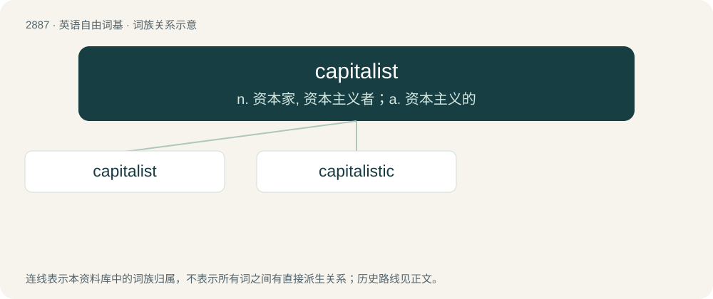

# 2995 · capitalist — n. 资本家, 资本主义者；a. 资本主义的

[总目录](../00_总目录_按常用程度.md)

**类型**：英语自由词基　｜　**来源语言**：见词源记录

## 核心含义与来源

- 核心含义：n. 资本家, 资本主义者；a. 资本主义的
- 英文含义：Of, or pertaining to, capitalism.
- 词形：capitalist

**来源记录 1**（形容词；Of, or pertaining to, capitalism.）

From capital + -ist. Calque of French capitaliste.

## 词族图

## 单词速览（常用到不常用）

| 单词 | 音标 | 释义 |
|---|---|---|
| [capitalist](#w-1) | /ˈkæp.ɪ.tə.lɪst/ | n. 资本家, 资本主义者；a. 资本主义的 |
| [capitalistic](#w-2) | /.kæpitəˈlistik/ | a. 资本主义的, 资本家的 |

## 逐词详解

### 1. capitalist

**词性**：形容词　｜　**音标**：/ˈkæp.ɪ.tə.lɪst/

**中文释义**：n. 资本家, 资本主义者；a. 资本主义的

**英文义项**：Of, or pertaining to, capitalism. / Supporting or endorsing capitalism.

**构词拆分**：capital + -ist

**词源与演化**：

From capital + -ist. Calque of French capitaliste.

**用法示例／搭配（非完整句）**：

> capitalist countries

该用例对应义项：Of, or pertaining to, capitalism.

### 2. capitalistic

**词性**：形容词　｜　**音标**：/.kæpitəˈlistik/

**中文释义**：a. 资本主义的, 资本家的

**英文义项**：Of or pertaining to capitalism or to capitalists. / Organised on a capitalist basis.

**构词拆分**：capitalist + -ic

**词源与演化**：

From capitalist + -ic, probably after German kapitalistisch. Derived from Proto-Indo-European \*káput (“head”), ultimately from Proto-Indo-European \*kap-.

**例句**：

> Capitalistic methods and incentives.

该用例对应义项：of or relating to capitalism or capitalists
