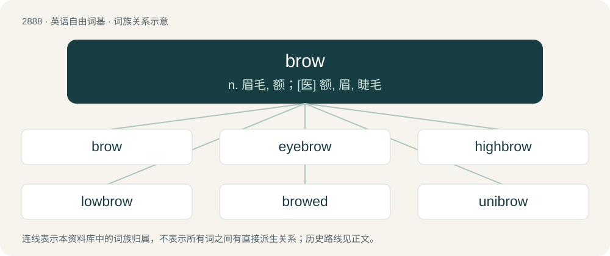

# 2997 · brow — n. 眉毛, 额；\[医\] 额, 眉, 睫毛

[总目录](../00_总目录_按常用程度.md)

**类型**：英语自由词基　｜　**来源语言**：见词源记录

## 核心含义与来源

- 核心含义：n. 眉毛, 额；\[医\] 额, 眉, 睫毛
- 英文含义：The bony ridge over the eyes, upon which the eyebrows are located.
- 词形：brow

**来源记录 1**（名词；The bony ridge over the eyes, upon which the eyebrows are located.）

From Middle English browe, from Old English brū, from Proto-West Germanic \*brāwu, from Proto-Germanic \*brūwō, from Proto-Indo-European \*h₃bʰrúHs (“brow”). Cognate with Scots broo (“brow”), Dutch brauw (“brow”), German Braue (“eyebrow”), Danish, Norwegian Nynorsk and Swedish bryn (“brow”), Faroese, Icelandic brún (“brow”). See also Middle Irish brúad, Tocharian B pärwāne (“eyebrows”), Lithuanian bruvi̇̀s, Serbo-Croatian obrva (“eyebrow”), Russian бровь (brovʹ, “brow”), Ancient Greek ὀφρύς (ophrús, “eyebrow”), Sanskrit भ्रू (bhrū, “eyebrow”)), Persian ابرو (abru, “eyebrow”), Khowar بروُ (bruú, “eyebrow”).

## 词族图

## 单词速览（常用到不常用）

| 单词 | 音标 | 释义 |
|---|---|---|
| [brow](#w-1) | /bɹaʊ/ | n. 眉毛, 额；\[医\] 额, 眉, 睫毛 |
| [eyebrow](#w-2) | /ˈaɪˌbɹaʊ/ | n. 眉毛；\[医\] 眉 |
| [highbrow](#w-3) | /ˈhaibrau/ | n. (自以为)文化修养高的人, 卖弄知识的人；a. 自炫博学的, 知识分子的, 不切实际的 |
| [lowbrow](#w-4) | 英 /ˈləʊbɹaʊ/；美 /ˈloʊbɹaʊ/ | a. 教养浅薄的；n. 教养浅薄的人 |
| [browed](#w-5) | /bɹaʊd/ | （用以构成复合词, 如：dark-browed浓眉的） |
| [unibrow](#w-6) | /ʌnaɪbˈraʊ/ | n. a single continuous brow resulting from the growin; 左右眉毛长在一起 |

## 逐词详解

### 1. brow

**词性**：名词　｜　**音标**：/bɹaʊ/

**中文释义**：n. 眉毛, 额；\[医\] 额, 眉, 睫毛

**英文义项**：The bony ridge over the eyes, upon which the eyebrows are located. / The eyebrow.

**词源与演化**：

From Middle English browe, from Old English brū, from Proto-West Germanic \*brāwu, from Proto-Germanic \*brūwō, from Proto-Indo-European \*h₃bʰrúHs (“brow”). Cognate with Scots broo (“brow”), Dutch brauw (“brow”), German Braue (“eyebrow”), Danish, Norwegian Nynorsk and Swedish bryn (“brow”), Faroese, Icelandic brún (“brow”). See also Middle Irish brúad, Tocharian B pärwāne (“eyebrows”), Lithuanian bruvi̇̀s, Serbo-Croatian obrva (“eyebrow”), Russian бровь (brovʹ, “brow”), Ancient Greek ὀφρύς (ophrús, “eyebrow”), Sanskrit भ्रू (bhrū, “eyebrow”)), Persian ابرو (abru, “eyebrow”), Khowar بروُ (bruú, “eyebrow”).

**用法示例／搭配（非完整句）**：

> the brow of a precipice

该用例对应义项：The projecting upper edge of a steep place such as a hill.

### 2. eyebrow

**词性**：名词　｜　**音标**：/ˈaɪˌbɹaʊ/

**中文释义**：n. 眉毛；\[医\] 眉

**英文义项**：The hair that grows over the bone ridge above the eye socket. / A dormer, usually of small size, whose roof line over the upright face is typically an arched curve, turning into a reverse curve to meet the horizontal line at either end.

**构词拆分**：eye + brow

**词源与演化**：

From Middle English eȝebreu, alteration of Old English ēaganbrū (“eyebrow”), equivalent to eye + brow. The corresponding Old English ēagbrǣw meant "eyelid". Compare Dutch oogbrauw (“eyelid; eyelash; eyebrow”), German Augenbraue (“eyebrow”).

**例句**：

> Benedito raised an eyebrow as his billy goat sniffed curiously at a clump of rocks.

### 3. highbrow

**词性**：形容词　｜　**音标**：/ˈhaibrau/

**中文释义**：n. (自以为)文化修养高的人, 卖弄知识的人；a. 自炫博学的, 知识分子的, 不切实际的

**英文义项**：Intellectually stimulating, highly cultured, sophisticated.

**构词拆分**：high + brow

**词源与演化**：

A compound of the words high + brow, first recorded usage in 1875. Referring to the (by that time discredited) science of phrenology, which suggested that a person of intelligence and sophistication would possess a higher brow-line than someone of lesser intelligence and sophistication.

**用法示例／搭配（非完整句）**：

> highbrow entertainment

该用例对应义项：Intellectually stimulating, highly cultured, sophisticated.

### 4. lowbrow

**词性**：形容词　｜　**音标**：英 /ˈləʊbɹaʊ/；美 /ˈloʊbɹaʊ/

**中文释义**：a. 教养浅薄的；n. 教养浅薄的人

**英文义项**：Unsophisticated, not intended for an audience of intelligence, education or culture.

**构词拆分**：low + brow

**词源与演化**：

A bahuvrihi compound of low + brow. An Americanism whose first use appears c. 1902. Refers to the (by that time discredited) pseudoscience of phrenology, which suggested that a person of low intelligence and sophistication would possess a lower brow-line than someone of greater intelligence and sophistication.

**例句**：

> The Three Stooges are known for their lowbrow slapstick humor consisting of foolish action for the masses.

该用例对应义项：Unsophisticated, not intended for an audience of intelligence, education or culture.

### 5. browed

**词性**：形容词　｜　**音标**：/bɹaʊd/

**中文释义**：（用以构成复合词, 如：dark-browed浓眉的）

**英文义项**：Having a brow of the specified kind.

**构词拆分**：brow + -ed

**词源与演化**：

From brow + -ed.

### 6. unibrow

**词性**：名词　｜　**音标**：/ʌnaɪbˈraʊ/

**中文释义**：n. a single continuous brow resulting from the growin; 左右眉毛长在一起

**英文义项**：A pair of eyebrows which meet in the middle.

**构词拆分**：uni- + brow

**词源与演化**：

From uni- + brow.

**例句**：

> He's self-conscious because of his unibrow.
