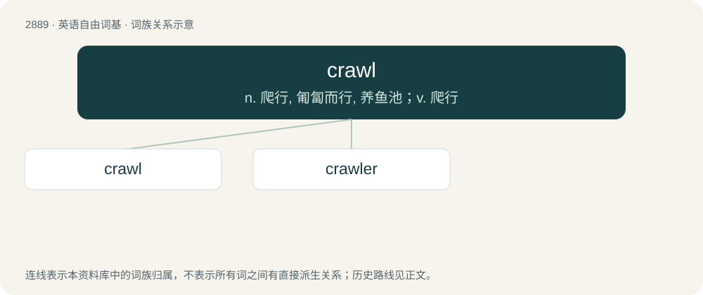

# 2998 · crawl — n. 爬行, 匍匐而行, 养鱼池；v. 爬行

[总目录](../00_总目录_按常用程度.md)

**类型**：英语自由词基　｜　**来源语言**：见词源记录

## 核心含义与来源

- 核心含义：n. 爬行, 匍匐而行, 养鱼池；v. 爬行
- 英文含义：To move by dragging one's body along or close to a surface, like a worm or insect, or on one's hands and knees, like a human baby.
- 词形：crawl

**多个词源／构词路径**：同一拼写可能有不同来源；以下按词性和含义分别列出。

**来源记录 1**（动词；To move by dragging one's body along or close to a surface, like a worm or insect, or on one's hands and knees, like a human baby.）

From Middle English crawlen, crewlen, creulen, crallen, \*cravelen, from Old Norse krafla (compare Danish kravle (“to crawl, creep”), Swedish kravla, kräla (“to creep, crawl”)), from Proto-Germanic \*krablōną (compare Saterland Frisian krabbelje, Dutch krabbelen, German Low German krabbeln, German krabbeln), frequentative of \*krabbōną (“to scratch, scrape”). Compare also Saterland Frisian krauelje (“to crawl, scuttle”), West Frisian kreauwelje (“to crawl”), Dutch krevelen, krieuwelen (“to crawl”), German Low German kribbeln, German kribbeln (“to creep, crawl, tingle”). See also crab, crabble.

**来源记录 2**（名词；A pen or enclosure of stakes and hurdles for holding fish.）

Compare kraal.

## 词族图

## 单词速览（常用到不常用）

| 单词 | 音标 | 释义 |
|---|---|---|
| [crawl](#w-1) | 英 /kɹɔːl/；/kɹɔl/ | n. 爬行, 匍匐而行, 养鱼池；v. 爬行 |
| [crawler](#w-2) | /ˈkrɔːlə/ | n. 爬行者, 蠕动的东西, 虱, (澳)马屁精, 奴颜婢膝的人, 婴儿的罩衣 |

## 逐词详解

### 1. crawl

**词性**：动词　｜　**音标**：英 /kɹɔːl/；/kɹɔl/

**中文释义**：n. 爬行, 匍匐而行, 养鱼池；v. 爬行

**英文义项**：To move by dragging one's body along or close to a surface, like a worm or insect, or on one's hands and knees, like a human baby. / To move or progress slowly or laboriously, or with great difficulty (for example due to feebleness) or frequent stops.

**词源与演化**：

From Middle English crawlen, crewlen, creulen, crallen, \*cravelen, from Old Norse krafla (compare Danish kravle (“to crawl, creep”), Swedish kravla, kräla (“to creep, crawl”)), from Proto-Germanic \*krablōną (compare Saterland Frisian krabbelje, Dutch krabbelen, German Low German krabbeln, German krabbeln), frequentative of \*krabbōną (“to scratch, scrape”). Compare also Saterland Frisian krauelje (“to crawl, scuttle”), West Frisian kreauwelje (“to crawl”), Dutch krevelen, krieuwelen (“to crawl”), German Low German kribbeln, German kribbeln (“to creep, crawl, tingle”). See also crab, crabble.

**例句**：

> Yahoo Search has updated its Slurp Crawler to crawl websites faster and more efficiently.

该用例对应义项：To visit (files or web sites) in order to index them for searching.

### 2. crawler

**词性**：名词　｜　**音标**：/ˈkrɔːlə/

**中文释义**：n. 爬行者, 蠕动的东西, 虱, (澳)马屁精, 奴颜婢膝的人, 婴儿的罩衣

**英文义项**：A child who is able to creep using its hands and knees but is not able to walk. / A crawl swimmer.

**构词拆分**：crawl (“to move slowly, by dragging the body along the ground”) + -er

**词源与演化**：

From crawl (“to move slowly, by dragging the body along the ground”) + -er.
