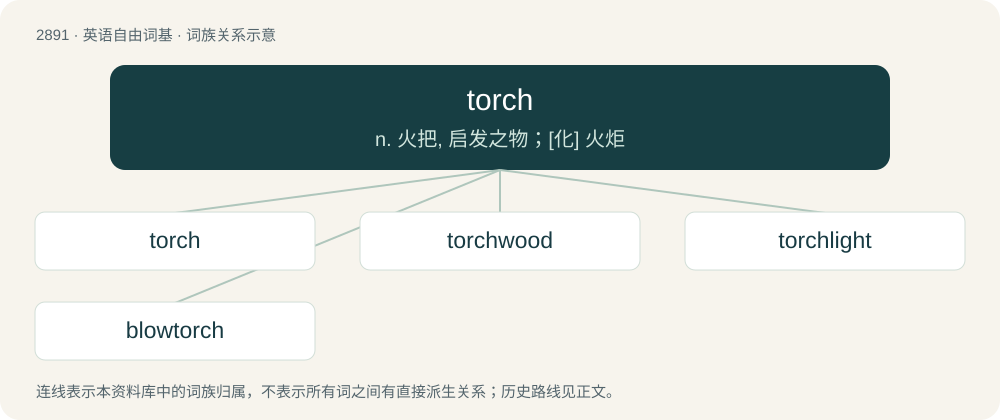

# 3001 · torch — n. 火把, 启发之物；\[化\] 火炬

[总目录](../00_总目录_按常用程度.md)

**类型**：英语自由词基　｜　**来源语言**：见词源记录

## 核心含义与来源

- 核心含义：n. 火把, 启发之物；\[化\] 火炬
- 英文含义：A stick of wood or plant fibres twisted together, with one end soaked in a flammable substance such as resin or tallow and set on fire, which is held in the hand, put into a wall bracket, or stuck into the ground, and used chiefly as a light source.
- 词形：torch

**来源记录 1**（名词；A stick of wood or plant fibres twisted together, with one end soaked in a flammable substance such as resin or tallow and set on fire, which is held in the hand, put into a wall bracket, or stuck into the ground, and used chiefly as a light source.）

The noun is derived from Middle English torch, torche (“large candle; lighted stick; (figurative) sunbeam”), from Old French torche, torque (“torch; bundle of (twisted) straw”) (modern French torche); further etymology uncertain, probably from Vulgar Latin \*torca (“coiled object”) (referring to a torch made from twisted plant fibres dipped in a flammable substance such as pitch), from Latin torqua, a variant of torquis (“collar of twisted metal, torque; wreath”), from torqueō (“to twist, wind”), ultimately from Proto-Indo-European \*terkʷ- (“to spin; to turn”). Etymology 1 sense 2.3 (Verbascum thapsus) is either due to the plant’s spike of yellow flowers, or because its leaves and stalks were used to make torches (noun etymology 1 sense 1). Etymology 1 sense 3.2 (“precious cause, etc., which needs to be protected and transmitted to others”) is derived from Latin lampada trādere, from Ancient Greek λᾰμπᾰ́δᾰ πᾰρᾰδιδόναι (lămpắdă părădidónai, “to hand over the torch”), a reference to the torch race held at various festivals such as the Panathenaic Games in Ancient Greece, which involved a relay where a torch was passed from one runner to another. The verb is derived from the noun.

## 词族图

## 单词速览（常用到不常用）

| 单词 | 音标 | 释义 |
|---|---|---|
| [torch](#w-1) | 英 /ˈtɔːtʃ/；美 /ˈtoɹtʃ/ | n. 火把, 启发之物；\[化\] 火炬 |
| [torchwood](#w-2) | 英 /ˈtɔːtʃwʊd/；美 /ˈtɔɹt͡ʃˌwʊd/ | n. 火炬木；脂檀 |
| [torchlight](#w-3) | /ˈtɒːtʃlait/ | n. 火炬之光 |
| [blowtorch](#w-4) | 英 /ˈbləʊˌtɔːtʃ/；美 /ˈbloʊˌtoɹt͡ʃ/ | n. 喷灯；\[机\] 喷灯 |

## 逐词详解

### 1. torch

**词性**：名词　｜　**音标**：英 /ˈtɔːtʃ/；美 /ˈtoɹtʃ/

**中文释义**：n. 火把, 启发之物；\[化\] 火炬

**英文义项**：A stick of wood or plant fibres twisted together, with one end soaked in a flammable substance such as resin or tallow and set on fire, which is held in the hand, put into a wall bracket, or stuck into the ground, and used chiefly as a light source. / A similarly shaped implement with a replaceable supply of flammable material; specifically, a pole with a lamp at one end.

**词源与演化**：

The noun is derived from Middle English torch, torche (“large candle; lighted stick; (figurative) sunbeam”), from Old French torche, torque (“torch; bundle of (twisted) straw”) (modern French torche); further etymology uncertain, probably from Vulgar Latin \*torca (“coiled object”) (referring to a torch made from twisted plant fibres dipped in a flammable substance such as pitch), from Latin torqua, a variant of torquis (“collar of twisted metal, torque; wreath”), from torqueō (“to twist, wind”), ultimately from Proto-Indo-European \*terkʷ- (“to spin; to turn”). Etymology 1 sense 2.3 (Verbascum thapsus) is either due to the plant’s spike of yellow flowers, or because its leaves and stalks were used to make torches (noun etymology 1 sense 1). Etymology 1 sense 3.2 (“precious cause, etc., which needs to be protected and transmitted to others”) is derived from Latin lampada trādere, from Ancient Greek λᾰμπᾰ́δᾰ πᾰρᾰδιδόναι (lămpắdă părădidónai, “to hand over the torch”), a reference to the torch race held at various festivals such as the Panathenaic Games in Ancient Greece, which involved a relay where a torch was passed from one runner to another. The verb is derived from the noun.

**例句**：

> The mob of angry villagers carried torches and pitchforks to the vampire’s castle.

该用例对应义项：A stick of wood or plant fibres twisted together, with one end soaked in a flammable substance such as resin or tallow and set on fire, which is held in the hand, put into a wall bracket, or stuck into the ground, and used chiefly as a light source.

### 2. torchwood

**词性**：名词　｜　**音标**：英 /ˈtɔːtʃwʊd/；美 /ˈtɔɹt͡ʃˌwʊd/

**中文释义**：n. 火炬木；脂檀

**英文义项**：Wood exhibiting fungal bioluminescence or foxfire. / Wood used to make torches.

**构词拆分**：torch + wood

**词源与演化**：

From torch + wood.

### 3. torchlight

**词性**：名词　｜　**音标**：/ˈtɒːtʃlait/

**中文释义**：n. 火炬之光

**英文义项**：The dim light produced by a burning torch. / The light produced by a flashlight.

**构词拆分**：torch + light

**词源与演化**：

From torch + light.

**例句**：

> The prince’s crown gleamed in the torchlight.

### 4. blowtorch

**词性**：名词　｜　**音标**：英 /ˈbləʊˌtɔːtʃ/；美 /ˈbloʊˌtoɹt͡ʃ/

**中文释义**：n. 喷灯；\[机\] 喷灯

**英文义项**：A tool which projects a controlled stream of a highly flammable gas over a spark in order to produce a controlled flame. / A jet fighter.

**构词拆分**：blow + torch

**词源与演化**：

From blow + torch.

**例句**：

> Have you ever lighted a cigarette with a blowtorch?
