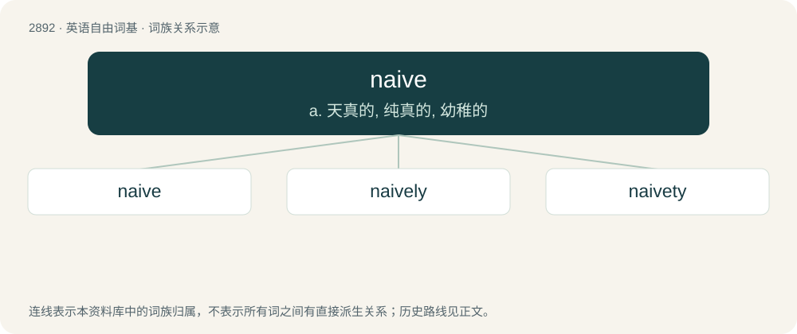

# 3002 · naive — a. 天真的, 纯真的, 幼稚的

[总目录](../00_总目录_按常用程度.md)

**类型**：英语自由词基　｜　**来源语言**：见词源记录

## 核心含义与来源

- 核心含义：a. 天真的, 纯真的, 幼稚的
- 英文含义：Lacking worldly experience, wisdom, or judgement; unsophisticated.
- 词形：naive

**来源记录 1**（形容词；Lacking worldly experience, wisdom, or judgement; unsophisticated.）

Borrowed from French naïve, feminine form of naïf, from Latin nātīvus (“native, natural”). Doublet of native.

## 词族图

## 单词速览（常用到不常用）

| 单词 | 音标 | 释义 |
|---|---|---|
| [naive](#w-1) | 英 /naɪˈiːv/；美 /naɪˈiv/ | a. 天真的, 纯真的, 幼稚的 |
| [naively](#w-2) | /naɪˈivli/ | adv. 无邪地；天真烂漫地 |
| [naivety](#w-3) | /nɑːˈiːvti/ | n. 无邪的行为；天真烂漫（等于naivete） |

## 逐词详解

### 1. naive

**词性**：形容词　｜　**音标**：英 /naɪˈiːv/；美 /naɪˈiv/

**中文释义**：a. 天真的, 纯真的, 幼稚的

**英文义项**：Lacking worldly experience, wisdom, or judgement; unsophisticated. / Not having been exposed to something.

**词源与演化**：

Borrowed from French naïve, feminine form of naïf, from Latin nātīvus (“native, natural”). Doublet of native.

**例句**：

> He took part in the experiment as a naive subject.

该用例对应义项：not initiated; deficient in relevant experience

### 2. naively

**词性**：副词　｜　**音标**：/naɪˈivli/

**中文释义**：adv. 无邪地；天真烂漫地

**英文义项**：In a naive manner.

**构词拆分**：naive + -ly

**词源与演化**：

From naive + -ly.

**例句**：

> He believed, naively, that she would leave him her money.

该用例对应义项：in a naive manner

### 3. naivety

**词性**：名词　｜　**音标**：/nɑːˈiːvti/

**中文释义**：n. 无邪的行为；天真烂漫（等于naivete）

**英文义项**：naïveté

**构词拆分**：naive + -ity

**词源与演化**：

From naive + -ity, English analogue of naïveté (naïf + -eté) borrowed from French.

**例句**：

> I'm getting tired of your ignorant naivety.
