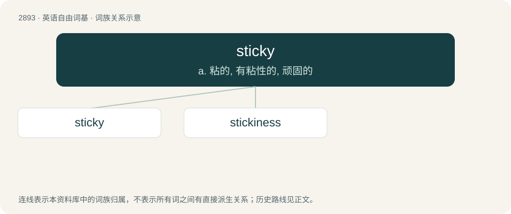

# 3003 · sticky — a. 粘的, 有粘性的, 顽固的

[总目录](../00_总目录_按常用程度.md)

**类型**：英语自由词基　｜　**来源语言**：见词源记录

## 核心含义与来源

- 核心含义：a. 粘的, 有粘性的, 顽固的
- 英文含义：Tending to stick; able to adhere via the drying of a viscous substance.
- 词形：sticky

**来源记录 1**（形容词；Tending to stick; able to adhere via the drying of a viscous substance.）

From stick + -y.

## 词族图

## 单词速览（常用到不常用）

| 单词 | 音标 | 释义 |
|---|---|---|
| [sticky](#w-1) | /ˈstɪki/ | a. 粘的, 有粘性的, 顽固的 |
| [stickiness](#w-2) | /ˈstikinis/ | n. 粘性, 胶粘 |

## 逐词详解

### 1. sticky

**词性**：形容词　｜　**音标**：/ˈstɪki/

**中文释义**：a. 粘的, 有粘性的, 顽固的

**英文义项**：Tending to stick; able to adhere via the drying of a viscous substance. / Difficult, awkward.

**构词拆分**：From stick + -y.

**词源与演化**：

From stick + -y.

**例句**：

> We should make the printing direction sticky so the user doesn't have to keep setting it.

该用例对应义项：Persistent.

### 2. stickiness

**词性**：名词　｜　**音标**：/ˈstikinis/

**中文释义**：n. 粘性, 胶粘

**英文义项**：The property of sticking or adhering; adhesion. / Warmth and humidity, as on a muggy day.

**构词拆分**：sticky + -ness

**词源与演化**：

From sticky + -ness.

**例句**：

> The low stickiness rating helped explain why our ad’s brand linkage rating was so low: people were turned off by the blurriness of the main photo.

该用例对应义项：A research measure that captures the extent to which viewers wish to spend more time looking at or reading a print advertisement.
