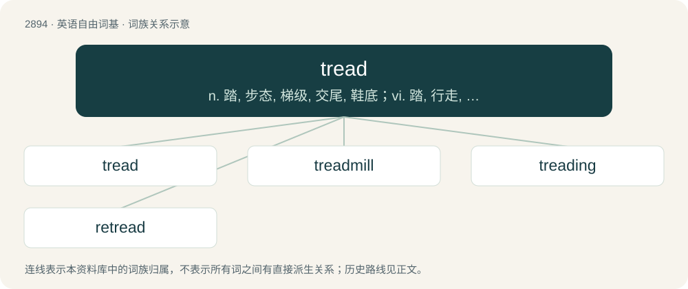

# 3004 · tread — n. 踏, 步态, 梯级, 交尾, 鞋底；vi. 踏, 行走, 交尾；vt. 踩, 踏, 践踏, 跳(舞)

[总目录](../00_总目录_按常用程度.md)

**类型**：英语自由词基　｜　**来源语言**：见词源记录

## 核心含义与来源

- 核心含义：n. 踏, 步态, 梯级, 交尾, 鞋底；vi. 踏, 行走, 交尾；vt. 踩, 踏, 践踏, 跳(舞)
- 英文含义：To step or walk (on or across something); to trample.
- 词形：tread

**多个词源／构词路径**：同一拼写可能有不同来源；以下按词性和含义分别列出。

**来源记录 1**（动词；To step or walk (on or across something); to trample.）

From Middle English treden, from Old English tredan, from Proto-West Germanic \*tredan, from Proto-Germanic \*trudaną.

**来源记录 2**（名词；A step taken with the foot.）

From Middle English tred, from treden (“to tread”).

## 词族图

## 单词速览（常用到不常用）

| 单词 | 音标 | 释义 |
|---|---|---|
| [tread](#w-1) | /tɹɛd/ | n. 踏, 步态, 梯级, 交尾, 鞋底；vi. 踏, 行走, 交尾；vt. 踩, 踏, 践踏, 跳(舞) |
| [treadmill](#w-2) | /ˈtɹɛd.mɪl/ | n. 踏车, 令人厌倦的工作；\[法\] 踏车 |
| [treading](#w-3) | /tredɪŋ/ | v. 踩, 踏( tread的现在分词 ); 踩成; 踏出; 步行于 |
| [retread](#w-4) | /ɹiːˈtɹɛd/ | vt. 给...装胎面, 翻新；n. 新胎面 |

## 逐词详解

### 1. tread

**词性**：动词　｜　**音标**：/tɹɛd/

**中文释义**：n. 踏, 步态, 梯级, 交尾, 鞋底；vi. 踏, 行走, 交尾；vt. 踩, 踏, 践踏, 跳(舞)

**英文义项**：To step or walk (on or across something); to trample. / To step or walk upon.

**词源与演化**：

From Middle English treden, from Old English tredan, from Proto-West Germanic \*tredan, from Proto-Germanic \*trudaną.

**例句**：

> Don't tread on the lawn.

该用例对应义项：To step or walk (on or across something); to trample.

### 2. treadmill

**词性**：名词　｜　**音标**：/ˈtɹɛd.mɪl/

**中文释义**：n. 踏车, 令人厌倦的工作；\[法\] 踏车

**英文义项**：A piece of indoor sporting equipment used to allow for the motions of running or walking while staying in one place. / A mill worked by horses, dogs, etc., treading an endless belt.

**构词拆分**：tread + mill

**词源与演化**：

From tread + mill. Its figurative senses refer to the idea that running on a treadmill requires continued effort and motion to remain in the same place.

**例句**：

> Tom was sweating profusely after a half an hour on the treadmill.

### 3. treading

**词性**：名词　｜　**音标**：/tredɪŋ/

**中文释义**：v. 踩, 踏( tread的现在分词 ); 踩成; 踏出; 步行于

**英文义项**：The act of one who treads.

**构词拆分**：tread + -ing

**词源与演化**：

From Middle English tredynge, tredyng; equivalent to tread + -ing.

**例句**：

> Do not muzzle an ox while it is treading out the grain.

### 4. retread

**词性**：动词　｜　**音标**：/ɹiːˈtɹɛd/

**中文释义**：vt. 给...装胎面, 翻新；n. 新胎面

**英文义项**：To replace the traction-providing surface of a vehicle that employs tires, tracks or treads. / To renew the tread of a tyre, providing a cheaper alternative to buying a new tyre, but potentially introducing a risk of premature failure if performed improperly.

**构词拆分**：re- + tread

**词源与演化**：

From re- + tread (“grooves carved into the face of a tire”, noun).
