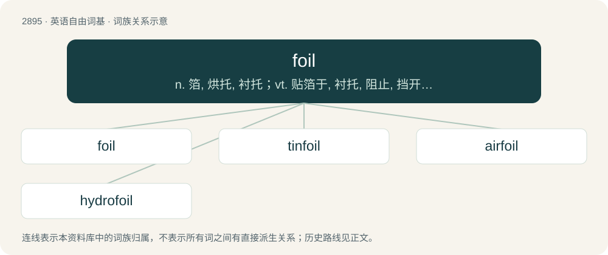

# 3006 · foil — n. 箔, 烘托, 衬托；vt. 贴箔于, 衬托, 阻止, 挡开, 挫败

[总目录](../00_总目录_按常用程度.md)

**类型**：英语自由词基　｜　**来源语言**：见词源记录

## 核心含义与来源

- 核心含义：n. 箔, 烘托, 衬托；vt. 贴箔于, 衬托, 阻止, 挡开, 挫败
- 英文含义：A very thin sheet of metal.
- 词形：foil

**多个词源／构词路径**：同一拼写可能有不同来源；以下按词性和含义分别列出。

**来源记录 1**（名词；A very thin sheet of metal.）

From Middle English foyle, from Middle French fueille, from Old French fueille (“plant leaf”), from Late Latin folia, the plural of folium, mistaken as a singular feminine. The literary sense is from the practice of backing a gem with metal foil to make it shine more brilliantly. Doublet of folio and folium, distantly also with phyllo and phyllon.

**来源记录 2**（动词；To prevent (something) from being accomplished.）

From Middle English foilen (“spoil a scent trail by crossing it”), from Old French fouler (“tread on, trample”), ultimately from Latin fullō (“to trample, full”).

**来源记录 3**（名词；The track of an animal.）

From French foulis.

**来源记录 4**（动词；To expand a product of two or more algebraic expressions, typically binomials.）

From mnemonic acronym FOIL (“First Outside Inside Last”).

## 词族图

## 单词速览（常用到不常用）

| 单词 | 音标 | 释义 |
|---|---|---|
| [foil](#w-1) | /fɔɪl/ | n. 箔, 烘托, 衬托；vt. 贴箔于, 衬托, 阻止, 挡开, 挫败 |
| [tinfoil](#w-2) | /ˈtinfɒil/ | n. 锡箔 |
| [airfoil](#w-3) | /ˈeəfɔil/ | n. 机翼, 方向舱 |
| [hydrofoil](#w-4) | 美 /ˈhaɪ.dɹoʊˌfɔɪl/ | n. 水翼艇；\[化\] 水翼 |

## 逐词详解

### 1. foil

**词性**：名词　｜　**音标**：/fɔɪl/

**中文释义**：n. 箔, 烘托, 衬托；vt. 贴箔于, 衬托, 阻止, 挡开, 挫败

**英文义项**：A very thin sheet of metal. / A very thin sheet of plastic.

**词源与演化**：

From Middle English foyle, from Middle French fueille, from Old French fueille (“plant leaf”), from Late Latin folia, the plural of folium, mistaken as a singular feminine. The literary sense is from the practice of backing a gem with metal foil to make it shine more brilliantly. Doublet of folio and folium, distantly also with phyllo and phyllon.

**用法示例／搭配（非完整句）**：

> wrap the sandwich up in foil

该用例对应义项：Thin aluminium/aluminum (or, formerly, tin) used for wrapping food.

### 2. tinfoil

**词性**：名词　｜　**音标**：/ˈtinfɒil/

**中文释义**：n. 锡箔

**英文义项**：A thin, pliable sheet of tin or an alloy of tin and lead, used as a protective wrapping. / Aluminium foil.

**构词拆分**：tin + foil

**词源与演化**：

From tin + foil.

**例句**：

> Tom wears a tinfoil hat to protect his brain from harmful radiation.

### 3. airfoil

**词性**：名词　｜　**音标**：/ˈeəfɔil/

**中文释义**：n. 机翼, 方向舱

**英文义项**：A structure shaped to produce lift when moving in air. / A wing of an aircraft.

**构词拆分**：air + foil

**词源与演化**：

From air + foil.

### 4. hydrofoil

**词性**：名词　｜　**音标**：美 /ˈhaɪ.dɹoʊˌfɔɪl/

**中文释义**：n. 水翼艇；\[化\] 水翼

**英文义项**：A wing attached to the hull of a ship that raises it out of the water when travelling at speed and thus reduces drag. / A vessel equipped with such a device.

**构词拆分**：hydro- + foil

**词源与演化**：

From hydro- + foil.
