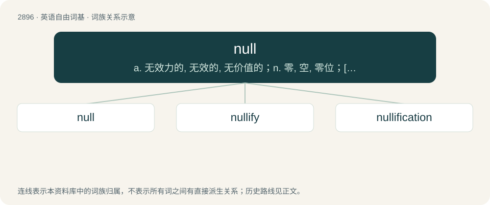

# 3007 · null — a. 无效力的, 无效的, 无价值的；n. 零, 空, 零位；\[计\] 空

[总目录](../00_总目录_按常用程度.md)

**类型**：英语自由词基　｜　**来源语言**：见词源记录

## 核心含义与来源

- 核心含义：a. 无效力的, 无效的, 无价值的；n. 零, 空, 零位；\[计\] 空
- 英文含义：A non-existent or empty value or set of values.
- 词形：null

**来源记录 1**（名词；A non-existent or empty value or set of values.）

Borrowed from Middle French nul, from Latin nūllus.

## 词族图

## 单词速览（常用到不常用）

| 单词 | 音标 | 释义 |
|---|---|---|
| [null](#w-1) | 英 /nʌl/；美 /nʌl/ | a. 无效力的, 无效的, 无价值的；n. 零, 空, 零位；\[计\] 空 |
| [nullify](#w-2) | /ˈnʌlɪfaɪ/ | vt. 使无效, 废弃, 取消；\[化\] 使等于零; 作废 |
| [nullification](#w-3) | /ˌnʌlɪfɪˈkeɪʃən/ | n. 无效, 废弃, 取消；\[法\] 无效, 废弃, 取消 |

## 逐词详解

### 1. null

**词性**：名词　｜　**音标**：英 /nʌl/；美 /nʌl/

**中文释义**：a. 无效力的, 无效的, 无价值的；n. 零, 空, 零位；\[计\] 空

**英文义项**：A non-existent or empty value or set of values. / Zero quantity of expressions; nothing.

**词源与演化**：

Borrowed from Middle French nul, from Latin nūllus.

**例句**：

> Since no date of birth was entered for the patient, his age is null.

该用例对应义项：The attribute of an entity that has no valid value.

### 2. nullify

**词性**：动词　｜　**音标**：/ˈnʌlɪfaɪ/

**中文释义**：vt. 使无效, 废弃, 取消；\[化\] 使等于零; 作废

**英文义项**：To make legally invalid. / To prevent from happening.

**构词拆分**：null + -ify

**词源与演化**：

From null + -ify.

**例句**：

> You'll nullify the contract if you move out before the lease period is up.

### 3. nullification

**词性**：名词　｜　**音标**：/ˌnʌlɪfɪˈkeɪʃən/

**中文释义**：n. 无效, 废弃, 取消；\[法\] 无效, 废弃, 取消

**英文义项**：The act of nullifying; a rendering void and of no effect, or no legal effect. / The nullification crisis in U.S. history, confrontation between the state of South Carolina and the federal government in 1832–33 over the former's attempt to declare null and void within the state the federal Tariffs of 1828 and 1832.

**构词拆分**：null + -ification

**词源与演化**：

Borrowed from Late Latin nullificatio, from nullifico, equivalent to null + -ification.
