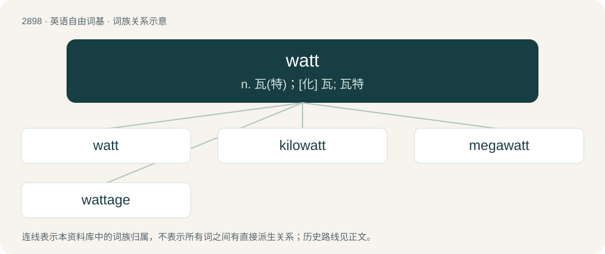

# 3009 · watt — n. 瓦(特)；\[化\] 瓦; 瓦特

[总目录](../00_总目录_按常用程度.md)

**类型**：英语自由词基　｜　**来源语言**：见词源记录

## 核心含义与来源

- 核心含义：n. 瓦(特)；\[化\] 瓦; 瓦特
- 英文含义：In the International System of Units, the derived unit of power; the power of a system in which one joule of energy is transferred per second.
- 词形：watt

**来源记录 1**（名词；In the International System of Units, the derived unit of power; the power of a system in which one joule of energy is transferred per second.）

Named after Scottish engineer James Watt. For the surname, see Watt.

## 词族图

## 单词速览（常用到不常用）

| 单词 | 音标 | 释义 |
|---|---|---|
| [watt](#w-1) | 英 /wɒt/；美 /wɑt/ | n. 瓦(特)；\[化\] 瓦; 瓦特 |
| [kilowatt](#w-2) | /ˈkɪ.ləˌwɒt/ | n. 千瓦；\[医\] 千瓦\[特\] |
| [megawatt](#w-3) | /ˈmegəwɒt/ | n. 兆瓦特；\[电\] 百万瓦 |
| [wattage](#w-4) | /ˈwɒtɪd͡ʒ/ | n. 瓦(特)数；\[医\] 瓦特数 |

## 逐词详解

### 1. watt

**词性**：名词　｜　**音标**：英 /wɒt/；美 /wɑt/

**中文释义**：n. 瓦(特)；\[化\] 瓦; 瓦特

**英文义项**：In the International System of Units, the derived unit of power; the power of a system in which one joule of energy is transferred per second.

**词源与演化**：

Named after Scottish engineer James Watt. For the surname, see Watt.

**例句**：

> The watt is the International System of Units' standard unit of power.

### 2. kilowatt

**词性**：名词　｜　**音标**：/ˈkɪ.ləˌwɒt/

**中文释义**：n. 千瓦；\[医\] 千瓦\[特\]

**英文义项**：One thousand (10³) watts, an amount of power large enough to power such things as a typical home appliance (e.g., a microwave oven, a toaster, or a hair dryer). (Consuming 1 kilowatt during a duration of 1 hour consumes 1 kilowatt-hour of energy.) / Catachresis for kilowatt-hour.

**构词拆分**：From kilo- + watt.

**词源与演化**：

From kilo- + watt.

### 3. megawatt

**词性**：名词　｜　**音标**：/ˈmegəwɒt/

**中文释义**：n. 兆瓦特；\[电\] 百万瓦

**英文义项**：One million (1 000 000) watts, an amount of power large enough to power such things as an entire commercial building or a small passenger aircraft. (Consuming 1 megawatt during a duration of 1 hour consumes 1 megawatt-hour of energy.)

**构词拆分**：mega- + watt

**词源与演化**：

From mega- + watt.

### 4. wattage

**词性**：名词　｜　**音标**：/ˈwɒtɪd͡ʒ/

**中文释义**：n. 瓦(特)数；\[医\] 瓦特数

**英文义项**：An amount or power (especially electric), expressed in watts, kilowatts etc. / The power requirement of some electric appliance.

**构词拆分**：watt + -age

**词源与演化**：

From watt + -age.
