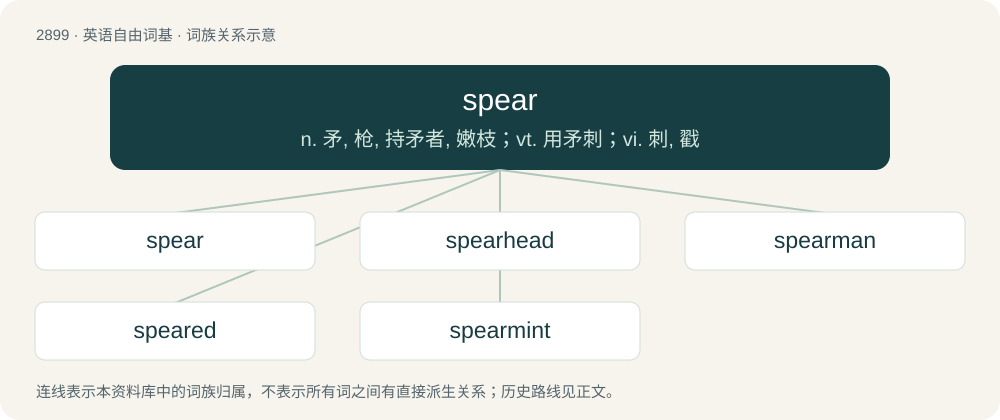

# 3010 · spear — n. 矛, 枪, 持矛者, 嫩枝；vt. 用矛刺；vi. 刺, 戳

[总目录](../00_总目录_按常用程度.md)

**类型**：英语自由词基　｜　**来源语言**：见词源记录

## 核心含义与来源

- 核心含义：n. 矛, 枪, 持矛者, 嫩枝；vt. 用矛刺；vi. 刺, 戳
- 英文含义：A long stick with a sharp tip used as a weapon for throwing or thrusting, or anything used to make a thrusting motion.
- 词形：spear

**多个词源／构词路径**：同一拼写可能有不同来源；以下按词性和含义分别列出。

**来源记录 1**（名词；A long stick with a sharp tip used as a weapon for throwing or thrusting, or anything used to make a thrusting motion.）

From Middle English spere, sperre, spear, from Old English spere, from Proto-West Germanic \*speru, from Proto-Germanic \*speru, from Proto-Indo-European \*sperH-. Cognates See also West Frisian spear, Dutch speer, German Speer, Old Norse spjǫr, \*sparrô, Middle Dutch sparre (“rafter”), Old Norse sparri (“spar, rafter”), sperra (“rafter, beam”); also Latin sparus (“short spear”), Albanian ferrë (“thorn, thornbush”).

**来源记录 2**（名词；The sprout of a plant, stalk）

Alteration of spire, from Middle English spyre, spier, spir, from Old English spīr (“stalk of a plant, shoot, blade”). More at spire.

## 词族图

## 单词速览（常用到不常用）

| 单词 | 音标 | 释义 |
|---|---|---|
| [spear](#w-1) | 英 /spɪə̯(ɹ)/；美 /spɪɹ/ | n. 矛, 枪, 持矛者, 嫩枝；vt. 用矛刺；vi. 刺, 戳 |
| [spearhead](#w-2) | 英 /ˈspɪə.hɛd/；美 /ˈspɪɹ.hɛd/ | n. 矛尖, 先锋队, 先头部队；vt. 做先锋, 带头 |
| [spearman](#w-3) | /ˈspiəmən/ | n. 持矛士兵 |
| [speared](#w-4) |  | vt. 用矛刺（spear的过去式与过去分词形式） |
| [spearmint](#w-5) | 英 /ˈspɪəˌmɪnt/；美 /ˈspɪɹˌmɪnt/ | n. 留兰香, 绿薄荷；\[化\] 薄荷 |

## 逐词详解

### 1. spear

**词性**：名词　｜　**音标**：英 /spɪə̯(ɹ)/；美 /spɪɹ/

**中文释义**：n. 矛, 枪, 持矛者, 嫩枝；vt. 用矛刺；vi. 刺, 戳

**英文义项**：A long stick with a sharp tip used as a weapon for throwing or thrusting, or anything used to make a thrusting motion. / A lance with barbed prongs, used by fishermen to retrieve fish.

**词源与演化**：

From Middle English spere, sperre, spear, from Old English spere, from Proto-West Germanic \*speru, from Proto-Germanic \*speru, from Proto-Indo-European \*sperH-. Cognates See also West Frisian spear, Dutch speer, German Speer, Old Norse spjǫr, \*sparrô, Middle Dutch sparre (“rafter”), Old Norse sparri (“spar, rafter”), sperra (“rafter, beam”); also Latin sparus (“short spear”), Albanian ferrë (“thorn, thornbush”).

**用法示例／搭配（非完整句）**：

> asparagus and broccoli spears

该用例对应义项：A long, thin strip from a vegetable.

### 2. spearhead

**词性**：动词　｜　**音标**：英 /ˈspɪə.hɛd/；美 /ˈspɪɹ.hɛd/

**中文释义**：n. 矛尖, 先锋队, 先头部队；vt. 做先锋, 带头

**英文义项**：To drive or campaign ardently for (an effort, project, etc.); to direct.

**构词拆分**：spear + head

**词源与演化**：

From Middle English spere-hed; equivalent to spear + head.

**例句**：

> He spearheaded the entire project from day one.

该用例对应义项：To drive or campaign ardently for (an effort, project, etc.); to direct.

### 3. spearman

**词性**：名词　｜　**音标**：/ˈspiəmən/

**中文释义**：n. 持矛士兵

**英文义项**：One who uses a spear; a soldier or warrior who fights with a spear; a person who hunts with a spear.

**构词拆分**：spear + -man

**词源与演化**：

From spear + -man.

### 4. speared

**词性**：形容词

**中文释义**：vt. 用矛刺（spear的过去式与过去分词形式）

**英文义项**：Wielding a spear.

**构词拆分**：From spear + -ed.

**词源与演化**：

From spear + -ed.

**例句**：

> The marsh has remained unchanged since the days when the Mohican Indians speared fish there.

### 5. spearmint

**词性**：名词　｜　**音标**：英 /ˈspɪəˌmɪnt/；美 /ˈspɪɹˌmɪnt/

**中文释义**：n. 留兰香, 绿薄荷；\[化\] 薄荷

**英文义项**：A herb of the mint family (Mentha spicata), commonly used in herb tea, candy and to treat mild stomach ache.

**构词拆分**：spear (“sprout of a plant, spire”) + mint

**词源与演化**：

From spear (“sprout of a plant, spire”) + mint, so named due to its spiry blooms.

**例句**：

> Spearmint is a species of mint that is native to Europe and Southwest Asia.
