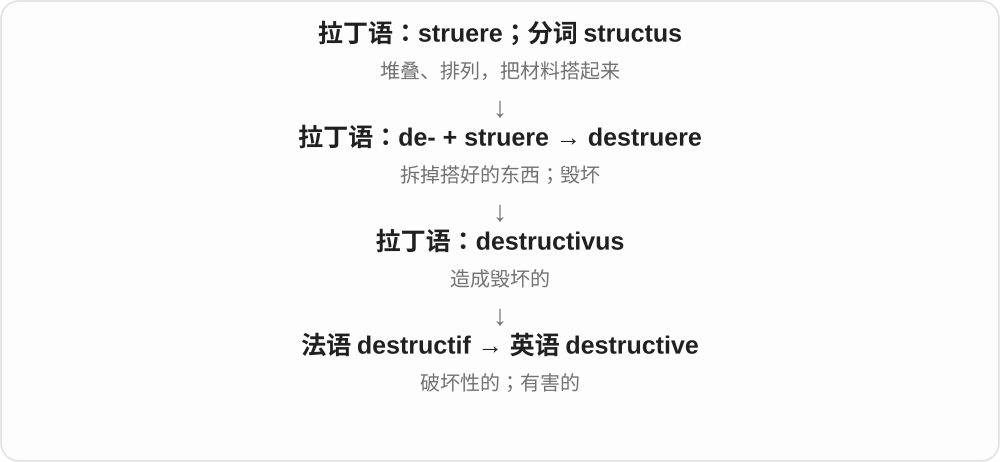
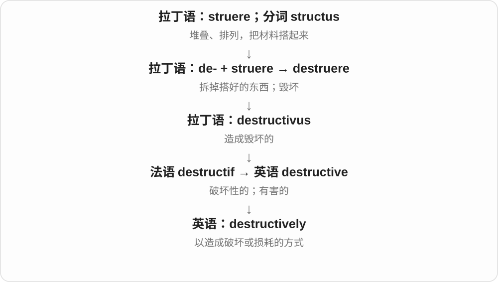
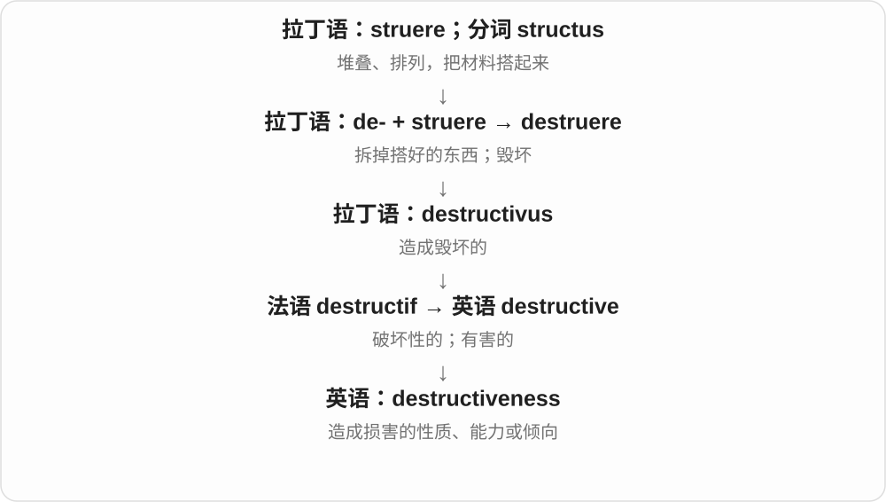

# 3012 · destructive — 破坏性质、方式、程度与否定，按操作对象理解

[逐词精讲目录](../00_逐词精讲目录.md) · [总目录](../00_总目录_按常用程度.md)

## 核心词根与来源

破坏可以谈实体、生态或关系。无损检测、编辑则按是否保留对象这一标准命名，不把无损误读成没有任何局限。

**DESTRUCTIVE：会破坏，non- 则否定这份性质**

destructive → destructively、destructiveness、nondestructive。

- **破坏性质、方式与程度**：destructive · destructively · destructiveness
- **保留对象的否定性质**：nondestructive

## 词形与演化规律

destroy 相关词族 → destructive；-ly 方式，-ness 性质；non- 否定。

## 单词速览（按词族由简到繁）

同一基础词的相关扩展放在一起，先读基础形式，再读扩展；各组之间优先读常用的。具体词源关系见各词讲解。

| 单词 | 音标 | 核心意思 |
|---|---|---|
| [destructive](#w-1) | /dɪˈstrʌktɪv/ | 破坏性的；有害的 |
| [destructively](#w-2) | /dɪˈstrʌktɪvli/ | 破坏性地；以造成损害的方式 |
| [destructiveness](#w-4) | /dɪˈstrʌktɪvnəs/ | 破坏性；毁坏能力或倾向 |
| [nondestructive](#w-3) | /ˌnɒndɪˈstrʌktɪv/，美式 /ˌnɑːndɪˈstrʌktɪv/ | 无损的；非破坏性的 |

## 逐词讲解

### 1. destructive — 破坏性的；有害的

**音标**：/dɪˈstrʌktɪv/

**先抓住这个画面**

destructive 像一边做事一边拆掉脚下的台阶：让原来能运转、能信任的东西逐渐坏掉。

**怎么拆**

拉丁 destructivus 经法语 destructif 进入英语；现代可看到 destruct- + -ive，但不能据此断言先有现代英语 destruct。

**怎么变成今天的意思**

可说 destructive storms，也可说 destructive habits。destructive criticism 只顾打击、不能帮助改善；技术里的 destructive testing 则通过使样品损坏来检验性能，不是说测试本身不正当。

**常见搭配与例句**

destructive behaviour；destructive criticism；destructive testing。

> The argument had become destructive rather than helpful.

争论开始造成伤害，已经无助于解决问题。

> The laboratory used destructive testing on a small sample.

实验室对一小份样品进行了破坏性测试。

**别混淆**

constructive 帮助改善；destructive 造成损害。但技术术语中的 destructive 有时只是说明会损伤样品。

### 2. destructively — 破坏性地；以造成损害的方式

**音标**：/dɪˈstrʌktɪvli/

**先抓住这个画面**

destructively 说的是一个动作怎样进行：做完后，某种关系、材料或原始信息受损了。

**怎么拆**

destructive + -ly。

**怎么变成今天的意思**

可描写人的反应，也可描述直接改坏原始材料或数据的操作。用在不同领域，破坏的对象并不一样。

**常见搭配与例句**

act destructively；react destructively；edit destructively。

> He reacted destructively by tearing up the shared plan.

他的反应充满破坏性，把共同制订的方案撕掉了。

> Editing destructively can make the original data difficult to recover.

破坏性编辑可能使原始数据难以恢复。

**别混淆**

aggressively 强调强硬、猛烈；destructively 强调造成损害。动作很强硬不必然有破坏性。

### 3. destructiveness — 破坏性；毁坏能力或倾向

**音标**：/dɪˈstrʌktɪvnəs/

**先抓住这个画面**

destructiveness 看的不是动静多大，而是能够毁掉多少、伤害多深。

**怎么拆**

destructive + -ness，把“破坏性的”变成可描述、比较的性质。

**怎么变成今天的意思**

可讨论风暴的破坏力，也可说嫉妒、习惯或冲突的破坏性。它通常是不可数名词。

**常见搭配与例句**

the destructiveness of a storm；the destructiveness of jealousy。

> The photographs show the destructiveness of the storm.

照片显示了这场风暴的破坏力。

> The novel explores the destructiveness of unchecked jealousy.

小说探讨了放任嫉妒发展所带来的破坏性。

**别混淆**

destruction 是破坏的行为或结果；destructiveness 是造成破坏的性质，某种东西尚未实际毁坏也可能具有这种性质。

### 4. nondestructive — 无损的；非破坏性的

**音标**：/ˌnɒndɪˈstrʌktɪv/，美式 /ˌnɑːndɪˈstrʌktɪv/

**先抓住这个画面**

想知道物件内部情况，却不必把它切开、砸坏，是 nondestructive testing 的基本用意。图像编辑里也借来表示保留原始内容、能再修改的处理方式。

**怎么拆**

non- 非、不 + destructive 破坏性的，否定相应破坏性质。具体测试或处理名称中的“不破坏”，要结合对象与操作范围理解。

**怎么变成今天的意思**

**destroy → destructive**  
具有破坏作用的性质

↓

**non- + destructive → nondestructive**  
不破坏相应对象的，常见于检测名称

nondestructive testing 无损检测；nondestructive editing 非破坏性编辑；a nondestructive method 无损方法。

**常见搭配与例句**

nondestructive testing；nondestructive editing。

> The team used nondestructive testing to inspect the part.

团队用无损检测检查这个部件。

> The editor chose a nondestructive method to preserve the original image.

编辑选用非破坏性方法，保留原始图像。

**别混淆**

nondestructive 关注保留对象，不等于检测一定找出所有问题，也不等于任何操作都可随意撤销。

## 这一组要分清什么

nondestructive 否定破坏，不自动说明精度、覆盖率；具体检测目标另看。

## 串起来练习

They compared destructive and nondestructive ways of examining the material.

他们比较了检查材料的破坏性和无损方法。
