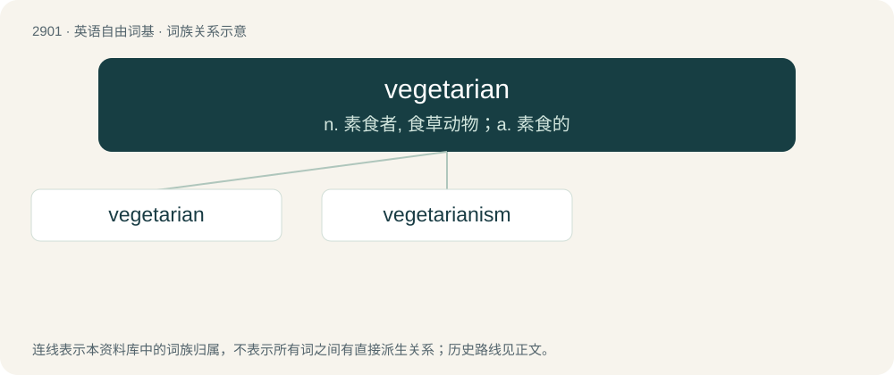

# 3013 · vegetarian — n. 素食者, 食草动物；a. 素食的

[总目录](../00_总目录_按常用程度.md)

**类型**：英语自由词基　｜　**来源语言**：见词源记录

## 核心含义与来源

- 核心含义：n. 素食者, 食草动物；a. 素食的
- 英文含义：A person who does not eat animal flesh, or, in some cases, use any animal products.
- 词形：vegetarian

**来源记录 1**（名词；A person who does not eat animal flesh, or, in some cases, use any animal products.）

From vegetable + -arian; popularized following the foundation of the British Vegetarian Society in 1847.

## 词族图

## 单词速览（常用到不常用）

| 单词 | 音标 | 释义 |
|---|---|---|
| [vegetarian](#w-1) | 英 /vɛ.d͡ʒɪˈtɛə.ɹi.ən/；美 /vɛ.d͡ʒɪˈtɛ.ɹi.ən/ | n. 素食者, 食草动物；a. 素食的 |
| [vegetarianism](#w-2) | 英 /vɛd͡ʒɪˈtɛəɹi.ənɪzəm/；美 /vɛd͡ʒɪˈtɛɹi.ənɪzəm/ | n. 素食主义；\[医\] 素食主义 |

## 逐词详解

### 1. vegetarian

**词性**：形容词　｜　**音标**：英 /vɛ.d͡ʒɪˈtɛə.ɹi.ən/；美 /vɛ.d͡ʒɪˈtɛ.ɹi.ən/

**中文释义**：n. 素食者, 食草动物；a. 素食的

**英文义项**：Of or relating to the type of diet eaten by vegetarians (in all senses). / Without meat.

**构词拆分**：vegetable + -arian

**词源与演化**：

From vegetable + -arian; popularized following the foundation of the British Vegetarian Society in 1847.

**用法示例／搭配（非完整句）**：

> I have a vegetarian brother

该用例对应义项：That does not eat meat.

### 2. vegetarianism

**词性**：名词　｜　**音标**：英 /vɛd͡ʒɪˈtɛəɹi.ənɪzəm/；美 /vɛd͡ʒɪˈtɛɹi.ənɪzəm/

**中文释义**：n. 素食主义；\[医\] 素食主义

**英文义项**：The practice of following a vegetarian diet.

**构词拆分**：vegetarian + -ism

**词源与演化**：

Attested since circa 1847, when the British Vegetarian Society was founded. From vegetarian + -ism.

**例句**：

> At around 10%, Germany has the highest rate of vegetarianism in Europe.
