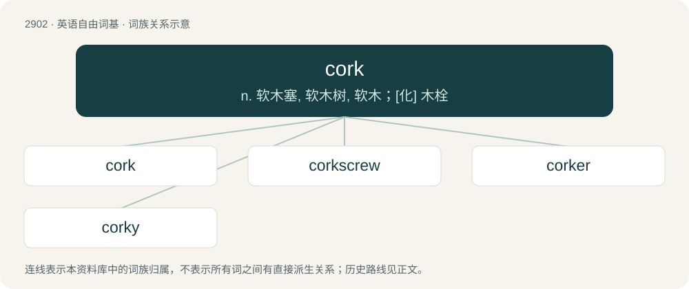

# 3014 · cork — n. 软木塞, 软木树, 软木；\[化\] 木栓

[总目录](../00_总目录_按常用程度.md)

**类型**：英语自由词基　｜　**来源语言**：见词源记录

## 核心含义与来源

- 核心含义：n. 软木塞, 软木树, 软木；\[化\] 木栓
- 英文含义：The dead protective tissue between the bark and cambium in woody plants, with suberin deposits making it impervious to gasses and water.
- 词形：cork

**多个词源／构词路径**：同一拼写可能有不同来源；以下按词性和含义分别列出。

**来源记录 1**（名词；The dead protective tissue between the bark and cambium in woody plants, with suberin deposits making it impervious to gasses and water.）

From Middle English cork (“oak bark, cork”), from Middle Dutch curc (“cork (material or object)”), either from Spanish corcho (“cork (material or object)”) (also corcha or corche) or from Old Spanish alcorque (“cork sole”). Doublet of cortex.

**来源记录 2**（名词；An aerialist maneuver involving a rotation where the rider goes heels over head, with the board overhead.）

From the traversal path resembling that of a corkscrew.

## 词族图

## 单词速览（常用到不常用）

| 单词 | 音标 | 释义 |
|---|---|---|
| [cork](#w-1) | 英 /kɔːk/；美 /kɔɹk/ | n. 软木塞, 软木树, 软木；\[化\] 木栓 |
| [corkscrew](#w-2) | 英 /ˈkɔːk.skɹuː/；美 /ˈkɔɹk.skɹu/ | n. 拔塞钻；a. 螺旋形的；vt. 硬拉出, 探听 |
| [corker](#w-3) | /kɔː.kə(ɹ)/ | n. 塞瓶塞的人；\[建\] 压塞机, 木塞压紧机 |
| [corky](#w-4) | /ˈkɒːki/ | a. 软木的, 活泼的 |

## 逐词详解

### 1. cork

**词性**：名词　｜　**音标**：英 /kɔːk/；美 /kɔɹk/

**中文释义**：n. 软木塞, 软木树, 软木；\[化\] 木栓

**英文义项**：The dead protective tissue between the bark and cambium in woody plants, with suberin deposits making it impervious to gasses and water. / The phellem of the cork oak, used for making bottle stoppers, flotation devices, and insulation material.

**词源与演化**：

From Middle English cork (“oak bark, cork”), from Middle Dutch curc (“cork (material or object)”), either from Spanish corcho (“cork (material or object)”) (also corcha or corche) or from Old Spanish alcorque (“cork sole”). Doublet of cortex.

**例句**：

> Snobs feel it's hard to call it wine with a straight face when the cork is made of plastic.

该用例对应义项：A bottle stopper made from this or any other material.

### 2. corkscrew

**词性**：名词　｜　**音标**：英 /ˈkɔːk.skɹuː/；美 /ˈkɔɹk.skɹu/

**中文释义**：n. 拔塞钻；a. 螺旋形的；vt. 硬拉出, 探听

**英文义项**：An implement for opening bottles that are sealed by a cork. Sometimes specifically such an implement that includes a screw-shaped part, or worm. / The screw-shaped worm of a typical corkscrew.

**构词拆分**：cork + screw

**词源与演化**：

From cork + screw.

**例句**：

> I opened the wine with a corkscrew.

该用例对应义项：An implement for opening bottles that are sealed by a cork. Sometimes specifically such an implement that includes a screw-shaped part, or worm.

### 3. corker

**词性**：名词　｜　**音标**：/kɔː.kə(ɹ)/

**中文释义**：n. 塞瓶塞的人；\[建\] 压塞机, 木塞压紧机

**英文义项**：One who puts corks into bottles. / A person or thing that is exceptional or remarkable.

**构词拆分**：From cork + -er.

**词源与演化**：

From cork + -er.

**例句**：

> That story was a corker.

该用例对应义项：(dated slang) a remarkable or excellent thing or person

### 4. corky

**词性**：形容词　｜　**音标**：/ˈkɒːki/

**中文释义**：a. 软木的, 活泼的

**英文义项**：Of wine, contaminated by a faulty or tainted cork. / Consisting of, or like, cork; dry; shrivelled.

**构词拆分**：cork + -y

**词源与演化**：

From cork (“stopper”) + -y.

**例句**：

> This wine smells a bit corky; get me another bottle.

该用例对应义项：Of wine, contaminated by a faulty or tainted cork.
