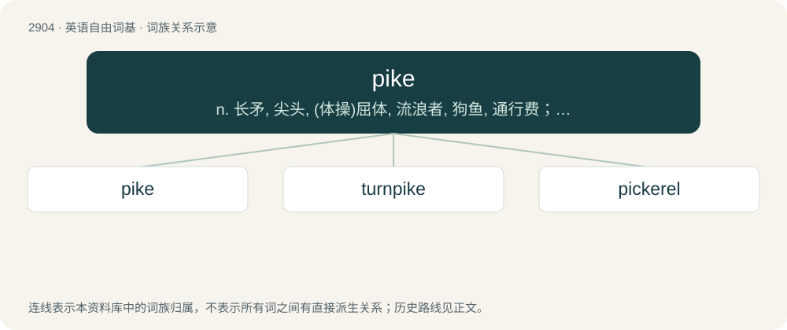

# 3015 · pike — n. 长矛, 尖头, (体操)屈体, 流浪者, 狗鱼, 通行费；vi. 用矛刺杀, 刺, 离开, 谨慎办事, 采用屈体姿势

[总目录](../00_总目录_按常用程度.md)

**类型**：英语自由词基　｜　**来源语言**：见词源记录

## 核心含义与来源

- 核心含义：n. 长矛, 尖头, (体操)屈体, 流浪者, 狗鱼, 通行费；vi. 用矛刺杀, 刺, 离开, 谨慎办事, 采用屈体姿势
- 英文含义：A sharp, pointed staff or implement.
- 词形：pike

**多个词源／构词路径**：同一拼写可能有不同来源；以下按词性和含义分别列出。

**来源记录 1**（名词；A sharp, pointed staff or implement.）

From Middle English pyke, pyk, pik, pike (“pike; sharp point, iron tip of a staff or spear, pointed toe of an item of footwear; sharp tool; mountain, peak”), from Old English pīc (“pointed object, pick axe”), and Middle French pique (“long thrusting weapon”), from Old French pic (“sharp point, spike”); both ultimately from Proto-West Germanic \*pīk, from Proto-Germanic \*pīkaz, \*pīkō (“sharp point, pike, peak”), related to pick with a narrower meaning. The word is cognate with Middle Dutch pecke, peke, picke (modern Dutch piek), German Pike, Norwegian pik, Danish pig, and possibly Old Irish pīk. It is a doublet of pique. The diving or gymnastics position is probably from tapered appearance of the body when the position is executed. The carnivorous freshwater fish is probably derived from the “sharp point, spike” senses, due to the fish’s pointed jaws. The verb sense “to quit or back out of a promise” may be from the sense of taking up pilgrim's staff or pike and leaving on a pilgrimage; and compare Middle English pī̆ken (“to go, remove oneself”) and Old Danish pikke af (“to go away”).

**来源记录 2**（名词；A gypsy, itinerant tramp, or traveller from any ethnic background; a pikey.）

Clipping of turnpike (“a toll road, especially a toll expressway; a spiked barrier across a road, originally used to block access to the road until toll had been paid”). Noun sense 2 (“gypsy, itinerant tramp, or traveller”) and verb sense 2 (“to depart, travel, especially to flee, run away”) may refer to someone frequently using turnpikes, or may be derived from Middle English pī̆ken (“to go, remove oneself”).

## 词族图

## 单词速览（常用到不常用）

| 单词 | 音标 | 释义 |
|---|---|---|
| [pike](#w-1) | 英 /paɪk/ | n. 长矛, 尖头, (体操)屈体, 流浪者, 狗鱼, 通行费；vi. 用矛刺杀, 刺, 离开, 谨慎办事, 采用屈体姿势 |
| [turnpike](#w-2) | /ˈtɜː(ɹ)npaɪk/ | n. 收税栅, 收税路, 收税高速公路, 公路, 大道 |
| [pickerel](#w-3) | 英 /ˈpɪk(ə)ɹəl/ | n. 狗鱼 |

## 逐词详解

### 1. pike

**词性**：名词　｜　**音标**：英 /paɪk/

**中文释义**：n. 长矛, 尖头, (体操)屈体, 流浪者, 狗鱼, 通行费；vi. 用矛刺杀, 刺, 离开, 谨慎办事, 采用屈体姿势

**英文义项**：A sharp, pointed staff or implement. / A large haycock (“conical stack of hay left in a field to dry before adding to a haystack”).

**词源与演化**：

From Middle English pyke, pyk, pik, pike (“pike; sharp point, iron tip of a staff or spear, pointed toe of an item of footwear; sharp tool; mountain, peak”), from Old English pīc (“pointed object, pick axe”), and Middle French pique (“long thrusting weapon”), from Old French pic (“sharp point, spike”); both ultimately from Proto-West Germanic \*pīk, from Proto-Germanic \*pīkaz, \*pīkō (“sharp point, pike, peak”), related to pick with a narrower meaning. The word is cognate with Middle Dutch pecke, peke, picke (modern Dutch piek), German Pike, Norwegian pik, Danish pig, and possibly Old Irish pīk. It is a doublet of pique. The diving or gymnastics position is probably from tapered appearance of the body when the position is executed. The carnivorous freshwater fish is probably derived from the “sharp point, spike” senses, due to the fish’s pointed jaws. The verb sense “to quit or back out of a promise” may be from the sense of taking up pilgrim's staff or pike and leaving on a pilgrimage; and compare Middle English pī̆ken (“to go, remove oneself”) and Old Danish pikke af (“to go away”).

**例句**：

> Scafell Pike is the highest mountain in England.

该用例对应义项：Especially in place names: a hill or mountain, particularly one with a sharp peak or summit.

### 2. turnpike

**词性**：名词　｜　**音标**：/ˈtɜː(ɹ)npaɪk/

**中文释义**：n. 收税栅, 收税路, 收税高速公路, 公路, 大道

**英文义项**：A frame consisting of two bars crossing each other at right angles and turning on a post or pin, to hinder the passage of animals, but admitting a person to pass between the arms. / A gate or bar set across a road to stop carriages, animals, and sometimes people, until a toll is paid.

**构词拆分**：turn + pike (“shaft”)

**词源与演化**：

From Middle English turnpyke (“spiked barrier across a road”), originally used to block access to such a road until a toll was paid. Equivalent to modern turn + pike (“shaft”).

**例句**：

> If you don't get off here, you'll have to get on the turnpike.

### 3. pickerel

**词性**：名词　｜　**音标**：英 /ˈpɪk(ə)ɹəl/

**中文释义**：n. 狗鱼

**英文义项**：A freshwater fish of the genus Esox. / Walleye, A species of gamefish, Sander vitreus, native to the Northern U.S. and Canada with pale, reflective eyes.

**构词拆分**：pike + -rel

**词源与演化**：

From Middle English pikerel; equivalent to pike + -rel.
