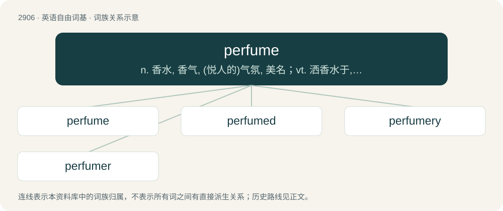

# 3017 · perfume — n. 香水, 香气, (悦人的)气氛, 美名；vt. 洒香水于, 薰香, 使充满香气

[总目录](../00_总目录_按常用程度.md)

**类型**：英语自由词基　｜　**来源语言**：见词源记录

## 核心含义与来源

- 核心含义：n. 香水, 香气, (悦人的)气氛, 美名；vt. 洒香水于, 薰香, 使充满香气
- 英文含义：A pleasant smell; the scent, odor, or odoriferous particles emitted from a sweet-smelling substance; a pleasant odor.
- 词形：perfume

**来源记录 1**（名词；A pleasant smell; the scent, odor, or odoriferous particles emitted from a sweet-smelling substance; a pleasant odor.）

Borrowed from Middle French parfum, perfum. Doublet of parfum.

## 词族图

## 单词速览（常用到不常用）

| 单词 | 音标 | 释义 |
|---|---|---|
| [perfume](#w-1) | 英 /ˈpɜːfjuːm/；美 /ˈpɝfjuːm/ | n. 香水, 香气, (悦人的)气氛, 美名；vt. 洒香水于, 薰香, 使充满香气 |
| [perfumed](#w-2) | /pəˈfjuːmd/ | a. 芳香的；香味的 |
| [perfumery](#w-3) | /pəˈfjuːm(ə)ri/ | n. 香料类, 香水(总称), 香料制造业 |
| [perfumer](#w-4) | 英 /pəˈfjuːmə/ | n. 香料制造人, 香水调配者, 香料商, 香水喷雾器 |

## 逐词详解

### 1. perfume

**词性**：名词　｜　**音标**：英 /ˈpɜːfjuːm/；美 /ˈpɝfjuːm/

**中文释义**：n. 香水, 香气, (悦人的)气氛, 美名；vt. 洒香水于, 薰香, 使充满香气

**英文义项**：A pleasant smell; the scent, odor, or odoriferous particles emitted from a sweet-smelling substance; a pleasant odor. / A substance created to provide a pleasant smell or one which emits an agreeable odor.

**词源与演化**：

Borrowed from Middle French parfum, perfum. Doublet of parfum.

**例句**：

> She bought a perfume at the airport.

该用例对应义项：A substance created to provide a pleasant smell or one which emits an agreeable odor.

### 2. perfumed

**词性**：形容词　｜　**音标**：/pəˈfjuːmd/

**中文释义**：a. 芳香的；香味的

**英文义项**：Scented, having been given a pleasant smell.

**构词拆分**：perfume (noun and verb) + -ed

**词源与演化**：

From perfume (noun and verb) + -ed.

**例句**：

> The perfumed pages of the letter contrasted with its doleful writing.

该用例对应义项：Scented, having been given a pleasant smell.

### 3. perfumery

**词性**：名词　｜　**音标**：/pəˈfjuːm(ə)ri/

**中文释义**：n. 香料类, 香水(总称), 香料制造业

**英文义项**：A shop selling perfumes. / A factory where perfume is made.

**构词拆分**：perfume + -ery

**词源与演化**：

From perfume + -ery.

**例句**：

> The rose is one of the first sent to be used in perfumery.

### 4. perfumer

**词性**：名词　｜　**音标**：英 /pəˈfjuːmə/

**中文释义**：n. 香料制造人, 香水调配者, 香料商, 香水喷雾器

**英文义项**：A person who makes or sells perfume. / One who perfumes something.

**构词拆分**：perfume (noun and verb) + -er

**词源与演化**：

From perfume (noun and verb) + -er, perhaps modelled on Middle French parfumeur.

**例句**：

> The perfumer stroked his wiry, red-tinged beard.
