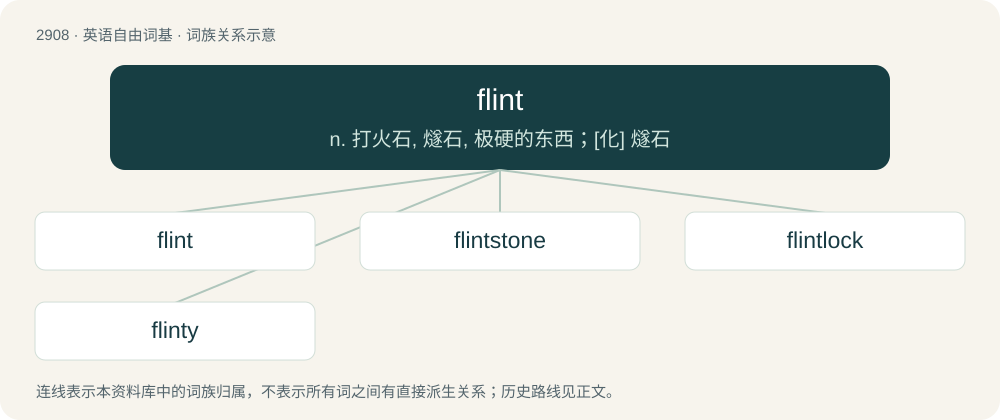

# 3019 · flint — n. 打火石, 燧石, 极硬的东西；\[化\] 燧石

[总目录](../00_总目录_按常用程度.md)

**类型**：英语自由词基　｜　**来源语言**：见词源记录

## 核心含义与来源

- 核心含义：n. 打火石, 燧石, 极硬的东西；\[化\] 燧石
- 英文含义：A hard, fine-grained quartz that fractures conchoidally and generates sparks when struck against a material such as steel, because tiny chips of the steel are heated to incandescence and burn in air.
- 词形：flint

**来源记录 1**（名词；A hard, fine-grained quartz that fractures conchoidally and generates sparks when struck against a material such as steel, because tiny chips of the steel are heated to incandescence and burn in air.）

From Middle English flynt, flint, from Old English flint, from Proto-West Germanic \*flint, from Proto-Germanic \*flintaz (compare Dutch vlint, flint (“flint, cobblestone”), German Flins, Flint (“flint, pebble”), Danish flint (“flint”)), from Proto-Indo-European \*(s)plind- (“to split, cleave”) (compare Irish slinn (“slate, shingle”), Ancient Greek πλίνθος (plínthos)), from \*(s)pley- (“to split”). More at split.

## 词族图

## 单词速览（常用到不常用）

| 单词 | 音标 | 释义 |
|---|---|---|
| [flint](#w-1) | /flɪnt/ | n. 打火石, 燧石, 极硬的东西；\[化\] 燧石 |
| [flintstone](#w-2) | /ˈflintstəjn/ | n. 燧石, 打火石 |
| [flintlock](#w-3) | 英 /ˈflɪntˌlɒk/ | n. 燧石发火装置, 燧发机, 明火枪 |
| [flinty](#w-4) | /ˈflɪnti/ | a. 燧石的, 含燧石的, 坚硬的, 冷酷的 |

## 逐词详解

### 1. flint

**词性**：名词　｜　**音标**：/flɪnt/

**中文释义**：n. 打火石, 燧石, 极硬的东西；\[化\] 燧石

**英文义项**：A hard, fine-grained quartz that fractures conchoidally and generates sparks when struck against a material such as steel, because tiny chips of the steel are heated to incandescence and burn in air. / A piece of flint, such as a gunflint, used to produce a spark by striking it with a firestriker.

**词源与演化**：

From Middle English flynt, flint, from Old English flint, from Proto-West Germanic \*flint, from Proto-Germanic \*flintaz (compare Dutch vlint, flint (“flint, cobblestone”), German Flins, Flint (“flint, pebble”), Danish flint (“flint”)), from Proto-Indo-European \*(s)plind- (“to split, cleave”) (compare Irish slinn (“slate, shingle”), Ancient Greek πλίνθος (plínthos)), from \*(s)pley- (“to split”). More at split.

**例句**：

> He used a flint to make a fire.

该用例对应义项：A piece of flint, such as a gunflint, used to produce a spark by striking it with a firestriker.

### 2. flintstone

**词性**：名词　｜　**音标**：/ˈflintstəjn/

**中文释义**：n. 燧石, 打火石

**英文义项**：A piece of flint.

**构词拆分**：flint + stone

**词源与演化**：

From Middle English flynt ston; equivalent to flint + stone.

### 3. flintlock

**词性**：名词　｜　**音标**：英 /ˈflɪntˌlɒk/

**中文释义**：n. 燧石发火装置, 燧发机, 明火枪

**英文义项**：An early type of firearm, using a spring-loaded flint to strike sparks into the firing pan. / A type of lock used on muskets, rifles, and pistols from the early 17th to the mid-19th century.

**构词拆分**：flint + lock

**词源与演化**：

From flint + lock.

### 4. flinty

**词性**：形容词　｜　**音标**：/ˈflɪnti/

**中文释义**：a. 燧石的, 含燧石的, 坚硬的, 冷酷的

**英文义项**：Resembling or containing flint; hard like flint. / Siliceous (including basanite).

**构词拆分**：flint + -y

**词源与演化**：

From flint + -y.

**用法示例／搭配（非完整句）**：

> flinty slate

该用例对应义项：Siliceous (including basanite).
