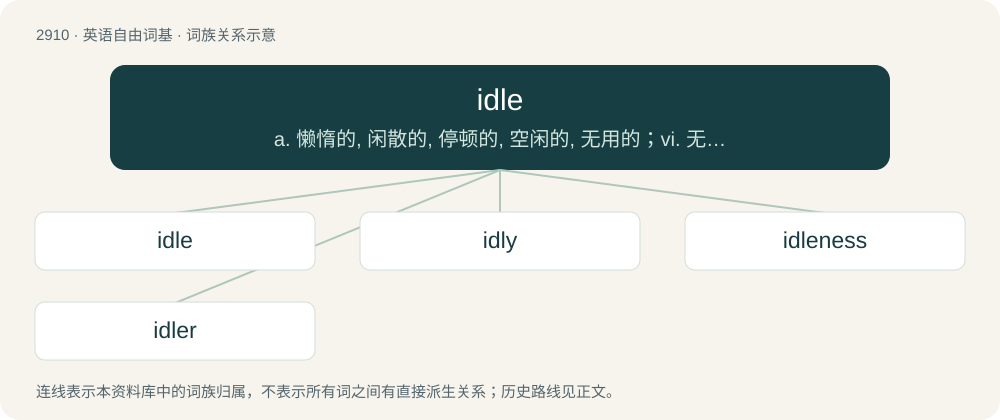

# 3020 · idle — a. 懒惰的, 闲散的, 停顿的, 空闲的, 无用的；vi. 无所事事, 闲散, 浪费, 空转；vt. 虚度, 使闲散, 使空转

[总目录](../00_总目录_按常用程度.md)

**类型**：英语自由词基　｜　**来源语言**：见词源记录

## 核心含义与来源

- 核心含义：a. 懒惰的, 闲散的, 停顿的, 空闲的, 无用的；vi. 无所事事, 闲散, 浪费, 空转；vt. 虚度, 使闲散, 使空转
- 英文含义：Not being used appropriately; not occupied; (of time) with no, no important, or not much activity.
- 词形：idle

**多个词源／构词路径**：同一拼写可能有不同来源；以下按词性和含义分别列出。

**来源记录 1**（形容词；Not being used appropriately; not occupied; (of time) with no, no important, or not much activity.）

From Middle English idel, ydel, from Old English īdel, from Proto-West Germanic \*īdl, from Proto-Germanic \*īdlaz. Cognate with Dutch ijdel (“vain, meaningless”), ijl (“rareified, skinny”), iel (“thin, slender”); German Low German iedel (“vain, idle”); German eitel (“vain, conceited”); and possibly Old Norse illr ("bad"; &gt; English ill).

**来源记录 2**（动词；To spend (time) in idleness; to waste; to consume.）

From Middle English idelen, from Old English īdlian, from Proto-West Germanic \*īdlēn. Cognate with German eiteln (“to make empty, free up”).

**来源记录 3**（名词；The state of idling, of being idle.）

From Middle English idel, ydel, from Old English īdel (“idleness”), from the adjective (see above).

## 词族图

## 单词速览（常用到不常用）

| 单词 | 音标 | 释义 |
|---|---|---|
| [idle](#w-1) | /ˈaɪd(ə)l/ | a. 懒惰的, 闲散的, 停顿的, 空闲的, 无用的；vi. 无所事事, 闲散, 浪费, 空转；vt. 虚度, 使闲散, 使空转 |
| [idly](#w-2) | /ˈaɪd(ə)lɪ/ | adv. 懒惰地, 空闲地 |
| [idleness](#w-3) | /ˈaɪdəlnəs/ | n. 懒惰, 闲散, 失业；\[化\] 空载 |
| [idler](#w-4) | 英 /ˈaɪ̯dləː/；美 /ˈaɪ̯dlɚ/ | n. 懒惰者, 游手好闲的人, 惰轮；\[化\] 惰轮 |

## 逐词详解

### 1. idle

**词性**：形容词　｜　**音标**：/ˈaɪd(ə)l/

**中文释义**：a. 懒惰的, 闲散的, 停顿的, 空闲的, 无用的；vi. 无所事事, 闲散, 浪费, 空转；vt. 虚度, 使闲散, 使空转

**英文义项**：Not being used appropriately; not occupied; (of time) with no, no important, or not much activity. / Not engaged in any occupation or employment; unemployed; inactive; doing nothing in particular.

**词源与演化**：

From Middle English idel, ydel, from Old English īdel, from Proto-West Germanic \*īdl, from Proto-Germanic \*īdlaz. Cognate with Dutch ijdel (“vain, meaningless”), ijl (“rareified, skinny”), iel (“thin, slender”); German Low German iedel (“vain, idle”); German eitel (“vain, conceited”); and possibly Old Norse illr ("bad"; &gt; English ill).

**例句**：

> My computer hibernates after it has been idle for 30 minutes.

该用例对应义项：Not being used appropriately; not occupied; (of time) with no, no important, or not much activity.

### 2. idly

**词性**：副词　｜　**音标**：/ˈaɪd(ə)lɪ/

**中文释义**：adv. 懒惰地, 空闲地

**英文义项**：Without specific purpose, intent or effort. / In an idle manner.

**构词拆分**：idle + -ly

**词源与演化**：

From Middle English idely, ydelly, idelliche, from Old English īdellīċe, equivalent to idle + -ly.

**例句**：

> I idly played with the paper, not even realizing I was folding it into a paper airplane.

该用例对应义项：Without specific purpose, intent or effort.

### 3. idleness

**词性**：名词　｜　**音标**：/ˈaɪdəlnəs/

**中文释义**：n. 懒惰, 闲散, 失业；\[化\] 空载

**英文义项**：The state of being idle; inactivity. / The state of being indolent; indolence.

**构词拆分**：idle + -ness

**词源与演化**：

From Middle English ydelnesse, from Old English īdelnes, from Proto-West Germanic \*īdlanassī, equivalent to idle + -ness. Cognate with Old Frisian īdelnisse (“idelness”), obsolete Dutch ijdelnis, Old Saxon īdalnussi (“idleness, vanity”), Old High German ītalnissa (“idleness, vanity, emptiness”).

**例句**：

> Idleness is the home of illness, illness is the home of death.

### 4. idler

**词性**：名词　｜　**音标**：英 /ˈaɪ̯dləː/；美 /ˈaɪ̯dlɚ/

**中文释义**：n. 懒惰者, 游手好闲的人, 惰轮；\[化\] 惰轮

**英文义项**：One who idles; one who spends their time in inaction. / One who idles; a lazy person; a sluggard.

**构词拆分**：From idle + -er.

**词源与演化**：

From idle + -er.
