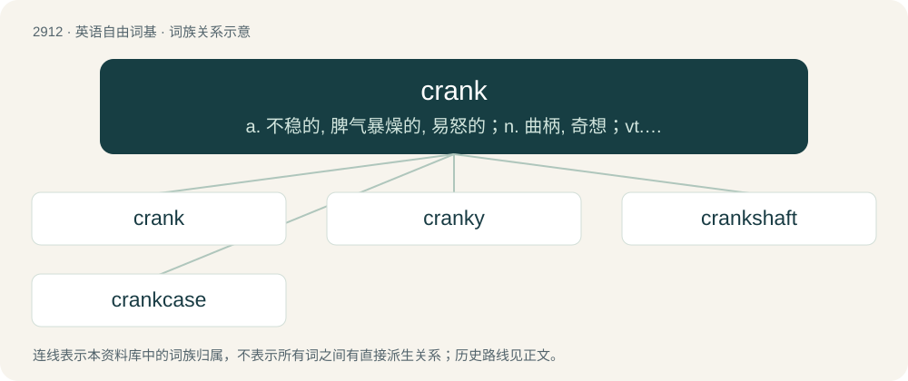

# 3021 · crank — a. 不稳的, 脾气暴燥的, 易怒的；n. 曲柄, 奇想；vt. 装曲柄

[总目录](../00_总目录_按常用程度.md)

**类型**：英语自由词基　｜　**来源语言**：见词源记录

## 核心含义与来源

- 核心含义：a. 不稳的, 脾气暴燥的, 易怒的；n. 曲柄, 奇想；vt. 装曲柄
- 英文含义：Hard; difficult.
- 词形：crank

**多个词源／构词路径**：同一拼写可能有不同来源；以下按词性和含义分别列出。

**来源记录 1**（形容词；Hard; difficult.）

From Dutch or Low German krank, ultimately from Proto-West Germanic \*krank, from Proto-Germanic \*krangaz, \*krankaz (“bent; weak”). Cognate with Scots crank, krank, German krank (“sick”).

**来源记录 2**（名词；A bent piece of an axle or shaft, or an attached arm perpendicular, or nearly so, to the end of a shaft or wheel, used to impart a rotation to a wheel or other mechanical device; also used to change circular into reciprocating motion, or reciprocating into circular motion.）

From Middle English crank, cronk, from a shortening of Old English crancstæf (“weaving tool, crank”, literally “bent or crooked staff”), the first element ultimately related to Etymology 1 above.

## 词族图

## 单词速览（常用到不常用）

| 单词 | 音标 | 释义 |
|---|---|---|
| [crank](#w-1) | 英 /kɹænk/；美 /kɹæŋk/ | a. 不稳的, 脾气暴燥的, 易怒的；n. 曲柄, 奇想；vt. 装曲柄 |
| [cranky](#w-2) | 英 /kɹænki/；美 /kɹæŋki/ | a. 古怪的, 暴躁的, 脾气坏的 |
| [crankshaft](#w-3) | /ˈkræŋkʃæft/ | n. 曲轴；\[机\] 曲柄轴 |
| [crankcase](#w-4) | /ˈkræŋkkeis/ | n. 曲轴箱；\[建\] 曲柄箱 |

## 逐词详解

### 1. crank

**词性**：名词　｜　**音标**：英 /kɹænk/；美 /kɹæŋk/

**中文释义**：a. 不稳的, 脾气暴燥的, 易怒的；n. 曲柄, 奇想；vt. 装曲柄

**英文义项**：An ailment, ache. / An ill-tempered or nasty person.

**词源与演化**：

From Dutch or Low German krank, ultimately from Proto-West Germanic \*krank, from Proto-Germanic \*krangaz, \*krankaz (“bent; weak”). Cognate with Scots crank, krank, German krank (“sick”).

**例句**：

> That crank next door thinks he’s created cold fusion in his garage.

该用例对应义项：An amateur in science or other technical subjects who persistently advocates flawed theories.

### 2. cranky

**词性**：形容词　｜　**音标**：英 /kɹænki/；美 /kɹæŋki/

**中文释义**：a. 古怪的, 暴躁的, 脾气坏的

**英文义项**：Not in good working condition; defective, faulty. / Grouchy, grumpy, irritable; easily upset.

**构词拆分**：crank + -y

**词源与演化**：

From crank + -y. Compare Middle Low German krankich (“sickly, unwell”).

**例句**：

> He got home from a long day at work tired and cranky.

该用例对应义项：Grouchy, grumpy, irritable; easily upset.

### 3. crankshaft

**词性**：名词　｜　**音标**：/ˈkræŋkʃæft/

**中文释义**：n. 曲轴；\[机\] 曲柄轴

**英文义项**：A rotating shaft with throws (parts that stick out) and which drives, is driven by (cranked by), or functions as a crank.

**构词拆分**：crank + shaft

**词源与演化**：

From crank + shaft.

**例句**：

> As I turned the handle of the crankshaft, the old tractor sputtered to life.

### 4. crankcase

**词性**：名词　｜　**音标**：/ˈkræŋkkeis/

**中文释义**：n. 曲轴箱；\[建\] 曲柄箱

**英文义项**：The part of an engine that contains the crankshaft.

**构词拆分**：crank + case

**词源与演化**：

From crank + case.
