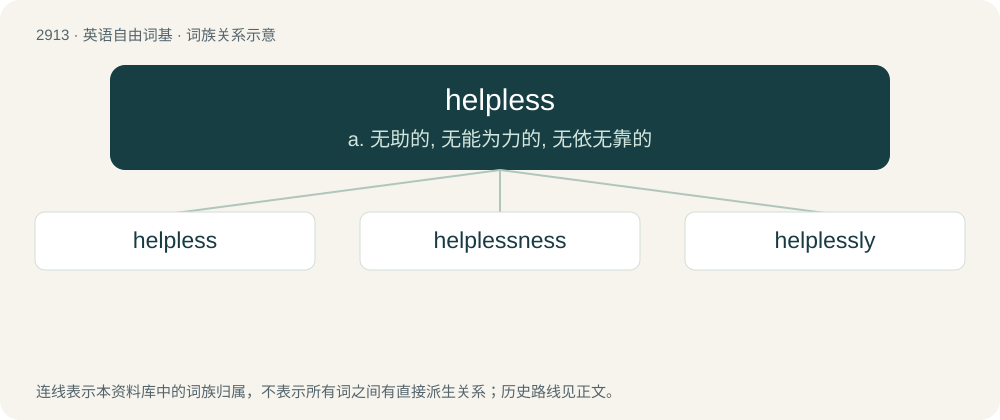

# 3022 · helpless — a. 无助的, 无能为力的, 无依无靠的

[总目录](../00_总目录_按常用程度.md)

**类型**：英语自由词基　｜　**来源语言**：见词源记录

## 核心含义与来源

- 核心含义：a. 无助的, 无能为力的, 无依无靠的
- 英文含义：Unable to defend oneself.
- 词形：helpless

**来源记录 1**（形容词；Unable to defend oneself.）

From Middle English helples, from Old English \*helplēas (“helpless”) from Proto-Germanic \*helpōlausaz, equivalent to help + -less. Compare Dutch hulpeloos (“helpless”), German hilflos (“helpless”), Danish hjælpeløs (“helpless”) and Swedish hjälplös (“helpless”).

## 词族图

## 单词速览（常用到不常用）

| 单词 | 音标 | 释义 |
|---|---|---|
| [helpless](#w-1) | /ˈhɛlplɪs/ | a. 无助的, 无能为力的, 无依无靠的 |
| [helplessness](#w-2) | 美 /ˈhɛlplɪsnɪs/ | n. 无可奈何状态, 无能为力; 无助的状态 |
| [helplessly](#w-3) | /ˈhɛlpləsli/ | adv. 无能为力地；无助地 |

## 逐词详解

### 1. helpless

**词性**：形容词　｜　**音标**：/ˈhɛlplɪs/

**中文释义**：a. 无助的, 无能为力的, 无依无靠的

**英文义项**：Unable to defend oneself. / Lacking help; powerless.

**构词拆分**：help + -less

**词源与演化**：

From Middle English helples, from Old English \*helplēas (“helpless”) from Proto-Germanic \*helpōlausaz, equivalent to help + -less. Compare Dutch hulpeloos (“helpless”), German hilflos (“helpless”), Danish hjælpeløs (“helpless”) and Swedish hjälplös (“helpless”).

**例句**：

> As helpless as a baby.

该用例对应义项：unable to manage independently

### 2. helplessness

**词性**：名词　｜　**音标**：美 /ˈhɛlplɪsnɪs/

**中文释义**：n. 无可奈何状态, 无能为力; 无助的状态

**英文义项**：The state of being helpless. / A feeling of inadequacy or impotence.

**构词拆分**：helpless + -ness

**词源与演化**：

From helpless + -ness.

**例句**：

> Some speculators take advantage of the ignorance and helplessness of old people.

### 3. helplessly

**词性**：副词　｜　**音标**：/ˈhɛlpləsli/

**中文释义**：adv. 无能为力地；无助地

**英文义项**：Without protection or assistance. / Without the ability to help oneself.

**构词拆分**：helpless + -ly

**词源与演化**：

From helpless + -ly.

**例句**：

> The spectators gaped helplessly as the balloon approached the power lines.

该用例对应义项：Without the ability to react actively.
