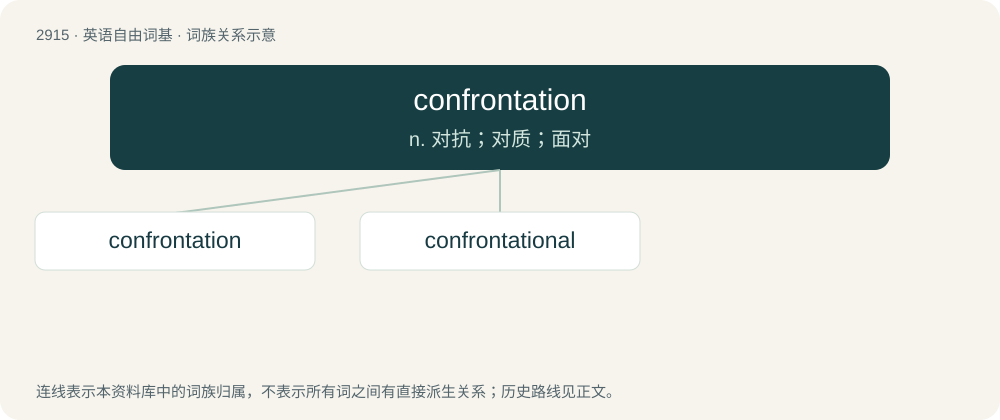

# 3024 · confrontation — n. 对抗；对质；面对

[总目录](../00_总目录_按常用程度.md)

**类型**：英语自由词基　｜　**来源语言**：见词源记录

## 核心含义与来源

- 核心含义：n. 对抗；对质；面对
- 英文含义：The act of confronting or challenging another, especially face to face.
- 词形：confrontation

**来源记录 1**（名词；The act of confronting or challenging another, especially face to face.）

From Middle French. Morphologically confront + -ation.

## 词族图

## 单词速览（常用到不常用）

| 单词 | 音标 | 释义 |
|---|---|---|
| [confrontation](#w-1) | 英 /ˌkɒn.fɹənˈteɪ.ʃən/；美 /ˌkɑn.fɹənˈteɪ.ʃən/ | n. 对抗；对质；面对 |
| [confrontational](#w-2) | /ˌkɒnfɹənˈteɪʃənˈəl/ | a. 挑衅的; 对抗的 |

## 逐词详解

### 1. confrontation

**词性**：名词　｜　**音标**：英 /ˌkɒn.fɹənˈteɪ.ʃən/；美 /ˌkɑn.fɹənˈteɪ.ʃən/

**中文释义**：n. 对抗；对质；面对

**英文义项**：The act of confronting or challenging another, especially face to face. / A conflict between armed forces.

**构词拆分**：confront + -ation

**词源与演化**：

From Middle French. Morphologically confront + -ation.

**例句**：

> The government was not ready for a confrontation with the unions.

该用例对应义项：the act of hostile groups opposing each other

### 2. confrontational

**词性**：形容词　｜　**音标**：/ˌkɒnfɹənˈteɪʃənˈəl/

**中文释义**：a. 挑衅的; 对抗的

**英文义项**：Pertaining to a confrontation; characterized by, or given to initiating hostile encounter; in-your-face.

**构词拆分**：From confrontation + -al.

**词源与演化**：

From confrontation + -al.

**例句**：

> Sami isn't as confrontational as he used to be.
