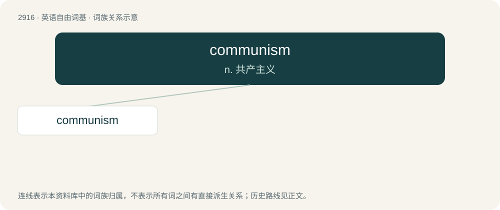

# 3026 · communism — n. 共产主义

[总目录](../00_总目录_按常用程度.md)

**类型**：英语自由词基　｜　**来源语言**：见词源记录

## 核心含义与来源

- 核心含义：n. 共产主义
- 英文含义：Any far-left political ideology or philosophy advocating holding the production of resources collectively, especially by seizing it through revolution.
- 词形：communism

**来源记录 1**（名词；Any far-left political ideology or philosophy advocating holding the production of resources collectively, especially by seizing it through revolution.）

A borrowing from French communisme, which was formed from commun (“common”) (from Latin commūnis) and the suffix -isme (“-ism”). By surface analysis, commune + -ism.

## 词族图

## 单词速览（常用到不常用）

| 单词 | 音标 | 释义 |
|---|---|---|
| [communism](#w-1) | 英 /ˈkɒmjᵿnɪz(ə)m/ | n. 共产主义 |

## 逐词详解

### 1. communism

**词性**：名词　｜　**音标**：英 /ˈkɒmjᵿnɪz(ə)m/

**中文释义**：n. 共产主义

**英文义项**：Any far-left political ideology or philosophy advocating holding the production of resources collectively, especially by seizing it through revolution. / Any political social system that implements a communist political philosophy.

**词源与演化**：

A borrowing from French communisme, which was formed from commun (“common”) (from Latin commūnis) and the suffix -isme (“-ism”). By surface analysis, commune + -ism.

**例句**：

> This tax plan is communism!

该用例对应义项：Any left-wing ideology, government regulations, or policies promoting a welfare state, nationalisation, etc.
