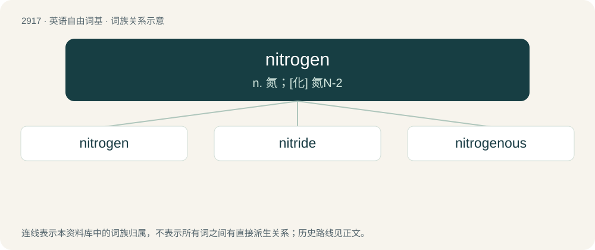

# 3029 · nitrogen — n. 氮；\[化\] 氮N-2

[总目录](../00_总目录_按常用程度.md)

**类型**：英语自由词基　｜　**来源语言**：见词源记录

## 核心含义与来源

- 核心含义：n. 氮；\[化\] 氮N-2
- 英文含义：The chemical element (symbol N) with an atomic number of 7 and atomic weight of 14.0067. It is a colorless and odorless gas.
- 词形：nitrogen

**来源记录 1**（名词；The chemical element (symbol N) with an atomic number of 7 and atomic weight of 14.0067. It is a colorless and odorless gas.）

Borrowed from French nitrogène (coined by French chemist and physician Jean-Antoine Chaptal in 1790). By surface analysis, nitro- + -gen. See also niter.

## 词族图

## 单词速览（常用到不常用）

| 单词 | 音标 | 释义 |
|---|---|---|
| [nitrogen](#w-1) | /ˈnaɪ.tɹə.d͡ʒən/ | n. 氮；\[化\] 氮N-2 |
| [nitride](#w-2) | /ˈnaɪ.tɹaɪd/ | n. 氮化物；\[化\] 氮化物 |
| [nitrogenous](#w-3) | /naiˈtrɒdʒənəs/ | a. 氮的, 含氮的；\[医\] 含氮的 |

## 逐词详解

### 1. nitrogen

**词性**：名词　｜　**音标**：/ˈnaɪ.tɹə.d͡ʒən/

**中文释义**：n. 氮；\[化\] 氮N-2

**英文义项**：The chemical element (symbol N) with an atomic number of 7 and atomic weight of 14.0067. It is a colorless and odorless gas. / Molecular nitrogen (diatomic nitrogen), N₂, a colorless, odorless gas at room temperature, which constitutes most of air (78% of it).

**词源与演化**：

Borrowed from French nitrogène (coined by French chemist and physician Jean-Antoine Chaptal in 1790). By surface analysis, nitro- + -gen. See also niter.

**例句**：

> By molar fraction, nitric oxide contains equal parts nitrogen and oxygen.

该用例对应义项：The chemical element (symbol N) with an atomic number of 7 and atomic weight of 14.0067. It is a colorless and odorless gas.

### 2. nitride

**词性**：名词　｜　**音标**：/ˈnaɪ.tɹaɪd/

**中文释义**：n. 氮化物；\[化\] 氮化物

**英文义项**：A compound of nitrogen where nitrogen has an oxidation state of −3.

**构词拆分**：From nitr(ogen) + -ide.

**词源与演化**：

From nitr(ogen) + -ide.

### 3. nitrogenous

**词性**：形容词　｜　**音标**：/naiˈtrɒdʒənəs/

**中文释义**：a. 氮的, 含氮的；\[医\] 含氮的

**英文义项**：of, relating to, or containing nitrogen

**构词拆分**：nitrogen + -ous

**词源与演化**：

From nitrogen + -ous.

**例句**：

> Other nitrogenous residues are contained in the urine of animals, and several other excretory products may be formed.
