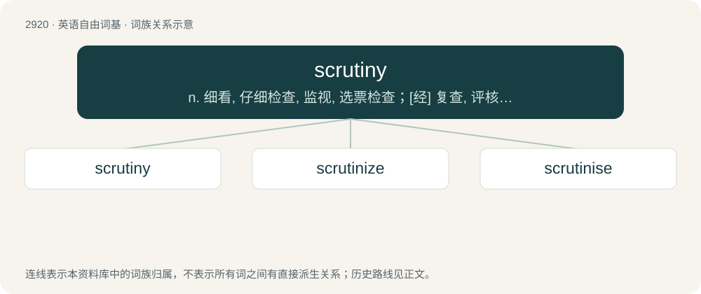

# 3030 · scrutiny — n. 细看, 仔细检查, 监视, 选票检查；\[经\] 复查, 评核, 仔细检查

[总目录](../00_总目录_按常用程度.md)

**类型**：英语自由词基　｜　**来源语言**：见词源记录

## 核心含义与来源

- 核心含义：n. 细看, 仔细检查, 监视, 选票检查；\[经\] 复查, 评核, 仔细检查
- 英文含义：Intense study of someone or something.
- 词形：scrutiny

**来源记录 1**（名词；Intense study of someone or something.）

From Middle English scrutiny, from Medieval Latin scrūtinium (“a search, an inquiry”), from Vulgar Latin scrūtor (“to search or examine thoroughly”), from Late Latin scrūta (“rubbish, broken trash”), from an extension of Proto-Indo-European \*(s)ker- (“to cut”).

## 词族图

## 单词速览（常用到不常用）

| 单词 | 音标 | 释义 |
|---|---|---|
| [scrutiny](#w-1) | 英 /ˈskɹuː.tɪ.ni/；美 /ˈskɹu.tɪ.ni/ | n. 细看, 仔细检查, 监视, 选票检查；\[经\] 复查, 评核, 仔细检查 |
| [scrutinize](#w-2) | 英 /ˈskɹuːtɨnaɪz/；美 /ˈskɹutn̩ˌaɪz/ | vt.vi. 细看, 仔细检查, 审查, 细阅；\[法\] 细看, 细阅, 仔细检查 |
| [scrutinise](#w-3) | /ˈskɹuːtɪnaɪz/ | vt.vi. 细看, 仔细检查, 审查, 细阅；\[经\] 详细检查, 细细地看 |

## 逐词详解

### 1. scrutiny

**词性**：名词　｜　**音标**：英 /ˈskɹuː.tɪ.ni/；美 /ˈskɹu.tɪ.ni/

**中文释义**：n. 细看, 仔细检查, 监视, 选票检查；\[经\] 复查, 评核, 仔细检查

**英文义项**：Intense study of someone or something. / Thorough inspection of a situation or a case.

**词源与演化**：

From Middle English scrutiny, from Medieval Latin scrūtinium (“a search, an inquiry”), from Vulgar Latin scrūtor (“to search or examine thoroughly”), from Late Latin scrūta (“rubbish, broken trash”), from an extension of Proto-Indo-European \*(s)ker- (“to cut”).

**用法示例／搭配（非完整句）**：

> come under scrutiny

该用例对应义项：Thorough inspection of a situation or a case.

### 2. scrutinize

**词性**：动词　｜　**音标**：英 /ˈskɹuːtɨnaɪz/；美 /ˈskɹutn̩ˌaɪz/

**中文释义**：vt.vi. 细看, 仔细检查, 审查, 细阅；\[法\] 细看, 细阅, 仔细检查

**英文义项**：To examine something with great care or detail, as to look for hidden or obscure flaws. / To audit accounts etc in order to verify them.

**构词拆分**：scrutiny + -ize

**词源与演化**：

From scrutiny + -ize.

**用法示例／搭配（非完整句）**：

> to scrutinize the conduct or motives of individuals

该用例对应义项：To examine something with great care or detail, as to look for hidden or obscure flaws.

### 3. scrutinise

**词性**：动词　｜　**音标**：/ˈskɹuːtɪnaɪz/

**中文释义**：vt.vi. 细看, 仔细检查, 审查, 细阅；\[经\] 详细检查, 细细地看

**英文义项**：To examine something with great care. / To audit accounts etc in order to verify them.

**构词拆分**：From scrutiny + -ise.

**词源与演化**：

From scrutiny + -ise.

**例句**：

> When writing a dissertation, it is important to heavily scrutinise your secondary sources.
