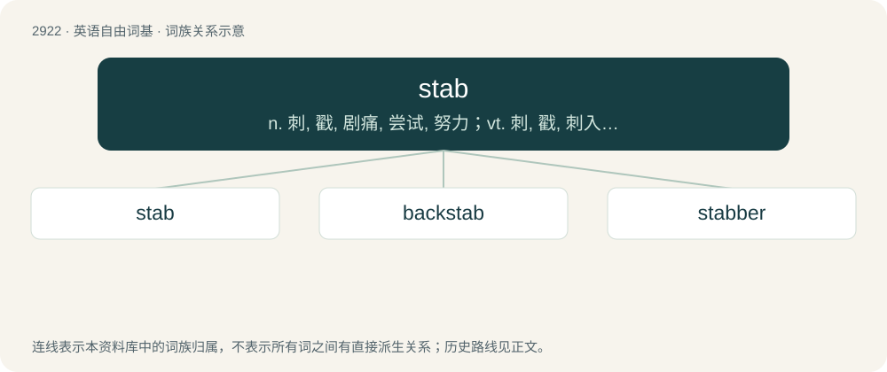

# 3033 · stab — n. 刺, 戳, 剧痛, 尝试, 努力；vt. 刺, 戳, 刺入, 刺痛, 直入, 使伤心；vi. 刺, 刺伤

[总目录](../00_总目录_按常用程度.md)

**类型**：英语自由词基　｜　**来源语言**：见词源记录

## 核心含义与来源

- 核心含义：n. 刺, 戳, 剧痛, 尝试, 努力；vt. 刺, 戳, 刺入, 刺痛, 直入, 使伤心；vi. 刺, 刺伤
- 英文含义：An act of stabbing or thrusting with an object to hurt or kill someone.
- 词形：stab

**多个词源／构词路径**：同一拼写可能有不同来源；以下按词性和含义分别列出。

**来源记录 1**（名词；An act of stabbing or thrusting with an object to hurt or kill someone.）

First attested in Scottish English (compare Scots stob, stobbe, stabb (“a pointed stick or stake; a thrust with a pointed weapon”)), from Middle English stabbe (“a stab”), probably a variant of Middle English stob, stub, stubbe (“pointed stick, stake, thorn, stub, stump”), from Old Norse stobbi, stubbi, cognate with Old English stybb. Cognate with Middle Dutch stobbe. Supposed by some to derive from Scottish Gaelic stob (“to prick, to prod, to push, to thrust”); supposed by others to be from a Scots word.

**来源记录 2**（名词；The horizontal or vertical stabilizer of an aircraft.）

Clipping of stabilizer or stabiliser.

## 词族图

## 单词速览（常用到不常用）

| 单词 | 音标 | 释义 |
|---|---|---|
| [stab](#w-1) | /stæb/ | n. 刺, 戳, 剧痛, 尝试, 努力；vt. 刺, 戳, 刺入, 刺痛, 直入, 使伤心；vi. 刺, 刺伤 |
| [backstab](#w-2) | /ˈbækˌstæb/ | v. 以卑鄙的手段陷害 |
| [stabber](#w-3) | /ˈstæbə/ | n. 刺的东西, 锥子, 刺客, 穿索针 |

## 逐词详解

### 1. stab

**词性**：名词　｜　**音标**：/stæb/

**中文释义**：n. 刺, 戳, 剧痛, 尝试, 努力；vt. 刺, 戳, 刺入, 刺痛, 直入, 使伤心；vi. 刺, 刺伤

**英文义项**：An act of stabbing or thrusting with an object to hurt or kill someone. / A wound made by stabbing.

**词源与演化**：

First attested in Scottish English (compare Scots stob, stobbe, stabb (“a pointed stick or stake; a thrust with a pointed weapon”)), from Middle English stabbe (“a stab”), probably a variant of Middle English stob, stub, stubbe (“pointed stick, stake, thorn, stub, stump”), from Old Norse stobbi, stubbi, cognate with Old English stybb. Cognate with Middle Dutch stobbe. Supposed by some to derive from Scottish Gaelic stob (“to prick, to prod, to push, to thrust”); supposed by others to be from a Scots word.

**例句**：

> I'll give this thankless task a stab.

该用例对应义项：An attempt.

### 2. backstab

**词性**：动词　｜　**音标**：/ˈbækˌstæb/

**中文释义**：v. 以卑鄙的手段陷害

**英文义项**：To attack someone (especially verbally) unfairly in a deceitful, underhand, or treacherous manner, especially when they're not present in the place or situation that it happens.

**构词拆分**：back + stab

**词源与演化**：

From back + stab.

### 3. stabber

**词性**：名词　｜　**音标**：/ˈstæbə/

**中文释义**：n. 刺的东西, 锥子, 刺客, 穿索针

**英文义项**：One who, or that which, stabs. / A small marlinespike.

**构词拆分**：From stab + -er.

**词源与演化**：

From stab + -er.
