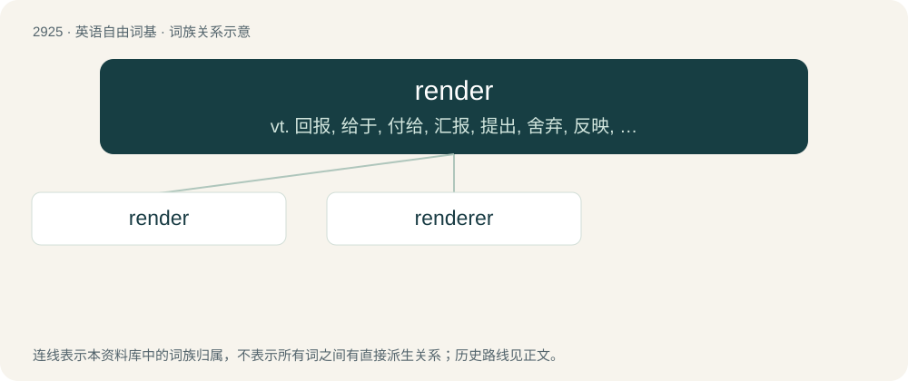

# 3035 · render — vt. 回报, 给于, 付给, 汇报, 提出, 舍弃, 反映, 表示, 表演, 致使, 执行, 实施；vi. 给予补偿；n. 交纳, 打底

[总目录](../00_总目录_按常用程度.md)

**类型**：英语自由词基　｜　**来源语言**：见词源记录

## 核心含义与来源

- 核心含义：vt. 回报, 给于, 付给, 汇报, 提出, 舍弃, 反映, 表示, 表演, 致使, 执行, 实施；vi. 给予补偿；n. 交纳, 打底
- 英文含义：To cause to become.
- 词形：render

**多个词源／构词路径**：同一拼写可能有不同来源；以下按词性和含义分别列出。

**来源记录 1**（动词；To cause to become.）

From Middle English renderen, rendren, from Old French rendre (“render, give back”), from Late Latin rendere, from Latin reddere (“make, give back”).

**来源记录 2**（名词；One who rends.）

From rend + -er.

## 词族图

## 单词速览（常用到不常用）

| 单词 | 音标 | 释义 |
|---|---|---|
| [render](#w-1) | 英 /ˈɹɛn.də/；美 /ˈɹɛn.dɚ/ | vt. 回报, 给于, 付给, 汇报, 提出, 舍弃, 反映, 表示, 表演, 致使, 执行, 实施；vi. 给予补偿；n. 交纳, 打底 |
| [renderer](#w-2) |  | n. 渲染器; 描绘器 |

## 逐词详解

### 1. render

**词性**：动词　｜　**音标**：英 /ˈɹɛn.də/；美 /ˈɹɛn.dɚ/

**中文释义**：vt. 回报, 给于, 付给, 汇报, 提出, 舍弃, 反映, 表示, 表演, 致使, 执行, 实施；vi. 给予补偿；n. 交纳, 打底

**英文义项**：To cause to become. / To interpret, give an interpretation or rendition of.

**词源与演化**：

From Middle English renderen, rendren, from Old French rendre (“render, give back”), from Late Latin rendere, from Latin reddere (“make, give back”).

**例句**：

> Bacon is very fatty when raw; however, most of the fat will render during cooking.

该用例对应义项：To have fat melt off meat from cooking.

### 2. renderer

**词性**：名词

**中文释义**：n. 渲染器; 描绘器

**英文义项**：One who, or that which, renders. / A vessel in which lard, tallow, etc., is rendered.

**构词拆分**：render + -er

**词源与演化**：

From Middle English renderar, equivalent to render + -er.
