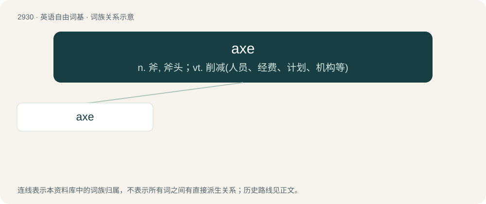

# 3037 · axe — n. 斧, 斧头；vt. 削减(人员、经费、计划、机构等)

[总目录](../00_总目录_按常用程度.md)

**类型**：英语自由词基　｜　**来源语言**：见词源记录

## 核心含义与来源

- 核心含义：n. 斧, 斧头；vt. 削减(人员、经费、计划、机构等)
- 英文含义：A tool for felling trees or chopping wood etc. consisting of a heavy head flattened to a blade on one side, and a handle attached to it.
- 词形：axe

**多个词源／构词路径**：同一拼写可能有不同来源；以下按词性和含义分别列出。

**来源记录 1**（名词；A tool for felling trees or chopping wood etc. consisting of a heavy head flattened to a blade on one side, and a handle attached to it.）

From Middle English ax, axe, ex, from Old English æx (“axe”), from Proto-West Germanic \*akusi (“axe”), from Proto-Germanic \*akwisī (“axe”), probably from a Proto-Indo-European \*h₂egʷsih₂ (“axe”), from \*h₂eḱ- (“sharp, pointed”). Cognate with Scots aix (“axe”), Dutch aks (“axe”), German Axt (“axe”), Danish økse (“axe”), Faroese, Norwegian Bokmål, and Norwegian Nynorsk øks (“axe”), Icelandic öxi (“axe”), Swedish yxa (“axe”), Latin ascia (“axe, mason's trowel”).

**来源记录 2**（动词；To furnish with an axle.）

Derived from French axe, from Latin axis.

## 词族图

## 单词速览（常用到不常用）

| 单词 | 音标 | 释义 |
|---|---|---|
| [axe](#w-1) | /æks/ | n. 斧, 斧头；vt. 削减(人员、经费、计划、机构等) |

## 逐词详解

### 1. axe

**词性**：名词　｜　**音标**：/æks/

**中文释义**：n. 斧, 斧头；vt. 削减(人员、经费、计划、机构等)

**英文义项**：A tool for felling trees or chopping wood etc. consisting of a heavy head flattened to a blade on one side, and a handle attached to it. / An ancient weapon consisting of a head that has one or two blades and a long handle.

**词源与演化**：

From Middle English ax, axe, ex, from Old English æx (“axe”), from Proto-West Germanic \*akusi (“axe”), from Proto-Germanic \*akwisī (“axe”), probably from a Proto-Indo-European \*h₂egʷsih₂ (“axe”), from \*h₂eḱ- (“sharp, pointed”). Cognate with Scots aix (“axe”), Dutch aks (“axe”), German Axt (“axe”), Danish økse (“axe”), Faroese, Norwegian Bokmål, and Norwegian Nynorsk øks (“axe”), Icelandic öxi (“axe”), Swedish yxa (“axe”), Latin ascia (“axe, mason's trowel”).

**例句**：

> A financial dealer has an axe in a stock that his buyers don't know about, giving him an advantage in making the most profit.

该用例对应义项：A position, interest, or reason in buying and selling stock, often with ulterior motives.
