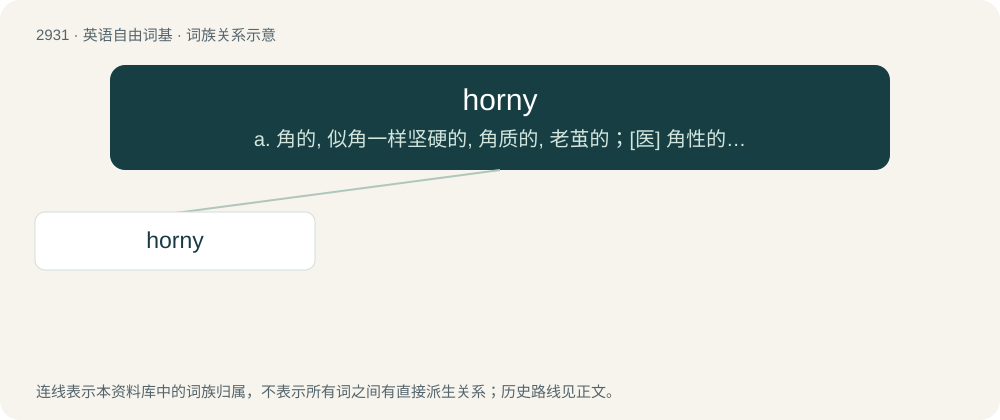

# 3038 · horny — a. 角的, 似角一样坚硬的, 角质的, 老茧的；\[医\] 角性的, 角的

[总目录](../00_总目录_按常用程度.md)

**类型**：英语自由词基　｜　**来源语言**：见词源记录

## 核心含义与来源

- 核心含义：a. 角的, 似角一样坚硬的, 角质的, 老茧的；\[医\] 角性的, 角的
- 英文含义：Hard or bony, like an animal's horn.
- 词形：horny

**来源记录 1**（形容词；Hard or bony, like an animal's horn.）

From Middle English horny, equivalent to horn + -y. Compare German hornig. Compare also Dutch hoornachtig, Swedish hornaktig, Old English hyrniġ (“angular”). Piecewise doublet of corny.

## 词族图

## 单词速览（常用到不常用）

| 单词 | 音标 | 释义 |
|---|---|---|
| [horny](#w-1) | 英 /ˈhɔːni/；美 /ˈhoɹni/ | a. 角的, 似角一样坚硬的, 角质的, 老茧的；\[医\] 角性的, 角的 |

## 逐词详解

### 1. horny

**词性**：形容词　｜　**音标**：英 /ˈhɔːni/；美 /ˈhoɹni/

**中文释义**：a. 角的, 似角一样坚硬的, 角质的, 老茧的；\[医\] 角性的, 角的

**英文义项**：Hard or bony, like an animal's horn. / Having the hard consistency and pale colour of an animal's horn.

**构词拆分**：horn + -y

**词源与演化**：

From Middle English horny, equivalent to horn + -y. Compare German hornig. Compare also Dutch hoornachtig, Swedish hornaktig, Old English hyrniġ (“angular”). Piecewise doublet of corny.

**例句**：

> It's hard to find good fanart of this character because most of the drawings are super horny.

该用例对应义项：Sexually exciting; arousing.
