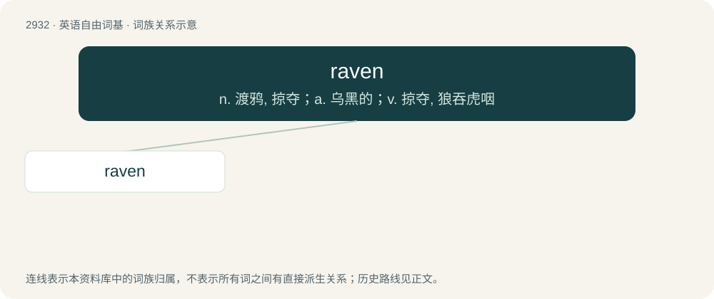

# 3041 · raven — n. 渡鸦, 掠夺；a. 乌黑的；v. 掠夺, 狼吞虎咽

[总目录](../00_总目录_按常用程度.md)

**类型**：英语自由词基　｜　**来源语言**：见词源记录

## 核心含义与来源

- 核心含义：n. 渡鸦, 掠夺；a. 乌黑的；v. 掠夺, 狼吞虎咽
- 英文含义：Any of several, generally large, species of birds in the genus Corvus with lustrous black plumage; especially the common raven (Corvus corax).
- 词形：raven

**多个词源／构词路径**：同一拼写可能有不同来源；以下按词性和含义分别列出。

**来源记录 1**（名词；Any of several, generally large, species of birds in the genus Corvus with lustrous black plumage; especially the common raven (Corvus corax).）

From Middle English raven, reven (“raven (Corvus corax); carrion crow (Corvus corone); rook (Corvus frugilegus) (?); the constellation Corvus; gall nuts of the Aleppo oak (Quercus infectoria) used to make black ink”), from Old English hræfn (“raven”), from Proto-West Germanic \*hrabn (“raven”), from Proto-Germanic \*hrabnaz (“raven”), probably from Proto-Indo-European \*ḱrep- (“to crackle; to rattle”) or \*ḱer- (“to croak, crow”), probably ultimately onomatopoeic, referring to the bird’s call.

**来源记录 2**（动词；To absorb or take in (something, such as information) greedily; also, to approach or pounce on (someone) like prey.）

A variant of ravin, from Middle English ravin, ravine, raven (noun).

## 词族图

## 单词速览（常用到不常用）

| 单词 | 音标 | 释义 |
|---|---|---|
| [raven](#w-1) | 英 /ˈɹeɪvn̩/；美 /ˈɹeɪvən/ | n. 渡鸦, 掠夺；a. 乌黑的；v. 掠夺, 狼吞虎咽 |

## 逐词详解

### 1. raven

**词性**：形容词　｜　**音标**：英 /ˈɹeɪvn̩/；美 /ˈɹeɪvən/

**中文释义**：n. 渡鸦, 掠夺；a. 乌黑的；v. 掠夺, 狼吞虎咽

**英文义项**：Of the jet-black and often glossy colour of the plumage of a raven (etymology 1, noun sense 1).

**词源与演化**：

From Middle English raven, reven (“raven (Corvus corax); carrion crow (Corvus corone); rook (Corvus frugilegus) (?); the constellation Corvus; gall nuts of the Aleppo oak (Quercus infectoria) used to make black ink”), from Old English hræfn (“raven”), from Proto-West Germanic \*hrabn (“raven”), from Proto-Germanic \*hrabnaz (“raven”), probably from Proto-Indo-European \*ḱrep- (“to crackle; to rattle”) or \*ḱer- (“to croak, crow”), probably ultimately onomatopoeic, referring to the bird’s call.

**例句**：

> She was a tall, sophisticated, raven-haired beauty.

该用例对应义项：Of the jet-black and often glossy colour of the plumage of a raven (etymology 1, noun sense 1).
