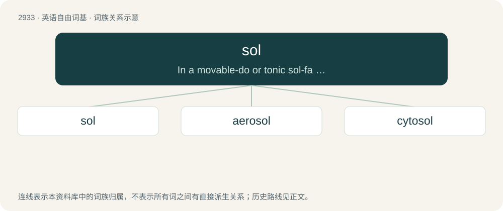

# 3043 · sol — In a movable-do or tonic sol-fa system: the fifth step in a scale, preceded by fa and followed by la.

[总目录](../00_总目录_按常用程度.md)

**类型**：英语自由词基　｜　**来源语言**：见词源记录

## 核心含义与来源

- 核心含义：In a movable-do or tonic sol-fa system: the fifth step in a scale, preceded by fa and followed by la.
- 英文含义：In a movable-do or tonic sol-fa system: the fifth step in a scale, preceded by fa and followed by la.
- 词形：sol

**多个词源／构词路径**：同一拼写可能有不同来源；以下按词性和含义分别列出。

**来源记录 1**（名词；In a movable-do or tonic sol-fa system: the fifth step in a scale, preceded by fa and followed by la.）

From Glover's solmization, from Middle English sol (“fifth degree or note of Guido of Arezzo's hexachordal scales”), Italian sol in the solmization of Guido of Arezzo, from the first syllable of Latin solve (“wash away”) in the lyrics of the scale-ascending hymn Ut queant laxis by Paulus Deacon.

**来源记录 2**（名词；In full nuevo sol or new sol: the main currency unit of Peru which replaced the inti in 1991; also, a coin of this value.）

From Spanish sol (“sun”), from Latin sōl (“sun”), ultimately from Proto-Indo-European \*sóh₂wl̥ (“sun”). Doublet of Sol and sol, directly from the Latin.

**来源记录 3**（名词；A solar day on the planet Mars (equivalent to 24 hours, 39 minutes, 35 seconds).）

From Latin sōl (“sun”); see further at etymology 3. Doublet of sol from Spanish.

**来源记录 4**（名词；A type of colloid in which a solid is dispersed in a liquid.）

Sense 1 (“type of colloid”) is derived from -sol (in words like alcosol and hydrosol), an abbreviation of solution. Sense 2 (“solution to an objection”) is derived directly from solution.

## 词族图

## 单词速览（常用到不常用）

| 单词 | 音标 | 释义 |
|---|---|---|
| [sol](#w-1) | 英 /sɒl/；美 /sɔl/ | 【英文】In a movable-do or tonic sol-fa system: the fifth step in a scale, preceded by fa and followed by la. |
| [aerosol](#w-2) | 英 /ˈɛə.ɹəˌsɒl/；美 /ˈɛɚ.əˌsɔl/ | n. 烟, 雾；\[化\] 气溶胶; 烟雾剂 |
| [cytosol](#w-3) | /ˈsaitəusɔl/ | n. \[生\]细胞溶质,胞液 |

## 逐词详解

### 1. sol

**词性**：名词　｜　**音标**：英 /sɒl/；美 /sɔl/

**英文义项**：In a movable-do or tonic sol-fa system: the fifth step in a scale, preceded by fa and followed by la. / In a fixed-do system: the musical note G.

**词源与演化**：

From Glover's solmization, from Middle English sol (“fifth degree or note of Guido of Arezzo's hexachordal scales”), Italian sol in the solmization of Guido of Arezzo, from the first syllable of Latin solve (“wash away”) in the lyrics of the scale-ascending hymn Ut queant laxis by Paulus Deacon.

**例句**：

> I'm such a bad singer that when I sing a scale I can't even reach sol!

### 2. aerosol

**词性**：名词　｜　**音标**：英 /ˈɛə.ɹəˌsɒl/；美 /ˈɛɚ.əˌsɔl/

**中文释义**：n. 烟, 雾；\[化\] 气溶胶; 烟雾剂

**英文义项**：A mixture of fine solid particles or liquid droplets suspended in a gaseous medium. / An aerosol can.

**构词拆分**：aero- + sol

**词源与演化**：

From aero- + sol (“solution”).

**例句**：

> Examples of common aerosols are mist, fog, and smoke.

该用例对应义项：A mixture of fine solid particles or liquid droplets suspended in a gaseous medium.

### 3. cytosol

**词性**：名词　｜　**音标**：/ˈsaitəusɔl/

**中文释义**：n. \[生\]细胞溶质,胞液

**英文义项**：The aqueous solution of a cell's cytoplasm, consisting of water, organic molecules and inorganic ions.

**构词拆分**：cyto- + sol

**词源与演化**：

From cyto- + sol.
