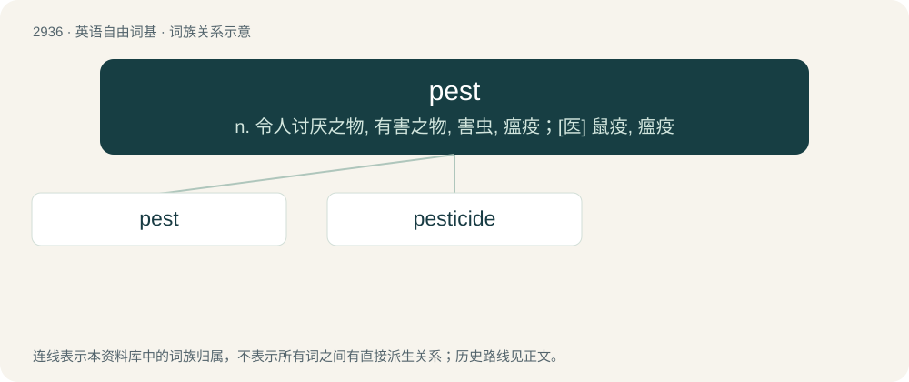

# 3045 · pest — n. 令人讨厌之物, 有害之物, 害虫, 瘟疫；\[医\] 鼠疫, 瘟疫

[总目录](../00_总目录_按常用程度.md)

**类型**：英语自由词基　｜　**来源语言**：见词源记录

## 核心含义与来源

- 核心含义：n. 令人讨厌之物, 有害之物, 害虫, 瘟疫；\[医\] 鼠疫, 瘟疫
- 英文含义：Any destructive insect that attacks crops or livestock; an agricultural pest.
- 词形：pest

**来源记录 1**（名词；Any destructive insect that attacks crops or livestock; an agricultural pest.）

In the 16th century in the sense of "pestilence" and specifically bubonic plague from Middle French peste (“pestilence”) (whence French peste). The other meanings are recorded soon after. Ultimately from Latin pestis.

## 词族图

## 单词速览（常用到不常用）

| 单词 | 音标 | 释义 |
|---|---|---|
| [pest](#w-1) | 英 /pɛst/ | n. 令人讨厌之物, 有害之物, 害虫, 瘟疫；\[医\] 鼠疫, 瘟疫 |
| [pesticide](#w-2) | 英 /ˈpɛstɪsaɪd/；美 /ˈpɛstɪˌsaɪd/ | n. 杀虫剂；\[化\] 农药 |

## 逐词详解

### 1. pest

**词性**：名词　｜　**音标**：英 /pɛst/

**中文释义**：n. 令人讨厌之物, 有害之物, 害虫, 瘟疫；\[医\] 鼠疫, 瘟疫

**英文义项**：Any destructive insect that attacks crops or livestock; an agricultural pest. / An annoying person, a nuisance.

**词源与演化**：

In the 16th century in the sense of "pestilence" and specifically bubonic plague from Middle French peste (“pestilence”) (whence French peste). The other meanings are recorded soon after. Ultimately from Latin pestis.

**例句**：

> Twenty million dollars are spent each year to fight this parasitic pest.

### 2. pesticide

**词性**：名词　｜　**音标**：英 /ˈpɛstɪsaɪd/；美 /ˈpɛstɪˌsaɪd/

**中文释义**：n. 杀虫剂；\[化\] 农药

**英文义项**：Anything, especially a synthetic substance but also any substance (e.g. sulfur), or virus, bacterium, or other organism, which kills or suppresses the activities of pests.

**构词拆分**：pest + -i- + -cide

**词源与演化**：

From pest + -i- + -cide.

**例句**：

> The pesticide degraded the health of the microbiome within the soil.
