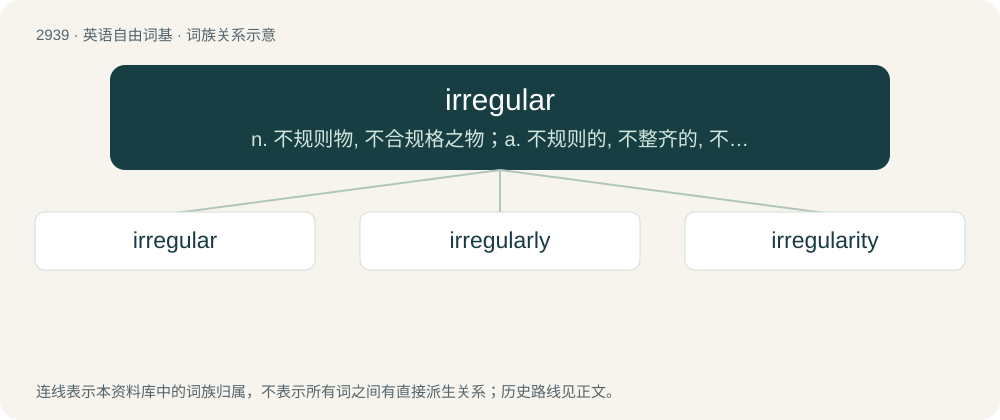

# 3047 · irregular — n. 不规则物, 不合规格之物；a. 不规则的, 不整齐的, 不合法的

[总目录](../00_总目录_按常用程度.md)

**类型**：英语自由词基　｜　**来源语言**：见词源记录

## 核心含义与来源

- 核心含义：n. 不规则物, 不合规格之物；a. 不规则的, 不整齐的, 不合法的
- 英文含义：Nonstandard; not conforming to rules or expectations.
- 词形：irregular

**来源记录 1**（形容词；Nonstandard; not conforming to rules or expectations.）

From Middle English irreguler, from Old French irreguler, from Medieval Latin or Late Latin irrēgulāris, from in- + regularis, equivalent to ir- + regular.

## 词族图

## 单词速览（常用到不常用）

| 单词 | 音标 | 释义 |
|---|---|---|
| [irregular](#w-1) | 英 /ɪˈɹɛɡ.jʊ.lə/；美 /ɪˈɹɛɡ.jə.lɚ/ | n. 不规则物, 不合规格之物；a. 不规则的, 不整齐的, 不合法的 |
| [irregularly](#w-2) | 英 /ɪˈɹɛɡjʊləli/ | adv. 不规则, 不整齐, 不合法 |
| [irregularity](#w-3) | 英 /ɪˌɹɛ.ɡjʊˈlæ.ɹɪ.ti/；/ɪˌɹɛ.ɡjəˈlɛɹ.ɪ.ti/ | n. 不规则, 例外, 违反规则的行为；\[化\] 不匀度 |

## 逐词详解

### 1. irregular

**词性**：形容词　｜　**音标**：英 /ɪˈɹɛɡ.jʊ.lə/；美 /ɪˈɹɛɡ.jə.lɚ/

**中文释义**：n. 不规则物, 不合规格之物；a. 不规则的, 不整齐的, 不合法的

**英文义项**：Nonstandard; not conforming to rules or expectations. / Of a surface, rough.

**构词拆分**：ir- + regular

**词源与演化**：

From Middle English irreguler, from Old French irreguler, from Medieval Latin or Late Latin irrēgulāris, from in- + regularis, equivalent to ir- + regular.

**例句**：

> "To buy" is an irregular English verb: its past simple and past participle tense is "bought".

该用例对应义项：Of a word, not following the regular or expected patterns of inflection in a given language.

### 2. irregularly

**词性**：副词　｜　**音标**：英 /ɪˈɹɛɡjʊləli/

**中文释义**：adv. 不规则, 不整齐, 不合法

**英文义项**：In an irregular manner; without rule, method, or order.

**构词拆分**：irregular + -ly

**词源与演化**：

From irregular + -ly.

**例句**：

> The stomach mucosa was irregularly blackened.

该用例对应义项：in an irregular manner

### 3. irregularity

**词性**：名词　｜　**音标**：英 /ɪˌɹɛ.ɡjʊˈlæ.ɹɪ.ti/；/ɪˌɹɛ.ɡjəˈlɛɹ.ɪ.ti/

**中文释义**：n. 不规则, 例外, 违反规则的行为；\[化\] 不匀度

**英文义项**：An instance of being irregular. / The state or condition of being irregular, or the extent to which something is irregular.

**构词拆分**：irregular + -ity

**词源与演化**：

From Middle French irrégularité, from Medieval Latin irregularitas. Morphologically irregular + -ity.

**用法示例／搭配（非完整句）**：

> an irregularity of surface

该用例对应义项：An object or event that is not regular or ordinary.
