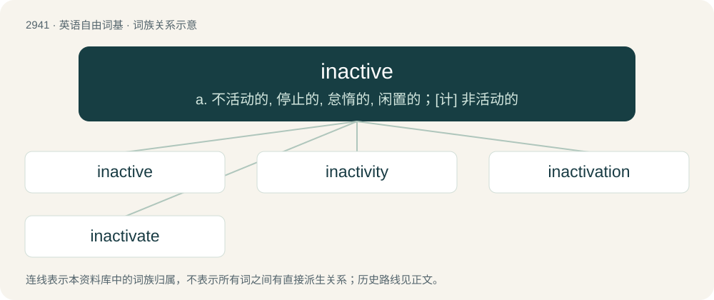

# 3049 · inactive — a. 不活动的, 停止的, 怠惰的, 闲置的；\[计\] 非活动的

[总目录](../00_总目录_按常用程度.md)

**类型**：英语自由词基　｜　**来源语言**：见词源记录

## 核心含义与来源

- 核心含义：a. 不活动的, 停止的, 怠惰的, 闲置的；\[计\] 非活动的
- 英文含义：Not active, temporarily or permanently.
- 词形：inactive

**来源记录 1**（形容词；Not active, temporarily or permanently.）

From French inactif. Piecewise doublet of unactive.

## 词族图

## 单词速览（常用到不常用）

| 单词 | 音标 | 释义 |
|---|---|---|
| [inactive](#w-1) | /ɪnˈæktɪv/ | a. 不活动的, 停止的, 怠惰的, 闲置的；\[计\] 非活动的 |
| [inactivity](#w-2) | /ˌɪn.ækˈtɪ.vɪ.ti/ | n. 不活动, 不活泼, 休止状态；\[经\] 商业呆滞 |
| [inactivation](#w-3) | /in,æktiˈveiʃən/ | n. 灭活, 失效；\[化\] 失活 |
| [inactivate](#w-4) | /ɪˈnæktɪveɪt/ | vt. 使不活动, 撤销, 使失去活性, 灭活；\[医\] 灭活, 使不活动 |

## 逐词详解

### 1. inactive

**词性**：形容词　｜　**音标**：/ɪnˈæktɪv/

**中文释义**：a. 不活动的, 停止的, 怠惰的, 闲置的；\[计\] 非活动的

**英文义项**：Not active, temporarily or permanently. / Not engaging in physical activity.

**词源与演化**：

From French inactif. Piecewise doublet of unactive.

**例句**：

> Synthetic glycine is optically inactive as it contains equal amounts of the d- and l- form.

该用例对应义项：Showing no optical activity in polarized light.

### 2. inactivity

**词性**：名词　｜　**音标**：/ˌɪn.ækˈtɪ.vɪ.ti/

**中文释义**：n. 不活动, 不活泼, 休止状态；\[经\] 商业呆滞

**英文义项**：The quality of being inactive; idleness; passiveness.

**构词拆分**：in- + activity + inactive + -ity；in- + activity；inactive + -ity

**词源与演化**：

From in- + activity or inactive + -ity.

**例句**：

> Now I'm trying to make up for my 5-year-long inactivity on Tatoeba.

### 3. inactivation

**词性**：名词　｜　**音标**：/in,æktiˈveiʃən/

**中文释义**：n. 灭活, 失效；\[化\] 失活

**英文义项**：The process of rendering something inactive.

**构词拆分**：inactive + -ation；in- + activation

**词源与演化**：

From in- + activation or inactive + -ation.

**例句**：

> The gene inactivation system.

该用例对应义项：the process of rendering inactive

### 4. inactivate

**词性**：动词　｜　**音标**：/ɪˈnæktɪveɪt/

**中文释义**：vt. 使不活动, 撤销, 使失去活性, 灭活；\[医\] 灭活, 使不活动

**英文义项**：To make inactive.

**构词拆分**：inactive + -ate；inactive + -ate (verb-forming suffix)；in- + activate

**词源与演化**：

From inactive + -ate (verb-forming suffix) or in- + activate.
