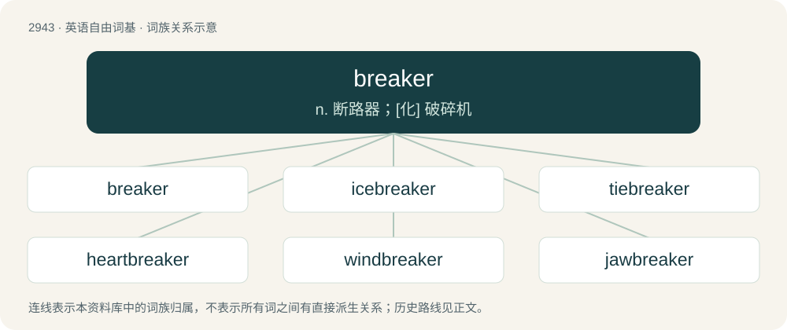

# 3051 · breaker — n. 断路器；\[化\] 破碎机

[总目录](../00_总目录_按常用程度.md)

**类型**：英语自由词基　｜　**来源语言**：见词源记录

## 核心含义与来源

- 核心含义：n. 断路器；\[化\] 破碎机
- 英文含义：Something that breaks (something else).
- 词形：breaker

**多个词源／构词路径**：同一拼写可能有不同来源；以下按词性和含义分别列出。

**来源记录 1**（名词；Something that breaks (something else).）

From Middle English breker, brekere, equivalent to break + -er. Cognate with Dutch breker, German Low German Breker, German Brecher.

**来源记录 2**（名词；A small cask of liquid kept permanently in a ship’s boat in case of shipwreck.）

Probably from Spanish barrica (“barrel”). Doublet of barrique.

## 词族图

## 单词速览（常用到不常用）

| 单词 | 音标 | 释义 |
|---|---|---|
| [breaker](#w-1) | 英 /ˈbɹeɪkə/；美 /ˈbɹeɪkɚ/ | n. 断路器；\[化\] 破碎机 |
| [icebreaker](#w-2) | 美 /ˈaɪsˌbɹeɪkəɹ/ | n. 碎冰船, 破冰设备 |
| [tiebreaker](#w-3) | 美 /ˈtaɪˌbɹeɪkɚ/ | n. 抢7决胜局； 线路中断器 |
| [heartbreaker](#w-4) | 英 /ˈhɑːt.bɹeɪ.kə/；美 /ˈhɑɹt.bɹeɪ.kɚ/ | n. 令人伤悲的人\[事物\]; \[戏谑语\]（女人的）一绺卷发; 权志龙solo专辑名 |
| [windbreaker](#w-5) | /ˈwɪndbɹeɪkə(ɹ)/ | n. 防风林, 防风茄克衫, 风衣 |
| [jawbreaker](#w-6) | /ˈdʒɒːbreikə/ | n. 难发音的字, 大块硬糖 |

## 逐词详解

### 1. breaker

**词性**：名词　｜　**音标**：英 /ˈbɹeɪkə/；美 /ˈbɹeɪkɚ/

**中文释义**：n. 断路器；\[化\] 破碎机

**英文义项**：Something that breaks (something else). / A machine for breaking rocks, or for breaking coal at the mines.

**构词拆分**：break + -er

**词源与演化**：

From Middle English breker, brekere, equivalent to break + -er. Cognate with Dutch breker, German Low German Breker, German Brecher.

**例句**：

> A: Is John at the tipple? B: No, he's at the breaker today.

该用例对应义项：The building in which such a machine is placed.

### 2. icebreaker

**词性**：名词　｜　**音标**：美 /ˈaɪsˌbɹeɪkəɹ/

**中文释义**：n. 碎冰船, 破冰设备

**英文义项**：A ship designed to break through ice so that it, or other ships coming behind, can navigate on frozen seas. / A game, activity, humorous anecdote, etc., designed to ease tension and encourage interaction among individuals in a situation where they do not know each other well.

**构词拆分**：ice + breaker

**词源与演化**：

From ice + breaker, in the figurative sense from the expression to break the ice.

**例句**：

> The new college hallmates were awkward with each other at first, but after a game of charades as an icebreaker, they were laughing like old friends.

该用例对应义项：A game, activity, humorous anecdote, etc., designed to ease tension and encourage interaction among individuals in a situation where they do not know each other well.

### 3. tiebreaker

**词性**：名词　｜　**音标**：美 /ˈtaɪˌbɹeɪkɚ/

**中文释义**：n. 抢7决胜局； 线路中断器

**英文义项**：Something that is used to pick a winner from a tied situation.

**构词拆分**：tie + breaker

**词源与演化**：

From tie + breaker.

**例句**：

> In the first set, both players scored the same number of points and the decision went to the tiebreaker.

### 4. heartbreaker

**词性**：名词　｜　**音标**：英 /ˈhɑːt.bɹeɪ.kə/；美 /ˈhɑɹt.bɹeɪ.kɚ/

**中文释义**：n. 令人伤悲的人\[事物\]; \[戏谑语\]（女人的）一绺卷发; 权志龙solo专辑名

**英文义项**：A person, usually attractive, who flirts with or otherwise enamours another person, but does not reciprocate their love. / Something that causes sorrow, grief or extreme disappointment.

**构词拆分**：heart + breaker

**词源与演化**：

From heart + breaker.

**例句**：

> The famous actor and heartbreaker admits that he's finally settled down.

### 5. windbreaker

**词性**：名词　｜　**音标**：/ˈwɪndbɹeɪkə(ɹ)/

**中文释义**：n. 防风林, 防风茄克衫, 风衣

**英文义项**：A thin jacket designed to resist wind chill and light rain.

**构词拆分**：wind + breaker

**词源与演化**：

From wind + breaker, from a trademark of the John Rissman company.

**例句**：

> The windbreaker protected Adriano from the cold wind.

### 6. jawbreaker

**词性**：名词　｜　**音标**：/ˈdʒɒːbreikə/

**中文释义**：n. 难发音的字, 大块硬糖

**英文义项**：A large, extremely hard, boiled candy, typically spherical. / A long, hard-to-pronounce word.

**构词拆分**：jaw + breaker

**词源与演化**：

From jaw + breaker.

**例句**：

> The word “callipygous” is something of a jawbreaker.

该用例对应义项：A long, hard-to-pronounce word.
