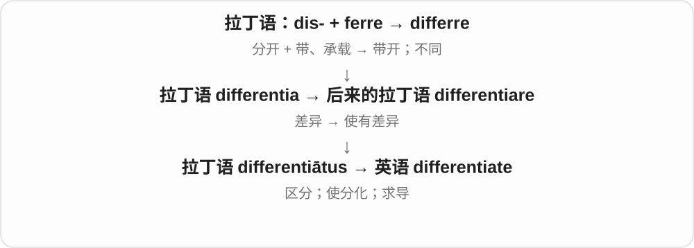
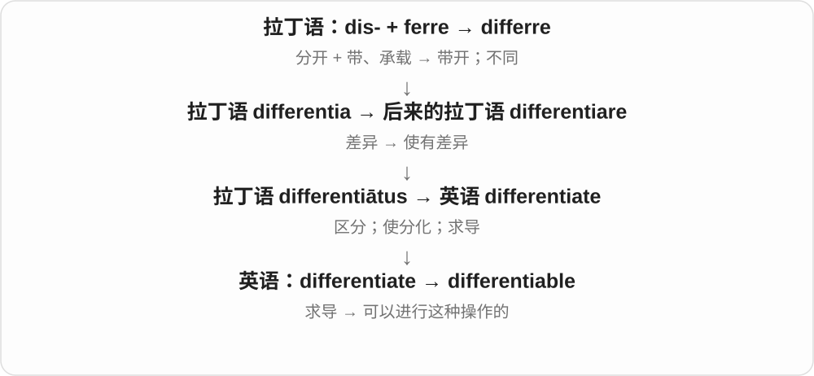

# 3052 · differentiate — 使有差别、认出差别，名词和可区分性质按作用展开

[逐词精讲目录](../00_逐词精讲目录.md) · [总目录](../00_总目录_按常用程度.md)

## 核心词根与来源

differentiation 可说差异化过程，differentiator 可说让它不同的因素。数学里的 differentiate、differentiable 又有微分专门意义，不能只靠商业中文替代。

**DIFFERENTIATE：把看似相近的对象分出不同**

differentiate → differentiation、differentiator、differentiable；基础动作与技术专义各见对应词条。

- **差异化动作、过程与因素**：differentiate · differentiation · differentiator
- **可区分或数学专门性质**：differentiable

## 词形与演化规律

different 相关词族 → differentiate；-ation 过程，-or 因素、工具或执行者，-able 相应能力或技术性质。

## 单词速览（按词族由简到繁）

同一基础词的相关扩展放在一起，先读基础形式，再读扩展；各组之间优先读常用的。具体词源关系见各词讲解。

| 单词 | 音标 | 核心意思 |
|---|---|---|
| [differentiate](#w-1) | /ˌdɪfəˈrenʃieɪt/ | 区分；使有差别；分化；求导 |
| [differentiation](#w-2) | /ˌdɪfərenʃiˈeɪʃən/ | 区分；差异化；分化；求导 |
| [differentiable](#w-3) | /ˌdɪfəˈrenʃəbəl/ | 可微的；可求导的 |
| [differentiator](#w-4) | 英 /ˌdɪfəˈrenʃieɪtə/；美 /ˌdɪfəˈrenʃieɪtər/ | 区别因素、差异化特点；区分者、工具 |

## 逐词讲解

### 1. differentiate — 区分；使有差别；分化；求导

**音标**：/ˌdɪfəˈrenʃieɪt/

**先抓住这个画面**

原来像一团混在一起的东西，经过观察或发展，开始看出各自不同。可以是你分辨差别，也可以是对象自己分化。

**怎么拆**

来自后来的拉丁语 differentiātus，出自 differentiare，根为 differentia“差别”。不是从现代 different 随意加字母。

**怎么变成今天的意思**

differentiate A from B 是把A和B区分；细胞 differentiate 是逐渐形成专门功能；数学里 differentiate a function 是求导。三种语境要分别学。

**常见搭配与例句**

differentiate between；differentiate from；differentiate with respect to x。

> The labels help customers differentiate the two products.

标签帮助顾客区分这两种产品。

> Differentiate x squared with respect to x to obtain 2x.

对x的平方关于x求导，得到2x。

**别混淆**

differ 是本来不同；differentiate 是辨别、造成这种差别，或专门的求导操作。

### 2. differentiation — 区分；差异化；分化；求导

**音标**：/ˌdɪfərenʃiˈeɪʃən/

**先抓住这个画面**

从“看起来一样、作用差不多”到“各有特点和分工”的过程。数学里则是计算导数这个操作的名称。

**怎么拆**

differentiate + -ion，英语动作名词；早期用例有数学背景。

**怎么变成今天的意思**

product differentiation 是让产品形成可识别的差别；cell differentiation 是细胞形成特定结构与功能。它不自动等于等级高低。

**常见搭配与例句**

product differentiation；cell differentiation；differentiation rules。

> Better service became the company’s main source of differentiation.

更好的服务成了这家公司区别于同行的主要特点。

> The lesson introduces differentiation through simple functions.

这节课通过简单函数介绍求导。

**别混淆**

difference 是差别本身；differentiation 是形成、辨明差别的过程，或数学求导。

### 3. differentiable — 可微的；可求导的

**音标**：/ˌdɪfəˈrenʃəbəl/

**先抓住这个画面**

放大曲线某一点附近，能找到一个稳定的局部变化率。在一元函数的基础情形里，这就是可求导。

**怎么拆**

differentiate 与 -able 形成的形容词，词干使用 differentia-；不能按长动词原样加 -able 再照字母读。

**怎么变成今天的意思**

在一点可微就在那里连续；反过来未必。y=|x| 在0处连续，却有一个尖角，左右斜率不同，所以在那里不可微。

**常见搭配与例句**

differentiable at a point；continuously differentiable。

> The function is differentiable at every point on this interval.

这个函数在该区间每一点都可微。

> The absolute value function is not differentiable at zero.

绝对值函数在零点不可微。

**别混淆**

continuous 是不断开；differentiable 还要求相应的局部线性近似或导数存在。

### 4. differentiator — 区别因素、差异化特点；区分者、工具

**音标**：英 /ˌdɪfəˈrenʃieɪtə/；美 /ˌdɪfəˈrenʃieɪtər/

**先抓住这个画面**

同类产品看起来都差不多，有一项特点让它显得不一样，那项特点就是 a differentiator。它不必是人，服务、设计、能力都可承担区分作用。

**怎么拆**

differentiate 去末尾 e + -or，使用 differentiat- 词干，形成使有区别、实施区分的事物、执行者名。专门技术里也有相应工具含义。

**怎么变成今天的意思**

**differentiate 区分、使差异化 → differentiator**  
使对象显出区别的因素、人或工具

↓

**differentiate 的 differentiat- 词干 + -or**  
现代常用来讲竞争中的区别特点

a key differentiator 关键差异化特点；a major differentiator 主要区别因素。

**常见搭配与例句**

a key differentiator；a major differentiator。

> Reliable service became the company’s key differentiator.

可靠服务成了这家公司的关键差异化特点。

> The review identified design as the main differentiator.

评测认为设计是主要区别因素。

**别混淆**

difference 是差别本身，differentiator 常是造成、体现区别的那个特点或因素。

## 这一组要分清什么

difference 差别与 differentiator 区别因素不同；数学微分义要按具体学科读。

## 串起来练习

The feature differentiates the products and acts as a key differentiator.

这项特点把产品区分开来，构成关键差异化因素。
