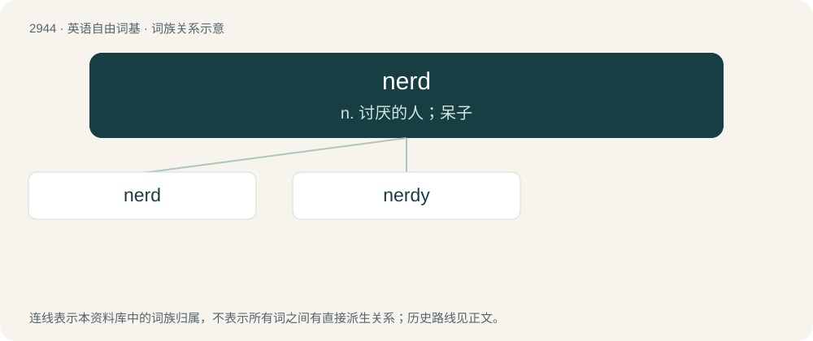

# 3052 · nerd — n. 讨厌的人；呆子

[总目录](../00_总目录_按常用程度.md)

**类型**：英语自由词基　｜　**来源语言**：见词源记录

## 核心含义与来源

- 核心含义：n. 讨厌的人；呆子
- 英文含义：A person who is intellectual but generally introverted.
- 词形：nerd

**来源记录 1**（名词；A person who is intellectual but generally introverted.）

Unknown. Attested since 1951 as US student slang. \* Perhaps an alteration of nerts (“nuts", "crazy”); see references below. \* The word, capitalized, appeared in 1950 in Dr. Seuss’s If I Ran the Zoo as the name of an imaginary animal: \*: And then, just to show them, I’ll sail to Katroo / And bring back an It-Kutch, a Preep and a Proo, / A Nerkle, a Nerd and a Seersucker too! \* Possibly a rebracketing of inert as a nert, as in he's inert = he's a nerd, in reference to one's lack of competence or athletic ability. \* Various unlikely folk etymologies and less likely backronymic speculations also exist.

## 词族图

## 单词速览（常用到不常用）

| 单词 | 音标 | 释义 |
|---|---|---|
| [nerd](#w-1) | 英 /nɜːd/；美 /nɝd/ | n. 讨厌的人；呆子 |
| [nerdy](#w-2) | /ˈnɜː(ɹ)di/ | a. 傻瓜似的；蠢的 |

## 逐词详解

### 1. nerd

**词性**：名词　｜　**音标**：英 /nɜːd/；美 /nɝd/

**中文释义**：n. 讨厌的人；呆子

**英文义项**：A person who is intellectual but generally introverted. / One who has an intense, obsessive interest in something.

**词源与演化**：

Unknown. Attested since 1951 as US student slang. \* Perhaps an alteration of nerts (“nuts", "crazy”); see references below. \* The word, capitalized, appeared in 1950 in Dr. Seuss’s If I Ran the Zoo as the name of an imaginary animal: \*: And then, just to show them, I’ll sail to Katroo / And bring back an It-Kutch, a Preep and a Proo, / A Nerkle, a Nerd and a Seersucker too! \* Possibly a rebracketing of inert as a nert, as in he's inert = he's a nerd, in reference to one's lack of competence or athletic ability. \* Various unlikely folk etymologies and less likely backronymic speculations also exist.

**例句**：

> The bullies used to call him a nerd at school.

该用例对应义项：A person who is intellectual but generally introverted.

### 2. nerdy

**词性**：形容词　｜　**音标**：/ˈnɜː(ɹ)di/

**中文释义**：a. 傻瓜似的；蠢的

**英文义项**：Being or like a nerd. / Of, pertaining to, in the style of, or appealing to nerds.

**构词拆分**：nerd + -y

**词源与演化**：

From nerd + -y.

**例句**：

> I got a pair of nerdy glasses and clothes for Halloween.

该用例对应义项：Of, pertaining to, in the style of, or appealing to nerds.
