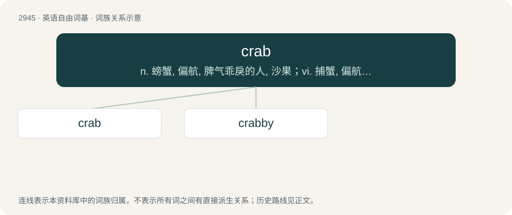

# 3053 · crab — n. 螃蟹, 偏航, 脾气乖戾的人, 沙果；vi. 捕蟹, 偏航, 发牢骚；vt. 使偏航, 抱怨, 破坏

[总目录](../00_总目录_按常用程度.md)

**类型**：英语自由词基　｜　**来源语言**：见词源记录

## 核心含义与来源

- 核心含义：n. 螃蟹, 偏航, 脾气乖戾的人, 沙果；vi. 捕蟹, 偏航, 发牢骚；vt. 使偏航, 抱怨, 破坏
- 英文含义：Any crustacean of the infraorder Brachyura, having five pairs of legs, the foremost of which are in the form of claws, and a carapace.
- 词形：crab

**多个词源／构词路径**：同一拼写可能有不同来源；以下按词性和含义分别列出。

**来源记录 1**（名词；Any crustacean of the infraorder Brachyura, having five pairs of legs, the foremost of which are in the form of claws, and a carapace.）

From Middle English crabbe, from Old English crabba (“crab; crayfish; cancer”), from Proto-West Germanic \*krabbō, from Proto-Germanic \*krabbô, from \*krabbōną (“to scratch”), from Proto-Indo-European \*grobʰeh₂yéti (“to scratch”), a metathesised o-grade of \*gerbʰ- (“to carve, scratch”). More at carve. Cognates See also Dutch krab, Low German Krabb, Danish krabbe, Swedish krabba. Further cognates with frequentative-infix are Saterland Frisian krabbelje (“to creep, crawl”), Dutch krabbelen (“to scratch”) and German krabbeln (“to crawl”). Possibly related to English creep and Swedish krypa (“to creep, crawl”) etc. Other origins have also been suggested, see Ancient Greek κάραβος (kárabos) (regarding the possibility of a substrate origin) and Persian خرچنگ (regarding possible ideophonic origin); compare also Old Armenian քարբ (kʻarb), German Krebs.

**来源记录 2**（名词；A crab apple or wild apple.）

From Middle English crabbe (“wild apple”), of Germanic origin, plausibly from North Germanic, cognate with Swedish dialect skrabba (“sour apple, apple cart”).

**来源记录 3**（名词；The tree species Carapa guianensis, native to South America.）

Possibly a corruption of the genus name Carapa

## 词族图

## 单词速览（常用到不常用）

| 单词 | 音标 | 释义 |
|---|---|---|
| [crab](#w-1) | 英 /kɹæb/ | n. 螃蟹, 偏航, 脾气乖戾的人, 沙果；vi. 捕蟹, 偏航, 发牢骚；vt. 使偏航, 抱怨, 破坏 |
| [crabby](#w-2) | /ˈkɹæb.i/ | a. 脾气坏的, 易怒的, 坏脾气的 |

## 逐词详解

### 1. crab

**词性**：名词　｜　**音标**：英 /kɹæb/

**中文释义**：n. 螃蟹, 偏航, 脾气乖戾的人, 沙果；vi. 捕蟹, 偏航, 发牢骚；vt. 使偏航, 抱怨, 破坏

**英文义项**：Any crustacean of the infraorder Brachyura, having five pairs of legs, the foremost of which are in the form of claws, and a carapace. / The meat of this crustacean, served as food; crabmeat.

**词源与演化**：

From Middle English crabbe, from Old English crabba (“crab; crayfish; cancer”), from Proto-West Germanic \*krabbō, from Proto-Germanic \*krabbô, from \*krabbōną (“to scratch”), from Proto-Indo-European \*grobʰeh₂yéti (“to scratch”), a metathesised o-grade of \*gerbʰ- (“to carve, scratch”). More at carve. Cognates See also Dutch krab, Low German Krabb, Danish krabbe, Swedish krabba. Further cognates with frequentative-infix are Saterland Frisian krabbelje (“to creep, crawl”), Dutch krabbelen (“to scratch”) and German krabbeln (“to crawl”). Possibly related to English creep and Swedish krypa (“to creep, crawl”) etc. Other origins have also been suggested, see Ancient Greek κάραβος (kárabos) (regarding the possibility of a substrate origin) and Persian خرچنگ (regarding possible ideophonic origin); compare also Old Armenian քարբ (kʻarb), German Krebs.

**例句**：

> Although crabs themselves are an easily treated inconvenience, the patient and his partner(s) clearly run major STD risks.

该用例对应义项：An infestation of pubic lice (Pthirus pubis).

### 2. crabby

**词性**：形容词　｜　**音标**：/ˈkɹæb.i/

**中文释义**：a. 脾气坏的, 易怒的, 坏脾气的

**英文义项**：Relating to or resembling crabs; crablike. / Abounding with crabs.

**构词拆分**：crab + -y

**词源与演化**：

From crab + -y.

**例句**：

> You're being one crabby cracker this morning. Did you get enough sleep?
