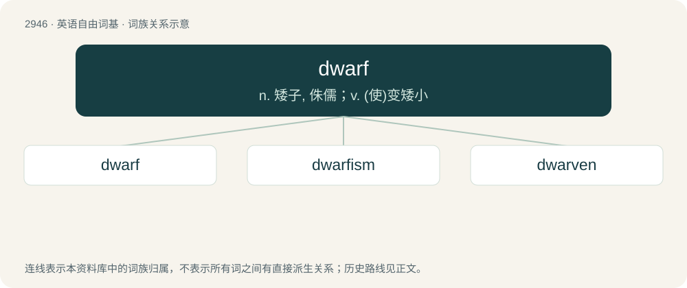

# 3054 · dwarf — n. 矮子, 侏儒；v. (使)变矮小

[总目录](../00_总目录_按常用程度.md)

**类型**：英语自由词基　｜　**来源语言**：见词源记录

## 核心含义与来源

- 核心含义：n. 矮子, 侏儒；v. (使)变矮小
- 英文含义：Any member of a race of beings from (especially Scandinavian and other Germanic) folklore, usually depicted as having some sort of supernatural powers and being skilled in crafting and metalworking, often as short with long beards, and sometimes as clashing with elves.
- 词形：dwarf

**来源记录 1**（名词；Any member of a race of beings from (especially Scandinavian and other Germanic) folklore, usually depicted as having some sort of supernatural powers and being skilled in crafting and metalworking, often as short with long beards, and sometimes as clashing with elves.）

From Middle English dwergh, dwerw, dwerf, from Old English dweorg, from Proto-West Germanic \*dwerg, from Proto-Germanic \*dwergaz. Cognate with Scots droich, dwerch (“dwarf, midget”); Old High German twerc (German, Luxembourgish Zwerg (“dwarf”)); Old Norse dvergr (Danish dværg (“dwarf, midget”), Faroese dvørgur (“dwarf”), Icelandic dvergur (“dwarf”), Norwegian Bokmål dverg (“dwarf”), Norwegian Nynorsk dverg, verg (“dwarf”), Swedish dvärg (“dwarf”)); Old Frisian dwirg (Saterland Frisian Dwärch (“dwarf”), West Frisian dwerch (“dwarf”)); Middle Low German dwerch, dwarch, twerg (German Low German Dwarg (“dwarf”)); Middle Dutch dwerch, dworch (Dutch dwerg (“dwarf”)). The Modern English noun has undergone complex phonetic changes. The form dwarf is the regular continuation of Old English dweorg, but the plural dweorgas would have given rise to dwarrows and the oblique stem dweorge- would have led to dwery. These forms are sometimes found as the nominative singular in Middle English texts and in English dialects. A parallel case is that of Old English burg giving burgh, borough, burrow, bury.

## 词族图

## 单词速览（常用到不常用）

| 单词 | 音标 | 释义 |
|---|---|---|
| [dwarf](#w-1) | 英 /dwɔːf/；美 /dwɔɹf/ | n. 矮子, 侏儒；v. (使)变矮小 |
| [dwarfism](#w-2) | 英 /ˈdwɔːfɪzəm/；美 /ˈdwɔɹfɪzəm/ | n. 矮小 |
| [dwarven](#w-3) |  | 【英文】Similar to a dwarf, for example in stature. |

## 逐词详解

### 1. dwarf

**词性**：名词　｜　**音标**：英 /dwɔːf/；美 /dwɔɹf/

**中文释义**：n. 矮子, 侏儒；v. (使)变矮小

**英文义项**：Any member of a race of beings from (especially Scandinavian and other Germanic) folklore, usually depicted as having some sort of supernatural powers and being skilled in crafting and metalworking, often as short with long beards, and sometimes as clashing with elves. / A person of short stature, often one whose limbs are disproportionately small in relation to the body as compared with typical adults, usually as the result of a genetic condition.

**词源与演化**：

From Middle English dwergh, dwerw, dwerf, from Old English dweorg, from Proto-West Germanic \*dwerg, from Proto-Germanic \*dwergaz. Cognate with Scots droich, dwerch (“dwarf, midget”); Old High German twerc (German, Luxembourgish Zwerg (“dwarf”)); Old Norse dvergr (Danish dværg (“dwarf, midget”), Faroese dvørgur (“dwarf”), Icelandic dvergur (“dwarf”), Norwegian Bokmål dverg (“dwarf”), Norwegian Nynorsk dverg, verg (“dwarf”), Swedish dvärg (“dwarf”)); Old Frisian dwirg (Saterland Frisian Dwärch (“dwarf”), West Frisian dwerch (“dwarf”)); Middle Low German dwerch, dwarch, twerg (German Low German Dwarg (“dwarf”)); Middle Dutch dwerch, dworch (Dutch dwerg (“dwarf”)). The Modern English noun has undergone complex phonetic changes. The form dwarf is the regular continuation of Old English dweorg, but the plural dweorgas would have given rise to dwarrows and the oblique stem dweorge- would have led to dwery. These forms are sometimes found as the nominative singular in Middle English texts and in English dialects. A parallel case is that of Old English burg giving burgh, borough, burrow, bury.

**用法示例／搭配（非完整句）**：

> dwarf honeysuckle

该用例对应义项：An animal, plant or other thing much smaller than the usual of its sort.

### 2. dwarfism

**词性**：名词　｜　**音标**：英 /ˈdwɔːfɪzəm/；美 /ˈdwɔɹfɪzəm/

**中文释义**：n. 矮小

**英文义项**：The condition of being a dwarf (person of short stature). / The quality of being puny or inferior.

**构词拆分**：dwarf + -ism

**词源与演化**：

From dwarf + -ism.

### 3. dwarven

**词性**：形容词

**英文义项**：Similar to a dwarf, for example in stature. / Of, pertaining to, or made by or for dwarfs/dwarves.

**构词拆分**：dwarf + -en

**词源与演化**：

From dwarv(es) + -en.
