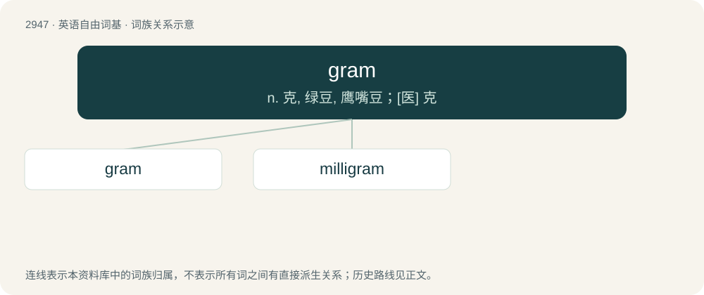

# 3055 · gram — n. 克, 绿豆, 鹰嘴豆；\[医\] 克

[总目录](../00_总目录_按常用程度.md)

**类型**：英语自由词基　｜　**来源语言**：见词源记录

## 核心含义与来源

- 核心含义：n. 克, 绿豆, 鹰嘴豆；\[医\] 克
- 英文含义：A unit of mass equal to one-thousandth of a kilogram. Symbol: g.
- 词形：gram

**多个词源／构词路径**：同一拼写可能有不同来源；以下按词性和含义分别列出。

**来源记录 1**（名词；A unit of mass equal to one-thousandth of a kilogram. Symbol: g.）

From French gramme, from Ancient Greek γράμμα (grámma, “a small weight, a scruple”). Doublet of gramma.

**来源记录 2**（名词；A leguminous plant grown for its seeds, especially the chickpea.）

From obsolete Portuguese gram (modern Portuguese grão), from Latin grānum. Doublet of corn, grain, granum, and grao.

**来源记录 3**（名词；Grandmother.）

Clipping of gramma.

**来源记录 4**（名词；A gramophone recording.）

Clipping of gramophone.

## 词族图

## 单词速览（常用到不常用）

| 单词 | 音标 | 释义 |
|---|---|---|
| [gram](#w-1) | /ˈɡɹæm/ | n. 克, 绿豆, 鹰嘴豆；\[医\] 克 |
| [milligram](#w-2) | 美 /ˈmɪlɪɡɹæm/ | n. 毫克；\[电\] 毫克 |

## 逐词详解

### 1. gram

**词性**：名词　｜　**音标**：/ˈɡɹæm/

**中文释义**：n. 克, 绿豆, 鹰嘴豆；\[医\] 克

**英文义项**：A unit of mass equal to one-thousandth of a kilogram. Symbol: g.

**词源与演化**：

From French gramme, from Ancient Greek γράμμα (grámma, “a small weight, a scruple”). Doublet of gramma.

**例句**：

> My wife gave birth prematurely to a 1,500-gram baby girl.

### 2. milligram

**词性**：名词　｜　**音标**：美 /ˈmɪlɪɡɹæm/

**中文释义**：n. 毫克；\[电\] 毫克

**英文义项**：An SI unit of mass equal to 10⁻³ grams. Symbol: mg

**构词拆分**：milli- + gram

**词源与演化**：

Borrowed from French milligramme, equivalent to milli- + gram.
