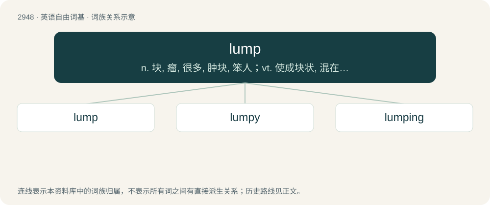

# 3056 · lump — n. 块, 瘤, 很多, 肿块, 笨人；vt. 使成块状, 混在一起；vi. 结块

[总目录](../00_总目录_按常用程度.md)

**类型**：英语自由词基　｜　**来源语言**：见词源记录

## 核心含义与来源

- 核心含义：n. 块, 瘤, 很多, 肿块, 笨人；vt. 使成块状, 混在一起；vi. 结块
- 英文含义：Something that protrudes, sticks out, or sticks together; a cluster or blob; a mound or mass of no particular shape.
- 词形：lump

**来源记录 1**（名词；Something that protrudes, sticks out, or sticks together; a cluster or blob; a mound or mass of no particular shape.）

From Middle English lumpe, from a Germanic base akin to Proto-Germanic \*limpaną (“to glide, go, hang loosely”). Compare Dutch lomp (“rag”), German Low German Lump (“rag”), German Lumpen (“rag”) and Lump (“ragamuffin”).

## 词族图

## 单词速览（常用到不常用）

| 单词 | 音标 | 释义 |
|---|---|---|
| [lump](#w-1) | /lʌmp/ | n. 块, 瘤, 很多, 肿块, 笨人；vt. 使成块状, 混在一起；vi. 结块 |
| [lumpy](#w-2) | /ˈlʌmpi/ | a. 多瘤的, 波浪起伏的, 粗笨的 |
| [lumping](#w-3) | 英 /ˈlʌmpɪŋ/ | a. 结成一团的, 重的, 大的；\[化\] 结块 |

## 逐词详解

### 1. lump

**词性**：名词　｜　**音标**：/lʌmp/

**中文释义**：n. 块, 瘤, 很多, 肿块, 笨人；vt. 使成块状, 混在一起；vi. 结块

**英文义项**：Something that protrudes, sticks out, or sticks together; a cluster or blob; a mound or mass of no particular shape. / A swelling or nodule of tissue under the skin or in an internal part of the body.

**词源与演化**：

From Middle English lumpe, from a Germanic base akin to Proto-Germanic \*limpaną (“to glide, go, hang loosely”). Compare Dutch lomp (“rag”), German Low German Lump (“rag”), German Lumpen (“rag”) and Lump (“ragamuffin”).

**例句**：

> The money arrived all at once as one big lump sum payment.

该用例对应义项：A group, set, or unit.

### 2. lumpy

**词性**：形容词　｜　**音标**：/ˈlʌmpi/

**中文释义**：a. 多瘤的, 波浪起伏的, 粗笨的

**英文义项**：Full of lumps, not smooth, uneven. / Of a water surface: covered in many small waves as a result of wind; choppy.

**构词拆分**：lump + -y

**词源与演化**：

From lump + -y.

**例句**：

> I don't know which was worse, the lumpy soup or the lumpy bed.

该用例对应义项：Full of lumps, not smooth, uneven.

### 3. lumping

**词性**：形容词　｜　**音标**：英 /ˈlʌmpɪŋ/

**中文释义**：a. 结成一团的, 重的, 大的；\[化\] 结块

**英文义项**：Bulky; heavy.

**构词拆分**：lump + -ing

**词源与演化**：

From lump + -ing.

**用法示例／搭配（非完整句）**：

> a lumping great thing

该用例对应义项：Bulky; heavy.
