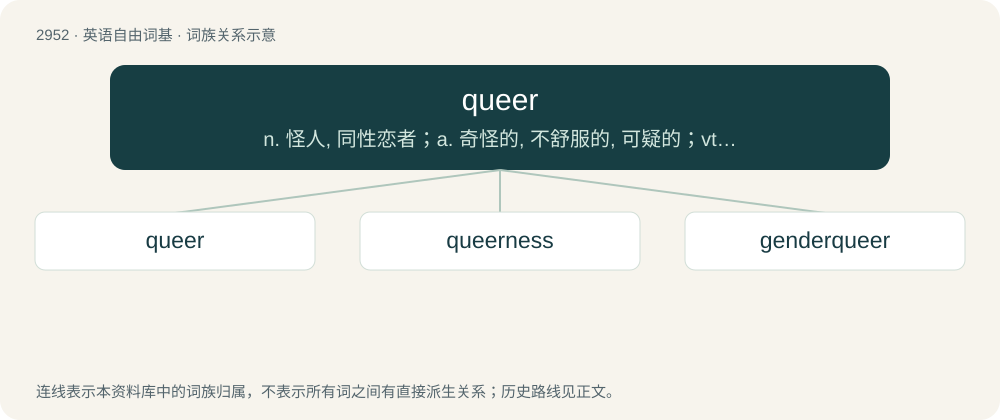

# 3059 · queer — n. 怪人, 同性恋者；a. 奇怪的, 不舒服的, 可疑的；vt. 搞糟

[总目录](../00_总目录_按常用程度.md)

**类型**：英语自由词基　｜　**来源语言**：见词源记录

## 核心含义与来源

- 核心含义：n. 怪人, 同性恋者；a. 奇怪的, 不舒服的, 可疑的；vt. 搞糟
- 英文含义：Homosexual.
- 词形：queer

**来源记录 1**（形容词；Homosexual.）

Attested since about 1510, at first in Scots. Usually taken to be from Middle Low German (Brunswick dialect) queer (“oblique, off-centre”) or the related German quer (“diagonal”), from Old Saxon thwerh, from Proto-West Germanic \*þwerh, from Proto-Germanic \*þwerhaz, from Proto-Indo-European \*terkʷ- (“to turn, twist, wind”); compare Latin torqueō, and see more at thwart. The OED argues against this due to the semantic differences and the date at which the word appears in Scots. Began to be used to describe gay people in the late 1800s; see usage notes for more.

## 词族图

## 单词速览（常用到不常用）

| 单词 | 音标 | 释义 |
|---|---|---|
| [queer](#w-1) | 英 /kwɪə/；美 /kwɪɹ/ | n. 怪人, 同性恋者；a. 奇怪的, 不舒服的, 可疑的；vt. 搞糟 |
| [queerness](#w-2) | /ˈkwiənis/ | n. 奇妙, 不舒服 |
| [genderqueer](#w-3) |  | 【英文】Not exclusively male or female; having or pertaining to a gender identity which is not represented by the gender binary. |

## 逐词详解

### 1. queer

**词性**：形容词　｜　**音标**：英 /kwɪə/；美 /kwɪɹ/

**中文释义**：n. 怪人, 同性恋者；a. 奇怪的, 不舒服的, 可疑的；vt. 搞糟

**英文义项**：Homosexual. / Non-heterosexual or non-cisgender: homosexual, bisexual, asexual, transgender, etc.

**词源与演化**：

Attested since about 1510, at first in Scots. Usually taken to be from Middle Low German (Brunswick dialect) queer (“oblique, off-centre”) or the related German quer (“diagonal”), from Old Saxon thwerh, from Proto-West Germanic \*þwerh, from Proto-Germanic \*þwerhaz, from Proto-Indo-European \*terkʷ- (“to turn, twist, wind”); compare Latin torqueō, and see more at thwart. The OED argues against this due to the semantic differences and the date at which the word appears in Scots. Began to be used to describe gay people in the late 1800s; see usage notes for more.

**例句**：

> I felt queer after eating those shrimp.

该用例对应义项：Slightly unwell.

### 2. queerness

**词性**：名词　｜　**音标**：/ˈkwiənis/

**中文释义**：n. 奇妙, 不舒服

**英文义项**：The quality of being queer or odd. / Something queer; an oddity.

**构词拆分**：queer + -ness

**词源与演化**：

From queer + -ness.

**例句**：

> If you have to tolerate my queerness, you're missing the point entirely.

### 3. genderqueer

**词性**：形容词

**英文义项**：Not exclusively male or female; having or pertaining to a gender identity which is not represented by the gender binary.

**构词拆分**：gender + queer

**词源与演化**：

From gender + queer. First known uses were in queer zines of the 1980s. Popularized in the 1990s including by Riki Wilchins.

**例句**：

> I used to be really cis, but by now I've become pretty genderqueer.
