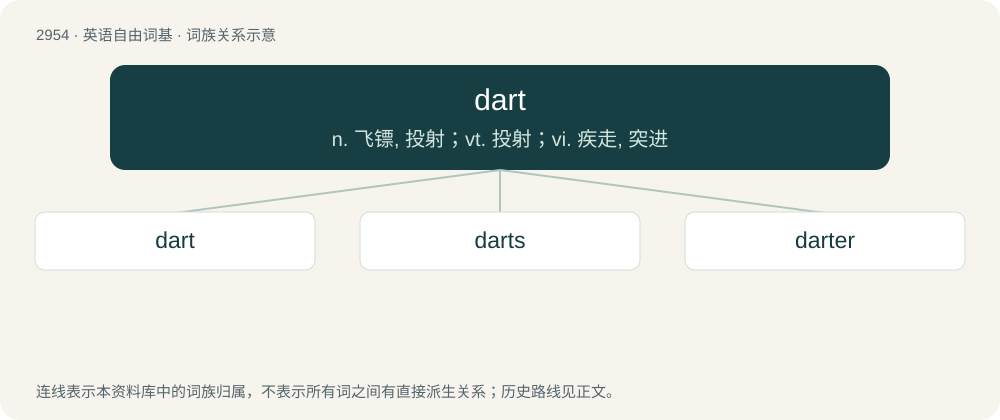

# 3060 · dart — n. 飞镖, 投射；vt. 投射；vi. 疾走, 突进

[总目录](../00_总目录_按常用程度.md)

**类型**：英语自由词基　｜　**来源语言**：见词源记录

## 核心含义与来源

- 核心含义：n. 飞镖, 投射；vt. 投射；vi. 疾走, 突进
- 英文含义：A pointed missile weapon, intended to be thrown by the hand; for example, a short lance or javelin.
- 词形：dart

**多个词源／构词路径**：同一拼写可能有不同来源；以下按词性和含义分别列出。

**来源记录 1**（名词；A pointed missile weapon, intended to be thrown by the hand; for example, a short lance or javelin.）

From Middle English dart, from Old French dart, dard (“dart”), from Medieval Latin dardus, from Frankish \*darōþu (“dart, spear”), from Proto-Germanic \*darōþuz (“dart, spear”), from Proto-Indo-European \*dʰerh₃- (“to leap, spring”). Compare Old High German tart (“javelin, dart”), Old English daroþ, dearod (“javelin, spear, dart”), Swedish dart (“dart, dagger”), Icelandic darraður, darr, dör (“dart, spear”).

**来源记录 2**（动词；To throw with a sudden effort or thrust; to hurl or launch.）

From Middle English darten, from the noun (see above).

## 词族图

## 单词速览（常用到不常用）

| 单词 | 音标 | 释义 |
|---|---|---|
| [dart](#w-1) | 英 /dɑːt/；美 /dɑɹt/ | n. 飞镖, 投射；vt. 投射；vi. 疾走, 突进 |
| [darts](#w-2) | 英 /ˈdɑːts/ | n. 掷镖游戏 |
| [darter](#w-3) | /ˈdɑːtə/ | n. 突进者, 突进物 |

## 逐词详解

### 1. dart

**词性**：名词　｜　**音标**：英 /dɑːt/；美 /dɑɹt/

**中文释义**：n. 飞镖, 投射；vt. 投射；vi. 疾走, 突进

**英文义项**：A pointed missile weapon, intended to be thrown by the hand; for example, a short lance or javelin. / Any sharp-pointed missile weapon, such as an arrow.

**词源与演化**：

From Middle English dart, from Old French dart, dard (“dart”), from Medieval Latin dardus, from Frankish \*darōþu (“dart, spear”), from Proto-Germanic \*darōþuz (“dart, spear”), from Proto-Indo-European \*dʰerh₃- (“to leap, spring”). Compare Old High German tart (“javelin, dart”), Old English daroþ, dearod (“javelin, spear, dart”), Swedish dart (“dart, dagger”), Icelandic darraður, darr, dör (“dart, spear”).

**例句**：

> Soon as I felt the floor tremor I made a dart for the door.

该用例对应义项：A sudden or fast movement.

### 2. darts

**词性**：名词　｜　**音标**：英 /ˈdɑːts/

**中文释义**：n. 掷镖游戏

**英文义项**：A game or sport in which darts are thrown at a board, and points are scored depending on where the darts land.

**构词拆分**：dart + -s

**词源与演化**：

From dart + -s (pluralia tantum).

**例句**：

> I never get tired of watching Tom and Mary play darts.

### 3. darter

**词性**：名词　｜　**音标**：/ˈdɑːtə/

**中文释义**：n. 突进者, 突进物

**英文义项**：One who darts, or who throws darts; that which darts. / Any member of the family Anhingidae, waterbirds with long necks.

**构词拆分**：dart + -er

**词源与演化**：

From dart + -er.

**例句**：

> With a scoring target of 501, a nine-darter is a perfect game.

该用例对应义项：A game of darts that is won with the specified number of darts thrown.
