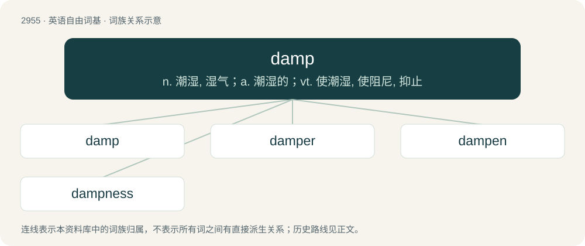

# 3061 · damp — n. 潮湿, 湿气；a. 潮湿的；vt. 使潮湿, 使阻尼, 抑止

[总目录](../00_总目录_按常用程度.md)

**类型**：英语自由词基　｜　**来源语言**：见词源记录

## 核心含义与来源

- 核心含义：n. 潮湿, 湿气；a. 潮湿的；vt. 使潮湿, 使阻尼, 抑止
- 英文含义：In a state between dry and wet; moderately wet; moist.
- 词形：damp

**来源记录 1**（形容词；In a state between dry and wet; moderately wet; moist.）

From Middle English dampen (“to stifle; suffocate”), from Old English damp, from Proto-Germanic \*dampaz. Akin to Low German damp, Dutch damp, and German Dampf (“vapor, steam, fog”), Icelandic dampi, Swedish damm (“dust”), and to German dampf imperative of dimpfen (“to smoke”). Also Middle English dampen (“to extinguish, choke, suffocate”).

## 词族图

## 单词速览（常用到不常用）

| 单词 | 音标 | 释义 |
|---|---|---|
| [damp](#w-1) | 美 /ˈdeə̯mp/；/ˈdæmp/ | n. 潮湿, 湿气；a. 潮湿的；vt. 使潮湿, 使阻尼, 抑止 |
| [damper](#w-2) | 美 /ˈdæmpɚ/ | n. 令人扫兴的人, 增湿器, 阻尼器；\[化\] 减震器 |
| [dampen](#w-3) | /ˈdæmpən/ | vt. 弄湿, 使沮丧；vi. 变湿, 丧气 |
| [dampness](#w-4) |  | \[建\] 湿度, 潮湿 |

## 逐词详解

### 1. damp

**词性**：形容词　｜　**音标**：美 /ˈdeə̯mp/；/ˈdæmp/

**中文释义**：n. 潮湿, 湿气；a. 潮湿的；vt. 使潮湿, 使阻尼, 抑止

**英文义项**：In a state between dry and wet; moderately wet; moist. / Despondent; dispirited, downcast.

**词源与演化**：

From Middle English dampen (“to stifle; suffocate”), from Old English damp, from Proto-Germanic \*dampaz. Akin to Low German damp, Dutch damp, and German Dampf (“vapor, steam, fog”), Icelandic dampi, Swedish damm (“dust”), and to German dampf imperative of dimpfen (“to smoke”). Also Middle English dampen (“to extinguish, choke, suffocate”).

**例句**：

> The lawn was still damp so we decided not to sit down.

该用例对应义项：In a state between dry and wet; moderately wet; moist.

### 2. damper

**词性**：名词　｜　**音标**：美 /ˈdæmpɚ/

**中文释义**：n. 令人扫兴的人, 增湿器, 阻尼器；\[化\] 减震器

**英文义项**：A valve or movable plate in the flue or other part of a stove, furnace, etc., used to check or regulate the draught of air. / A contrivance (sordine), as in a pianoforte, to deaden vibrations; or, as in other pieces of mechanism, to check some action at a particular time.

**构词拆分**：damp (verb) + -er

**词源与演化**：

From damp (verb) + -er. The name of the type of bread is first attested in 1825, and originally likely refers to damping the appetite.

**例句**：

> Tom always puts a damper on things.

### 3. dampen

**词性**：动词　｜　**音标**：/ˈdæmpən/

**中文释义**：vt. 弄湿, 使沮丧；vi. 变湿, 丧气

**英文义项**：To make damp or moist; to make moderately wet. / To become damp or moist.

**构词拆分**：From damp + -en.

**词源与演化**：

From damp + -en.

**例句**：

> We won't let the bad news dampen our spirits.

该用例对应义项：To lessen; to dull; to make less intense (said of emotions and non-physical things).

### 4. dampness

**词性**：名词

**中文释义**：\[建\] 湿度, 潮湿

**英文义项**：Moderate humidity; moisture; moistness; the state or quality of being damp. / The degree to which something is damp or moist.

**构词拆分**：damp + -ness

**词源与演化**：

From damp + -ness.

**例句**：

> The dampness in the writing paper caused the ink to spread and smudge.

该用例对应义项：The degree to which something is damp or moist.
