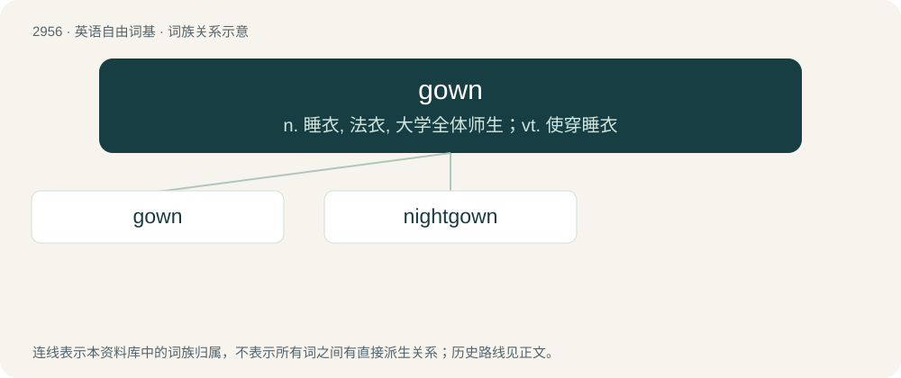

# 3062 · gown — n. 睡衣, 法衣, 大学全体师生；vt. 使穿睡衣

[总目录](../00_总目录_按常用程度.md)

**类型**：英语自由词基　｜　**来源语言**：见词源记录

## 核心含义与来源

- 核心含义：n. 睡衣, 法衣, 大学全体师生；vt. 使穿睡衣
- 英文含义：A loose, flowing upper garment.
- 词形：gown

**来源记录 1**（名词；A loose, flowing upper garment.）

From Middle English gowne, from Anglo-Norman goune, gune (“fur-trimmed coat, pelisse”), from Old French goune, from Late Latin gunna (“leather garment, a fur”). Cognate with Manx gooyn, Irish gúna.

## 词族图

## 单词速览（常用到不常用）

| 单词 | 音标 | 释义 |
|---|---|---|
| [gown](#w-1) | 英 /ˈɡaʊ̯n/；/ˈɡæʊ̯n/ | n. 睡衣, 法衣, 大学全体师生；vt. 使穿睡衣 |
| [nightgown](#w-2) | /ˈnaɪtˌɡaʊn/ | n. 女式睡衣, 孩子穿的睡衣, 妇女穿的睡衣 |

## 逐词详解

### 1. gown

**词性**：名词　｜　**音标**：英 /ˈɡaʊ̯n/；/ˈɡæʊ̯n/

**中文释义**：n. 睡衣, 法衣, 大学全体师生；vt. 使穿睡衣

**英文义项**：A loose, flowing upper garment. / A woman's ordinary outer dress, such as a calico or silk gown.

**词源与演化**：

From Middle English gowne, from Anglo-Norman goune, gune (“fur-trimmed coat, pelisse”), from Old French goune, from Late Latin gunna (“leather garment, a fur”). Cognate with Manx gooyn, Irish gúna.

**例句**：

> In the perennial town versus gown battles, townies win some violent battles, but the collegians are winning the war.

该用例对应义项：The university community, especially as contrasted with the local populace.

### 2. nightgown

**词性**：名词　｜　**音标**：/ˈnaɪtˌɡaʊn/

**中文释义**：n. 女式睡衣, 孩子穿的睡衣, 妇女穿的睡衣

**英文义项**：A long loose robe worn mainly by women for sleeping in. / A dressing gown.

**构词拆分**：By surface analysis, night + gown

**词源与演化**：

From Middle English nyght gowne. By surface analysis, night + gown.

**例句**：

> Mary was still wearing a nightgown when Tom got to her house at noon.
