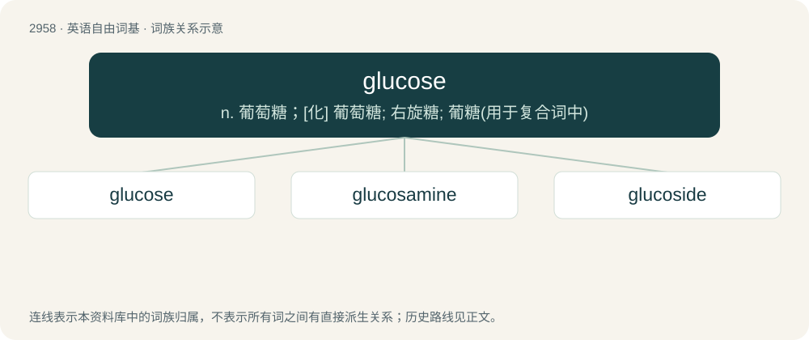

# 3063 · glucose — n. 葡萄糖；\[化\] 葡萄糖; 右旋糖; 葡糖(用于复合词中)

[总目录](../00_总目录_按常用程度.md)

**类型**：英语自由词基　｜　**来源语言**：见词源记录

## 核心含义与来源

- 核心含义：n. 葡萄糖；\[化\] 葡萄糖; 右旋糖; 葡糖(用于复合词中)
- 英文含义：A simple monosaccharide (sugar) with a molecular formula of C₆H₁₂O₆; a principle source of energy for cellular metabolism.
- 词形：glucose

**来源记录 1**（名词；A simple monosaccharide (sugar) with a molecular formula of C₆H₁₂O₆; a principle source of energy for cellular metabolism.）

From French, from Ancient Greek γλεῦκος (gleûkos, “wine, must”). By surface analysis, gluco- + -ose; note that -ose is derived from the word glucose.

## 词族图

## 单词速览（常用到不常用）

| 单词 | 音标 | 释义 |
|---|---|---|
| [glucose](#w-1) | 英 /ˈɡluː.kəʊz/；美 /ˈɡlu.koʊs/ | n. 葡萄糖；\[化\] 葡萄糖; 右旋糖; 葡糖(用于复合词中) |
| [glucosamine](#w-2) | /^luːkəuˈsæmiːn/ | \[化\] 壳糖胺; 氨基葡糖; 葡糖胺；\[医\] 氨基葡萄糖, 葡萄糖胺 |
| [glucoside](#w-3) | /ˈgluːkəusaid/ | n. 糖苷；\[化\] 葡糖苷; 葡萄糖苷; 糖苷 |

## 逐词详解

### 1. glucose

**词性**：名词　｜　**音标**：英 /ˈɡluː.kəʊz/；美 /ˈɡlu.koʊs/

**中文释义**：n. 葡萄糖；\[化\] 葡萄糖; 右旋糖; 葡糖(用于复合词中)

**英文义项**：A simple monosaccharide (sugar) with a molecular formula of C₆H₁₂O₆; a principle source of energy for cellular metabolism.

**词源与演化**：

From French, from Ancient Greek γλεῦκος (gleûkos, “wine, must”). By surface analysis, gluco- + -ose; note that -ose is derived from the word glucose.

**例句**：

> Whoever lost a bag with a glucose meter inside, contact this address.

### 2. glucosamine

**词性**：名词　｜　**音标**：/^luːkəuˈsæmiːn/

**中文释义**：\[化\] 壳糖胺; 氨基葡糖; 葡糖胺；\[医\] 氨基葡萄糖, 葡萄糖胺

**英文义项**：An amino derivative of glucose that is a component of polysaccharides such as chitin; it is marketed as a dietary supplement supposedly to reduce the symptoms of arthritis.

**构词拆分**：glucose + -amine

**词源与演化**：

From glucose + -amine.

### 3. glucoside

**词性**：名词　｜　**音标**：/ˈgluːkəusaid/

**中文释义**：n. 糖苷；\[化\] 葡糖苷; 葡萄糖苷; 糖苷

**英文义项**：A glycoside that yields glucose after hydrolysis.

**构词拆分**：glucose + -ide

**词源与演化**：

From glucose + -ide (1865-70).
