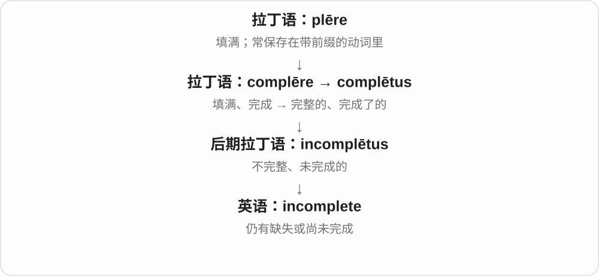
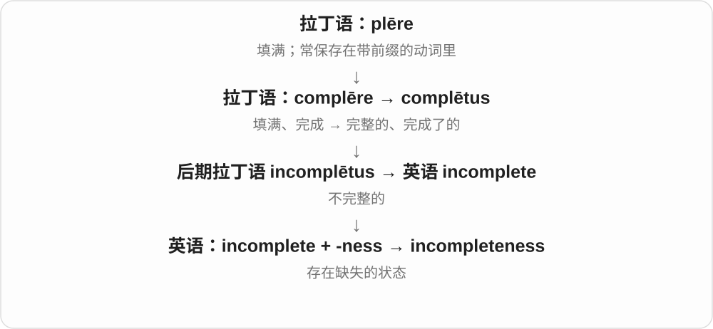
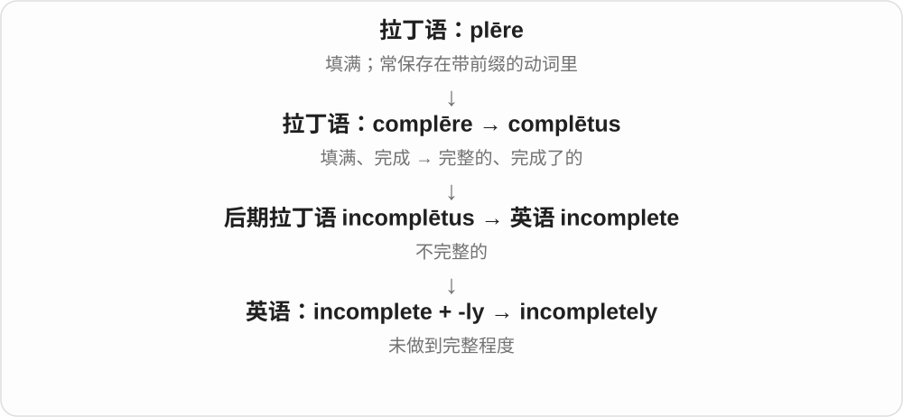

# 3065 · incomplete — 不完整；未完成

[逐词精讲目录](../00_逐词精讲目录.md) · [总目录](../00_总目录_按常用程度.md)

## 核心词根与来源

incomplete 在 complete 前加否定成分。incompleteness 是不完整性，incompletely 说明完成或描述得不充分。

**INCOMPLETE：整体所需的部分还没有齐**

缺一页、少一步或尚未结束，都可能不完整。

- **性质、方式与状态**：incomplete · incompletely · incompleteness

## 词形与演化规律

in- 否定；incomplete form、incompletely described、the incompleteness of the record。词不自动说明缺失原因。

## 单词速览（按词族由简到繁）

同一基础词的相关扩展放在一起，先读基础形式，再读扩展；各组之间优先读常用的。具体词源关系见各词讲解。

| 单词 | 音标 | 核心意思 |
|---|---|---|
| [incomplete](#w-1) | 英、美 /ˌɪnkəmˈpliːt/ | 不完整的；未完成的 |
| [incompleteness](#w-2) | 英、美 /ˌɪnkəmˈpliːtnəs/ | 不完整；缺失的状态 |
| [incompletely](#w-3) | 英、美 /ˌɪnkəmˈpliːtli/ | 不完全地；未彻底地 |

## 逐词讲解

### 1. incomplete — 不完整的；未完成的

**音标**：英、美 /ˌɪnkəmˈpliːt/

**先抓住这个画面**

已经有了一部分，但还缺几块：可能缺内容，也可能工作还没做完。

**怎么拆**

后期拉丁语 incomplētus，in-“不” + complētus“完整的”，进入中古英语；现代可直观分析为 in- + complete。

**怎么变成今天的意思**

an incomplete address 可能缺门牌号；an incomplete task 是尚未做完的任务。它不等于错误，已有部分完全可能正确。

**常见搭配与例句**

incomplete information；an incomplete record；remain incomplete。

> The address is incomplete because the house number is missing.

地址不完整，因为缺了门牌号。

> The painting remained incomplete when the artist moved away.

画家搬走时，这幅画还没有完成。

**别混淆**

incorrect 是有错；incomplete 是有缺，两者可以分别出现。

### 2. incompleteness — 不完整；缺失的状态

**音标**：英、美 /ˌɪnkəmˈpliːtnəs/

**先抓住这个画面**

把“缺一块”本身拿出来谈：资料的空白会怎样影响判断。

**怎么拆**

incomplete + -ness。

**怎么变成今天的意思**

可以说记录、说明或知识的不完整；这是抽象性质，通常不可数。数学中的 incompleteness 有专门定义，不等于某位作者漏写几行。

**常见搭配与例句**

the incompleteness of the record；a sense of incompleteness。

> The incompleteness of the records makes comparison difficult.

记录不全，使比较变得困难。

> The final chapter leaves a deliberate sense of incompleteness.

最后一章刻意留下了一种未完的感觉。

**别混淆**

inaccuracy 是失准；incompleteness 是不全。缺页不一定意味着剩下的页写错了。

### 3. incompletely — 不完全地；未彻底地

**音标**：英、美 /ˌɪnkəmˈpliːtli/

**先抓住这个画面**

动作做过了，却没有做到全覆盖或收尾。

**怎么拆**

incomplete + -ly。

**怎么变成今天的意思**

incompletely understood 是只了解一部分；incompletely filled 是尚未填满。偏书面，日常也可用 not fully。

**常见搭配与例句**

incompletely understood；incompletely documented；incompletely filled。

> The causes of the change are still incompletely understood.

人们对这一变化的原因仍只了解一部分。

> Several sections of the form were incompletely filled in.

表格的几个部分没有填写完整。

**别混淆**

partly 只说部分；incompletely 更容易暗示本来需要完整，却还差一点。

## 这一组要分清什么

incomplete 是没齐全，incorrect 是不正确；材料可以完整却错误，也可以不完整但已有部分正确。

## 串起来练习

The incomplete record was incompletely described in the report.

不完整的记录在报告中也没有得到充分描述。
