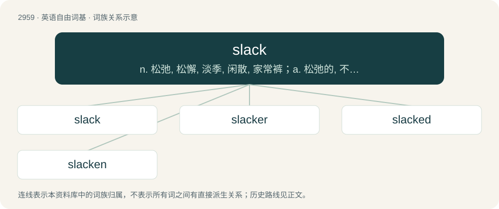

# 3066 · slack — n. 松弛, 松懈, 淡季, 闲散, 家常裤；a. 松弛的, 不流畅的, 疏忽的, 无力的, 呆滞的, 软弱的, 漏水的；adv. 马虎地, 缓慢地

[总目录](../00_总目录_按常用程度.md)

**类型**：英语自由词基　｜　**来源语言**：见词源记录

## 核心含义与来源

- 核心含义：n. 松弛, 松懈, 淡季, 闲散, 家常裤；a. 松弛的, 不流畅的, 疏忽的, 无力的, 呆滞的, 软弱的, 漏水的；adv. 马虎地, 缓慢地
- 英文含义：The part of anything that hangs loose, having no strain upon it.
- 词形：slack

**多个词源／构词路径**：同一拼写可能有不同来源；以下按词性和含义分别列出。

**来源记录 1**（名词；The part of anything that hangs loose, having no strain upon it.）

From Middle English slak, from Old English slæc (“slack”), from Proto-Germanic \*slakaz. For sense of coal dust, compare slag.

**来源记录 2**（动词；To slacken.）

From Middle English slakken, slaken, from Old English slacian, from Proto-Germanic \*slakōną (“to slack, slacken”).

**来源记录 3**（名词；A temporary speed restriction where track maintenance or engineering work is being carried out at a particular place.）

Either from the adjective in Etymology 1 or the verb in Etymology 2.

**来源记录 4**（名词；A valley, or small, shallow dell; a sag or saddle in a ridge.）

From Middle English slak, from Old Norse slakki (“a slope”). Cognate with Icelandic slakki, Norwegian slakke.

**来源记录 5**（名词；Small coal; coal dust.）

Of unknown origin. Possibly related to Middle Dutch slacke or Middle Low German slecke. Doublet of slag.

## 词族图

## 单词速览（常用到不常用）

| 单词 | 音标 | 释义 |
|---|---|---|
| [slack](#w-1) | /slæk/ | n. 松弛, 松懈, 淡季, 闲散, 家常裤；a. 松弛的, 不流畅的, 疏忽的, 无力的, 呆滞的, 软弱的, 漏水的；adv. 马虎地, 缓慢地 |
| [slacker](#w-2) | 美 /ˈslækɚ/ | n. 懒惰虫, 逃避兵役者 |
| [slacked](#w-3) | /slækt/ | v. 偷懒( slack的过去式和过去分词 ); 减速; 放松 |
| [slacken](#w-4) | /ˈslæ.kən/ | vt. 使松弛, 放松, 放慢；vi. 变松弛, 减弱, 松劲 |

## 逐词详解

### 1. slack

**词性**：名词　｜　**音标**：/slæk/

**中文释义**：n. 松弛, 松懈, 淡季, 闲散, 家常裤；a. 松弛的, 不流畅的, 疏忽的, 无力的, 呆滞的, 软弱的, 漏水的；adv. 马虎地, 缓慢地

**英文义项**：The part of anything that hangs loose, having no strain upon it. / A dip in a surface.

**词源与演化**：

From Middle English slak, from Old English slæc (“slack”), from Proto-Germanic \*slakaz. For sense of coal dust, compare slag.

**用法示例／搭配（非完整句）**：

> the slack of a rope or of a sail

该用例对应义项：The part of anything that hangs loose, having no strain upon it.

### 2. slacker

**词性**：名词　｜　**音标**：美 /ˈslækɚ/

**中文释义**：n. 懒惰虫, 逃避兵役者

**英文义项**：One who procrastinates or is lazy; one who does not do their fair share or pull their own weight. / A person lacking a sense of direction in life; an underachiever.

**构词拆分**：slack + -er

**词源与演化**：

From slack + -er; compare especially slack off.

**例句**：

> Slacktivism is a portmanteau formed out of the words slacker and activism.

### 3. slacked

**词性**：形容词　｜　**音标**：/slækt/

**中文释义**：v. 偷懒( slack的过去式和过去分词 ); 减速; 放松

**英文义项**：Dressed in slacks.

**构词拆分**：slack (attributive form of slacks) + -ed (“having”)

**词源与演化**：

From slack (attributive form of slacks) + -ed (“having”).

**例句**：

> He slacked off on the job.

### 4. slacken

**词性**：动词　｜　**音标**：/ˈslæ.kən/

**中文释义**：vt. 使松弛, 放松, 放慢；vi. 变松弛, 减弱, 松劲

**英文义项**：To gradually decrease in intensity or tautness; to become slack; to lag. / To make slack, less taut, or less intense.

**构词拆分**：slack + -en

**词源与演化**：

From Middle English slakenen, equivalent to slack + -en.

**用法示例／搭配（非完整句）**：

> The pace slackened.

该用例对应义项：To gradually decrease in intensity or tautness; to become slack; to lag.
